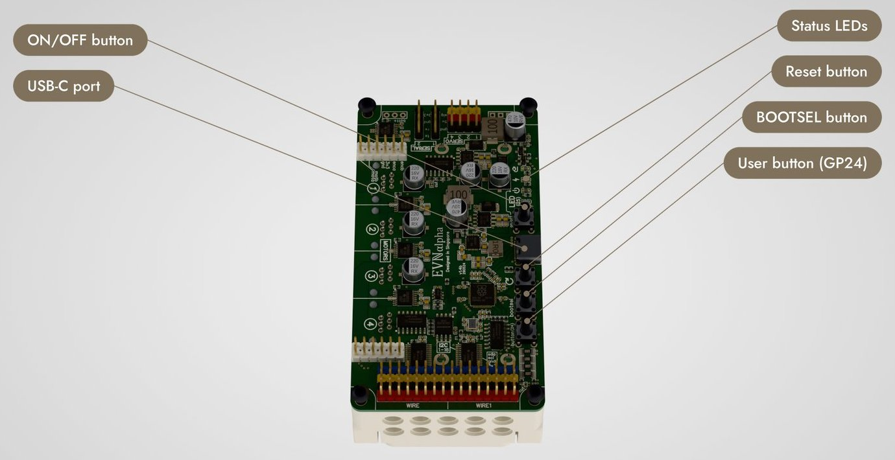

# The board: buttons, lights and pins

What is where on the EVN ALPHA, from the board's printed card.

## Buttons

The four buttons sit in a row along the bottom edge, beside the USB-C socket.

| Button | What it does |
| :--- | :--- |
| **User button** (marked `button (24)`) | A press coasts every motor and ends the running program (`SystemExit`, as Pybricks' stop button): the stop that needs no computer. No motor moves again until the next program, or the next line at the REPL, starts. A program that uses the button as an input calls `evn.set_stop_button(None)` first (as Pybricks): then a press stops nothing until that program ends. With the live console connected (the *Board* view) a press coasts every motor too: the console stays connected, its row says *stopped by the user button*, and the motors stay coasted until the next program run or the next connect. While the board waits, a press starts `main.py` ([A program that starts from the user button](MAIN_PY.md)). Held for 2 s, it restarts the board. |
| **BOOTSEL** | Held while you press and release RESET (or, on a board that is switched on, while you unplug USB and plug it back in), it puts the board in its loader (the `RPI-RP2` drive), for a [firmware flash](GETTING_STARTED.md#4-put-the-firmware-on-the-board). |
| **RESET** | Restarts the board. Your programs, files and calibrations stay. |
| **ON/OFF** | Switches the board on and off. |

## The board's lights

| Light | Pattern | Meaning |
| :--- | :--- | :--- |
| Red, LED3 (`ON/OFF`) | on | The board is switched on (power on). |
| Green, LED6 (`CABLE`) | on | A USB cable is connected. |
| Yellow, LED1 (`CHARGE`) | on | The cells are charging. It goes out when they are full. |
| User LED, blue (`LED (25)`) | once a second | No computer has the board's port open (also while `main.py` runs on its own). |
| User LED | five times a second | A computer has the board's port open (the extension's live console, the REPL, a running program). |
| User LED | a double blink once a second | `main.py` is waiting for a press of the user button. |
| User LED | your program's | A program used `evn.led`. The LED then stays under program control until the board restarts. |

The double blink of the start wait does not look like the steady blinking of an open port. With VS Code connected, the [Board view](BOARD_VIEW.md)'s console row says the same thing in words: *Board is waiting for the user button (main.py)*, or whether the board is running its own program.

## Motor ports

Ports **M1 to M4** take a LEGO EV3 or NXT motor. Each also has a 6-pin header, marked `M1 (PINS)` to `M4 (PINS)`, for other gearmotors with a quadrature encoder. Its pins, in the order of the wiring box in the picture above: motor output A, motor output B, GND, 3V3, encoder input A, encoder input B.

| Port | Encoder A | Encoder B | Motor driver A | Motor driver B |
| :--- | :--- | :--- | :--- | :--- |
| M1 | GP18 | GP19 | GP29 | GP28 |
| M2 | GP17 | GP16 | GP27 | GP26 |
| M3 | GP14 | GP15 | GP23 | GP22 |
| M4 | GP13 | GP12 | GP21 | GP20 |

- When a port has a LEGO motor plugged in, **do not connect anything else to its encoder inputs.**
- The encoder inputs are **input only and not 5 V-tolerant.**
- The motor driver inputs are not exposed on the board.

## I2C ports

Sixteen ports, each wired `3V3 · GND · SCL · SDA`. Ports 1 to 8 share the RP2040's `Wire` bus (SCL GP05, SDA GP04); ports 9 to 16 share `Wire1` (SCL GP07, SDA GP06). Each bus is switched to one port at a time, which is how two buses give sixteen ports.

The I2C ports are **I2C only** and 5 V-tolerant.

## Serial ports and servo ports

| Header | Pins | Wiring |
| :--- | :--- | :--- |
| Serial 1 | TX GP00, RX GP01 | `TX · RX · GND · 3V3` |
| Serial 2 | TX GP08, RX GP09 | `TX · RX · GND · 3V3` |
| SRV1 | signal GP02 | `GND · 5V · SIG` |
| SRV2 | signal GP03 | `GND · 5V · SIG` |
| SRV3 | signal GP10 | `GND · 5V · SIG` |
| SRV4 | signal GP11 | `GND · 5V · SIG` |

These pins can also be used for GPIO, SPI and more, but they are **not 5 V-tolerant. Do not apply more than 3.3 V to them.**

## Current ratings

| Supply | Rating |
| :--- | :--- |
| 5 V (on the servo ports) | 3 A max |
| 3.3 V (all other ports) | 3 A max |
| Motor driver, per channel | 3 A RMS, 4 A peak |
