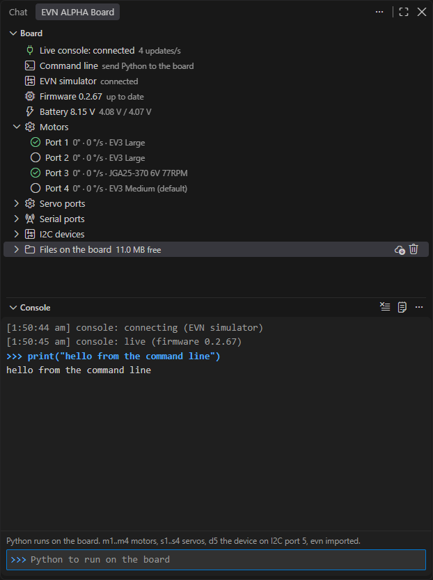
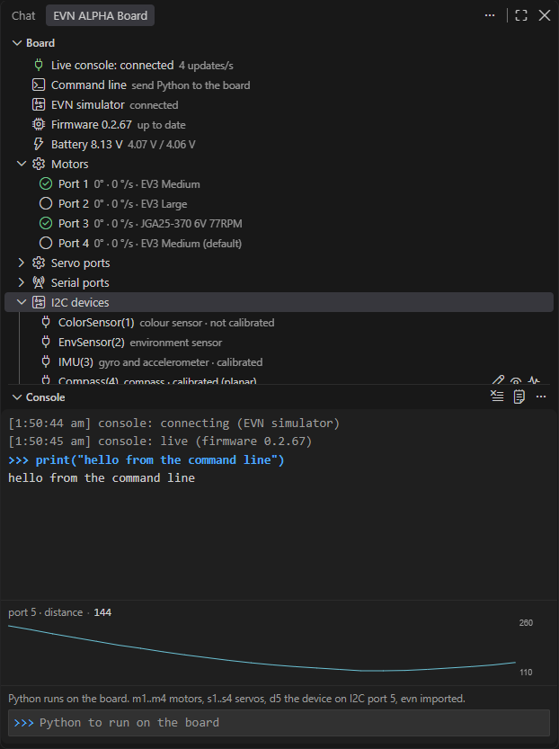

# The Board view and the live console

The *Board* view shows what the board is doing right now, and lets you drive every port without writing a program.

## Where it is

The *Board* and *Console* views live in the **secondary side bar**: *View → Appearance → Secondary Side Bar*, or **Ctrl+Alt+B**. **Board panel** under *Start* opens it too. Both can stay open beside your program; drag them elsewhere if you prefer.

## The live console

Whenever no program is running and the REPL is closed, the extension keeps a **live console** open to the board. The *Board* rows then follow the board as it changes.

The line at the top of the view says which state you are in:

- **live · connected 3 minutes ago**: the live console is connected.
- **live over Bluetooth · connected 3 minutes ago**: the same, over the board's [wireless link](BLUETOOTH.md).
- **read 12 seconds ago**: the console is off, and you see one read, not a live link.

**Read the board**, in the view's header, reads the firmware, the files and the I2C devices again when you ask.

Two things to know:

- **A program the board started by itself is never interrupted.** If `main.py` is running (started from the user button), the console row says so and only watches. Its output reaches the **Console** view (brought up when the console finds it) and the **EVN Board output** panel, and the status bar shows `main.py running on the board` with the red **Stop**, as for a Run. Press the row's stop button (*Stop the board's program and connect*) to take the board over.
- **The link gets out of the way.** Run, the REPL, an upload, a reset or a flash take the port; the console lets go and comes back a second after the port is free. Turn `evn.console.enabled` off if it should never hold the port.

## The firmware and battery rows

The **firmware** row shows the firmware the board runs, next to the one this extension brings. When the board's is older, the row turns into a warning with a **Flash** button, and the extension offers the flash once.

The **battery** row shows the pack voltage and both cell voltages (the pack is always two cells). It turns into a warning under `evn.battery.warnVolts` (7.0 V by default, 3.5 V a cell), and an error under 6.6 V. A low pack is worth checking when motors behave oddly. The status bar shows the same warning while the console is connected; set `evn.battery.warnVolts` to 0 to turn it off.

A read is refused while a program runs, because the program holds the port. Stop the program, or close the *EVN ALPHA* terminal, first. Without `mpremote`, the view offers an **Install mpremote** button.

## Naming the board

Give the board a name once with **EVN: Name this board**, or the tag button on the port row. The status bar then reads `EVN: Kenneth's robot (COM7)`.

The extension knows each board by its USB serial number, so it finds yours again whatever port name the computer gives it next time.

## Driving the ports

Every port row is also a way to drive that port. Its buttons appear only while the live console is connected. On servo and serial ports they appear once you have said, with the gear, what is plugged in. None of them is offered while a program runs: the program has the board.

### Motors

The **Motors** rows show the angle and speed of ports 1 to 4, four times a second. Turn a shaft by hand and watch the number move: a quick check of wiring and direction. The row reads `90° · 0 °/s · EV3 Large`.

**Say which motor is plugged in** with the **gear**:

| Choice | Notes |
| :--- | :--- |
| *EV3 Large*, *EV3 Medium*, *NXT* | LEGO motors. |
| *JGA25-370 6V 77RPM* | A 6 V gearmotor; the board caps it at 6 V. |
| *Pololu 25D 9.7:1 HP 12V* | A fast 12 V gearmotor, about 3500 deg/s on the battery. Never hold it stalled. |
| *CHR-GM16-030PA 9V 1:63* | A 16 mm 9 V gearmotor, 1:63. Another ratio is a **Custom…** motor with 7 × 4 × the ratio counts. |
| *CM22-2230 12V 1:49* | A 22 mm 12 V planetary gearmotor, 1:49, about 760 deg/s on the battery. Never hold it stalled: on a full battery its stall reaches the gearbox's maximum torque. Another ratio is a **Custom…** motor with 16 × 4 × the ratio counts. |
| **Custom…** | Any other DC motor with a quadrature encoder. It asks for a name, the encoder counts per output turn (one channel's pulses × 4 × the gear ratio; a LEGO motor is 720), the rated voltage and the no-load speed. |

The choice is **stored on the board**. `Motor(port)` then runs that motor in every program, from any computer. The row reads it back: *EV3 Medium*, *custom (N20 6 V)*, or *EV3 Large (default)* for a port nobody has set.

**Calibrate it** with the **pulse button**, or right-click *Calibrate this motor*. The shaft must be free to turn. It moves about a turn and a half each way for about 12–13 seconds (up to about 3 s more when it has to measure the breakaway again). [Calibrating your robot](CALIBRATION.md#motors) has the whole procedure.

The row's icon shows the calibration at a glance:

- a tick: calibrated and stored;
- an empty circle: not calibrated;
- a warning: calibrated for another motor, *calibrate again warm*, a calibration the board warns about, or not yet stored. The tooltip says which, with the date;
- a spinner: calibrating now.

The calibration also finds which way the encoder counts. A non-LEGO motor wired the other way round then simply works. That flip belongs to the port: when you swap the motor, say so with the gear, which clears it.

Choosing a different motor clears the port's calibration; right-click *Clear calibration* does it by hand.

A custom, JGA25, Pololu 25D, CHR-GM16 or CM22-2230 motor is not fully trusted until it is calibrated, and `Motor(port)` says so once. If its encoder counts the other way, its first move runs away until the board's runaway guard coasts it, after about a quarter of a second. The program then stops with a `RuntimeError` that says to calibrate it. A custom motor is guarded this way only when it was given its no-load speed.

**Move it** with the row's buttons:

- The arrow, **Jog this motor 90° forward**, turns it 90° at 200 deg/s and lets it coast: the quickest check after wiring a motor. While the motor moves or holds, the arrow is **Stop this motor** instead.
- Right-click for **Jog this motor 90° back**, **Run this motor at a speed...** (deg/s; negative runs backwards), **Run this motor to an angle...**, **Run this motor for a time...** and **Stop this motor**.

The row keeps counting while the motor turns. While the port calibrates there is no jog.

### Servo ports

Press the gear on a port and say what is on it: *Geekservo 270°*, *Geekservo 360°*, *Geekservo continuous*, *generic 180°*, *Custom servo...*, *RGB LED strip* or *nothing*. The console then makes the object for you: servo port 3 is `s3`, an LED strip `l3`.

For any other servo choose *Custom servo...*. Give it a name, its range in degrees (0 for a continuous servo), its shortest and longest pulse in microseconds (often 500 and 2500; the servo's sheet says) and its direction. The tooltip then shows the `Servo(...)` line to use in a program.

**Drive this servo port...** asks for an angle, a duty in percent (a continuous servo) or a colour (an LED strip). **Stop this servo port** ends it.

### Serial ports

Serial 1 and Serial 2. The gear says what is on the header: *EVN Bluetooth module*, *UART (raw serial)* or *nothing*. The console makes `bt1` / `bt2` or `u1` / `u2` for it.

A UART asks for its baud rate (9600 to 921600, 115200 being the usual, or *Other...* for 300 to 3000000). The row then reads `UART 9600 · 0 bytes waiting`. Change it later with the same gear; bytes already queued are kept.

A Bluetooth row shows the module's state, whether the board's REPL is on it, the bytes waiting and the board's wireless link. Its buttons are the [Bluetooth guide](BLUETOOTH.md).

### I2C devices

The board lists the sensors and displays it finds on ports 1 to 16, each identified by its own ID register, and checks again about every 5 s. A colour sensor on port 1 shows as `ColorSensor(1) · colour sensor`: what your program writes for it, and what it is. The chip and its address are in the tooltip. Right-click **Copy the code for this device** copies `ColorSensor(1)`.

On a device it knows:

- **Set a property of this device...** offers what can be set (a colour sensor's gain, its integration time, …), then asks for the value.
- **Read this device live...** asks what to show (`hsv`, `rgb`, `lux`, `distance`, `heading`, …). The row then shows it four times a second, with a [chart](#the-charts) in the *Console* view. The eye-closed button stops it. A live reading is remembered for that board and comes back when the console reconnects.
- An IMU, compass, colour sensor, gesture sensor, HiTechnic colour sensor or TCS3430 also has a **pulse** button that calibrates it. The row then reads *calibrated*, with the date in the tooltip; right-click for **Clear calibration**. [Calibrating your robot](CALIBRATION.md) walks through each one.
- A **VL53L1X** row shows its offset calibration the same way. It is calibrated from a program (`calibrate_offset(mm)`), with no button.

### Files on the board

**Files on the board** is kept up to date without you pressing anything. It starts with a **Storage** row (`Storage · 10.6 MB free of 11.0 MB (96 %)`). It turns into a warning when less than a tenth of the space, or less than 256 kB, is free: a data log the board cannot save is lost. The warning offers **Download all data logs**.

The **data** folder holds what `evn.DataLog` saves (`data · 3 data logs, 412 kB`, newest first). Click a log, or its cloud button, to download it into the **Data** folder of your projects folder. A `.csv` opens in the [data viewer](DATA_LOGGER.md#looking-at-a-log). If a file of that name is already there, choose **Replace** or **Keep both**.

Every file has a cloud button and a delete button. The **data** row downloads all logs with one button; its right-click menu deletes them all after one confirmation. Downloads and deletes also work with the console off, while nothing else holds the port.

## The command line

**Command line** is the row to try things with. Click it (or **EVN: Send a command to the board**), type one line of Python and press Enter.

These names are ready to use:

- `m1` to `m4`: the four motors;
- `s1` to `s4`: the servos you set up (`l1` to `l4` for an LED strip);
- `bt1` / `bt2` and `u1` / `u2`: the serial ports;
- `d5`: the device on I2C port 5;
- `evn`, already imported.

So `m1.run_angle(200, 90)` turns port 1 by 90°, and `m1.angle()` prints where it is. The answer, and anything the board prints, appear in the **Console** view and the **EVN Board output** panel (**EVN: Show the board output**). The last 20 commands are offered again when you open the row.

## The Console view

The *Console* view, under the *Board* view, is the command line with a prompt and a transcript. Type Python and press **Enter**; it runs on the board in the same namespace, so a variable set on one line is there on the next.

- **Shift+Enter** adds a line instead of sending, so a short `for` loop goes over at once.
- **Up** and **Down** walk the lines you sent before.
- **Ctrl+L** clears the transcript; **Esc** empties the prompt.

While the console is not live, the prompt is greyed out and says why ("the board is running its own program (main.py)", "connecting to the board..."). It shows the same lines as the **EVN Board output** panel, including what a program the board started by itself prints. The extension's own log is a separate panel, **EVN ALPHA log**, and the program terminal of a Run is **EVN ALPHA**.

This is not the board's REPL. The REPL is the **REPL** button and the terminal it opens (**Open REPL** is in the Console view's `...` menu too). The Console view sits on top of the live link, which is why the *Board* rows keep updating.

### The charts

While a device is read live (**Read this device live...**), a small chart of it appears above the prompt. It shows about the last minute, one line for each number the reading gives (up to four), the scale on the right and the latest value in the header: `port 5 · lux · 123.4`. It is a quick way to see whether a sensor is steady, drifting or noisy.

The chart goes when you stop the reading. If the sensor starts raising errors, the curve stands still and the header turns red. A reading that is not a number or a short list of them (`hsv`, which is a dict) has no chart. The charts cost the board nothing extra: they use the telemetry the rows already get.
