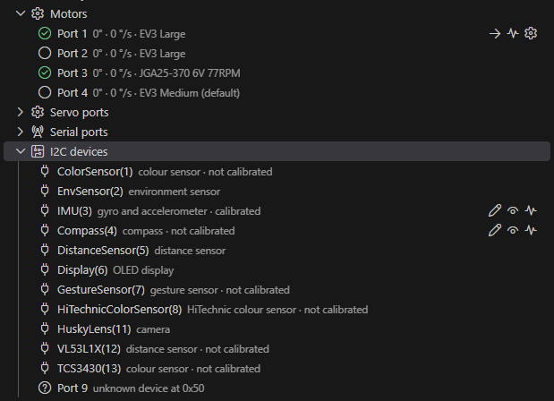
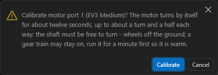
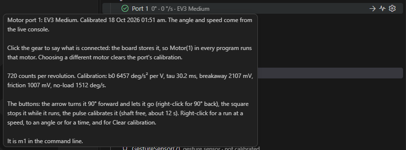
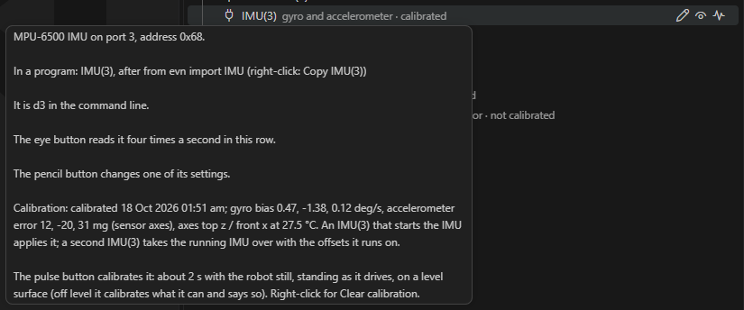
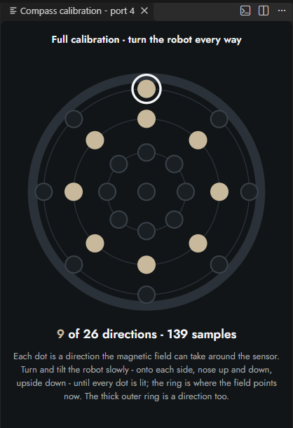
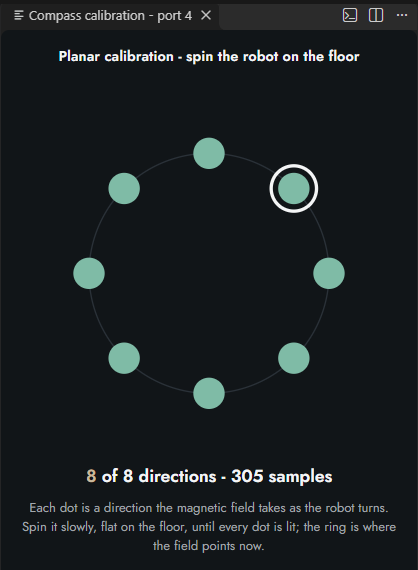
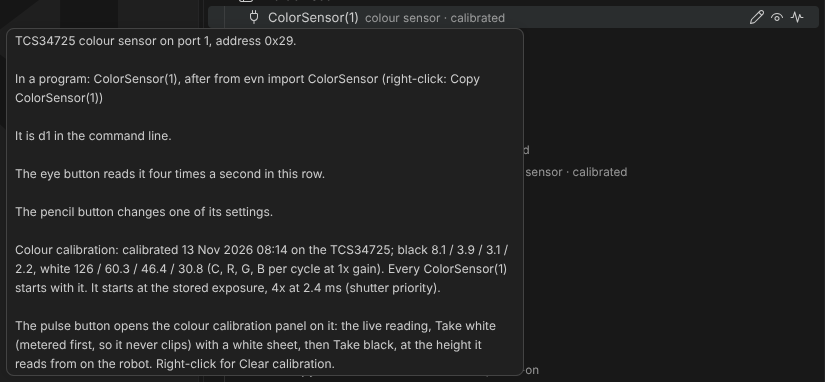

# Calibrating your robot

Four parts of an EVN ALPHA robot are worth calibrating: each **motor**, the **IMU** (gyro and accelerometer), the **compass** and the **colour sensors** (`ColorSensor`, `GestureSensor`, and the extended `TCS3430` and `HiTechnicColorSensor`). The extended **VL53L1X** distance sensor has its own offset calibration too.

Each calibration takes a few seconds to a minute. The board stores it for that port, and every program uses it from then on, from any computer, after every reboot. You calibrate once, and again only when something on the robot changes.

| What | Why | Takes | Stored for | Do it again when |
| :--- | :--- | :--- | :--- | :--- |
| [Motor](#motors) | measures this motor's strength, time constant and friction, so moves are fast and land on target; finds which way its encoder counts | about 12–13 s per port, shaft free to turn | motor port 1–4 | you swap the motor, or choose a different motor for the port; a mechanism that was cold when you calibrated it |
| [IMU](#imu) | removes the gyro's bias and the accelerometer's error, and finds which way the module is mounted, so the heading does not drift from the start and a level robot reads level | about 2 s still (one pose), or about 10 s with a half turn (two poses) | I2C port 1–16 | you move the module to another port, plug in another module, or change how it is mounted |
| [Compass](#compass) | removes the pull of the robot's own iron (motors, battery, screws), so the heading points to magnetic north | about 20 s (planar) to a minute (full) of turning the robot | I2C port 1–16 | you move the motors, the battery or other metal parts, or the compass itself |
| [Colour sensor](#colour-sensors) | takes the white (a white sheet, metered first so it never clips) and the black (nothing in front), so a white reads white under the module's own light and colours are named reliably; stores the gain it picked, so every program starts at it | two readings, a few seconds, all colour sensors on one page | I2C port 1–16 | you move the sensor to another height above the surface, change the light, or plug another sensor into the port |
| [VL53L1X distance sensor](#vl53l1x-distance-sensor) (an extended peripheral) | corrects the distance it reads (the offset) and, behind a cover window, the light the window reflects (the crosstalk) | about 2 s with a flat card at a measured distance | I2C port 1–16 | you put a window in front of it, or plug another sensor into the port |

You can calibrate from the extension's **Board view** (buttons on each row, no code), from **Python**, or from **blocks**. All three store the same record.

## What is calibrated: the calibration page

The Board view's title bar has a **checklist** button, **What is calibrated (calibration page)**. It is also on the right-click menu of the *Motors* and *I2C devices* rows, and in the Command Palette. It opens one page with a line for each part of the robot that can be calibrated: the four motor ports, and each IMU, compass, colour sensor and VL53L1X the board found. Each line says what the board reports about that port's record (nothing on it is guessed):

| Mark | Meaning |
| :--- | :--- |
| ✓ | calibrated (and stored) |
| ! | not calibrated |
| ⚠ | calibrate again: *the calibration is for another motor* / *another sensor*, *calibrate again warm*, an IMU *(gyro only)*, a colour record with only its black or its white; or *not yet in flash* (it is stored once every motor has stopped: nothing to redo) |
| … | calibrating now |
| · | nothing to do here: a VL53L1X runs on its own (factory) offset until a program calibrates it (`calibrate_offset()`) |
| ? | the board sent no record for it (flash the current firmware) |

On each line:

- **Details** gives the numbers.
- **Calibrate** runs that part's one-click calibration (below).
- **Advanced...** gives its other choices (the IMU's two poses and its front axis, the compass's full run, the colour calibration panel); a motor line has **Clear calibration...** there instead.

**Calibrate what needs it** lists the ! and ⚠ lines, ticked. Untick what you do not use (the board cannot tell a motor port with a motor on it from an empty one, so all four ports are listed). It runs them one after another, each with its own short confirm. Each is started only when the one before has ended (a colour sensor's once its new black and white are stored, or the colour panel is closed).

The page follows the board as it reports, and **Read again** asks it at once.

Every calibration has a **one-click** path, the **pulse** button on its row, and an **Advanced** path on the row's right-click menu:

| Part | One click (pulse button) | Advanced (right-click) |
| :--- | :--- | :--- |
| Motor | the motor's calibration, one confirm | *Clear this motor port's calibration...*; **Calibrate all motors (one after the other)...** on the *Motors* row |
| IMU | level + front: one pose, level, about 2 s, then the robot tipped nose-down once to find its front | **Calibrate this IMU (advanced: two poses, find the front)...**: **Level + find the front**, **Level only** or **Two poses** |
| Compass | planar: spin the robot on the floor, about 20 s | **Calibrate this compass (advanced: full or planar)...** |
| Colour sensor | the calibration panel | the panel's camera controls |

## Before you start

- **Stop the motors.** Storing a calibration is a flash write, which the firmware never does while a motor is driving. With the motors stopped, a program's `calibrate()` returns only once the record is in flash.
- **For the Board view:** open the **Board** section (secondary side bar, **Ctrl+Alt+B**) and make sure the line at its top reads **live · connected …**. The calibration buttons appear only while the live console is connected ([The Board view](BOARD_VIEW.md#the-live-console)). They sit on each row as small icons: the **pulse** button calibrates, and the same entries are in the row's right-click menu together with **Clear calibration**.

<details>
<summary>If a motor is running when a calibration is stored</summary>

The calibration is used at once but reaches the flash only once every motor has stopped. A program's `calibrate()` then prints `WARNING: Motor(n): calibration in force, not stored yet`. Until the Board view's next rescan (every few seconds) after that, it says *calibrated (not yet in flash)*.

</details>

**Dates.** Calibrations made while VS Code is connected are dated.

<details>
<summary>Where the date comes from</summary>

A calibration record carries the date it was made, from the board's clock. The board has no battery-backed clock: the extension's live console sets it every time it connects. So a calibration made from the Board view, or by a program started from the extension, is dated. One made by a program that runs without the extension (a `main.py` started from the user button) is stored as *date unknown*.

</details>



## Motors

> **Warning: swapping a motor? Choose the new motor with the gear before you run it.** A port whose row in the Board view ends in *encoder reversed* (for example *JGA25-370 6V 77RPM · encoder reversed*; on the calibration page, its **Details**) has its encoder flipped for the motor that was calibrated there. Plug another motor into it (a LEGO motor, say) without choosing it with the gear, and the new motor can **run away at full speed** as soon as a program moves it. The runaway guard may not catch it.
>
> Choosing the new motor with the gear, or **Clear calibration** on the row, removes the flip. A motor of the same model as the old one needs **Clear calibration**: choosing the model the port already has changes nothing. If a motor runs away, stop the program: every motor coasts. Stop it with **Stop all motors** (the square button in the Board view's title bar, or *EVN: Stop all motors* in the Command Palette), with Ctrl+C in the terminal, or with the board's user button.

A motor's calibration measures the motor on the port: how strongly and how quickly it responds, its friction, its top speed and which way its encoder counts. The motor controller is built from these numbers, so a calibrated motor moves faster and lands more exactly than one running on its model's defaults ([what it measures](#what-the-calibration-measures)).

**The shaft must be free to turn.** The motor moves by itself for about twelve seconds, up to about a turn and a half each way, and stops near where it started. Take anything off it that must not move, and lift a robot's wheels off the ground.

### From the Board view

1. **Say which motor is on the port.** Press the **gear** on the motor's row and pick *EV3 Large*, *EV3 Medium*, *NXT*, *JGA25-370 6V 77RPM*, *Pololu 25D 9.7:1 HP 12V*, *CHR-GM16-030PA 9V 1:63*, *CM22-2230 12V 1:49*, or *Custom…* for any other DC motor with a quadrature encoder. The choice is stored on the board. Choosing a different motor clears the port's calibration, an *encoder reversed* flip included. A port nobody has configured runs the firmware's default (EV3 Large on ports 1–2, EV3 Medium on 3–4), shown as *EV3 Large (default)*.
2. **Press the pulse button** on the row (or right-click → **Calibrate this motor (shaft free, ~12 s)...**). A dialog asks you to free the shaft; press **Calibrate**.
3. A notification shows **EVN: calibrating motor port N... (about 12 s, shaft free)** while the row reads *calibrating... (shaft free)*.
4. When it is done, a message says *motor port N calibrated ✓*; its **Details** button gives the numbers (`b0`, `tau`, the breakaway voltage, the no-load speed) and says *and stored*. When the calibration asks to be taken again warm, the message has a **Calibrate again (warm)** button.

**Calibrate all motors**: the pulse button on the *Motors* row (or right-click → **Calibrate all motors (one after the other)...**) lists the four ports, all ticked. Untick the ports with no motor on them and confirm once: the board calibrates them back to back (about 12 s each). Every shaft must be free to turn.



**Set up drive base** (the rocket button on the *Motors* row) sets up a two-wheel robot in one go:

1. Pick the left and the right wheel's port (the standard robot's 4 and 3 are pre-picked).
2. Calibrate both, after one "wheels off the ground".
3. Put the robot on the floor and press **Drive**: both wheels turn for 0.6 s and coast. Say what the robot did (forward, backward, turned left or right). A wrong wheel direction is flipped and it drives again.
4. Pick the wheel (or type its diameter) and type the axle track (wheel centre to wheel centre).
5. Choose the IMU (with its one-click calibration).

It ends with the line for your program, for example `robot = DriveBase(Motor(4, Direction.COUNTERCLOCKWISE), Motor(3), 62.4, 170, imu=3)`, copied or inserted at the cursor, and remembers your answers for next time.

The board calibrates one motor at a time (**Calibrate all motors** runs them one after another). The row's icon shows the calibration, and its tooltip says it in words:

| Icon | Tooltip | Meaning |
| :--- | :--- | :--- |
| tick | *calibrated 21 Sep 2026 14:02* | calibrated and stored, with the date |
| tick | *calibrated (date unknown)* | calibrated by a program while the board's clock was not set |
| warning | *calibrated (not yet in flash)* | in use, stored once every motor has stopped |
| empty circle | *not calibrated* | runs on the motor model's defaults |
| warning | *calibration is for another motor - calibrate again* | the stored record was made for a different motor model and is not used |
| warning | *calibrated ... - calibrate again warm* | the mechanism on the shaft was still warming up while it was measured |
| warning | *calibrated ...* and *The board says: ...* | a record the board uses but warns about, e.g. *stored b0 is not plausible for this motor model* (an EV3 Medium set as a Large, say) |
| spinner | *calibrating...* | the calibration is running |

The row's text ends in *encoder reversed* when the calibration found this motor's encoder counting against its drive and flipped it. That is a non-LEGO motor wired the other way round, such as the JGA25 or the Pololu 25D on the EVN cable. The motor simply works, and its tooltip says so. Read the warning at the top of this section before you put another motor on that port.

The row's tooltip lists the measured numbers, and why the last calibration failed if it did.



### From Python

```python
from evn import Motor
m = Motor(1)
print(m.calibrate())      # (b0, tau_ms, v_break_mv, v_f_mv), after about 12 s
```

Several motors in one go: start each with `wait=False` (the board measures them one after another in the background), then wait until none is busy.

```python
import evn
from evn import Motor, wait

motors = [Motor(1), Motor(2), Motor(3), Motor(4)]
for m in motors:
    m.calibrate(wait=False)
while any(evn.calibration(p)["busy"] for p in (1, 2, 3, 4)):
    wait(50)
```

<details>
<summary>Collecting the results with calibrate()</summary>

A `calibrate()` on each port collects the results as well: it joins a run that is still going and hands over the result of one that has already finished. A command that moves, holds or stops the motor in between drops that result, and the `calibrate()` then measures again: `m.run()`, `m.stop()`, `m.hold()`, or its `DriveBase`, `close()`, a take-over, `evn.stop_all()`. Reads and settings do not: `m.angle()`, `m.speed()`, `m.reset_angle()`, `m.settings()`.

</details>

If the shaft cannot turn, or nothing a controller could run on was measured, `calibrate()` raises `RuntimeError("calibration failed: …")`. The reason is also kept in `evn.calibration(port)["error"]`. Ctrl-C or the user button stop it: the motor coasts and `calibrate()` raises `KeyboardInterrupt`. The full description is in the [API reference](API_ROBOT.md#calibrating-the-motor-calibrate).

### From blocks

| Block | Does |
| :--- | :--- |
| **calibrate motor** *1* **wait** ☑ | calibrates the motor and waits for it (about 12 s). Unticked, it starts the calibration and goes on: start each motor that way, then a ticked block on the same port waits for that run, so several motors calibrate together |
| **motor** *1* **is calibrated** | `True` when the port has a calibration — use it to calibrate only once: *if not motor 1 is calibrated: calibrate motor 1* |

### What the calibration measures

A motor's calibration measures:

- how strongly it accelerates for each volt (`b0`) and how quickly it responds (`tau_ms`);
- the voltage that breaks the shaft free and the voltage its running friction costs;
- its no-load speed;
- the direction its encoder counts and the encoder's exact phase widths, in each direction of turning;
- whether the rotor cogs.

The motor controller is built from these numbers, so a calibrated motor moves faster and lands more exactly than one running on its model's defaults. The measured no-load speed becomes the motor's 100 % (`full_speed()`), and, when it is higher than the model's default, its speed limit.

<details>
<summary>Phase widths and cogging</summary>

The phase widths are measured in each direction because a Hall sensor's edges sit at slightly different angles each way, and a stopped shaft is placed by them. For cogging, the calibration ends with 20 short kicks. A rotor with magnetic detents (the Pololu 25D) comes to rest in one every time, so the rests line up at the detent period.

A custom motor that cogs is then controlled like a library motor with detents. The detents are cancelled while it moves, and the shaft rests in the detent nearest its target at the end of a move. `evn.calibration(port)["cogging_edges"]` gives the period.

</details>

**A motor can be calibrated with its mechanism attached** (a gear train, a wheel in the air). The mechanism's friction and inertia then become part of the motor's model, and `load()` reads only what is added on top.

Calibrate it **warm**, after it has run for a minute. A cold gear train's friction falls over its first seconds of motion, and a calibration taken then describes a state the motor leaves behind.

<details>
<summary>A heavy load, and the warm check</summary>

The record is kept. When the friction is clearly above what the motor set on the port runs at, the calibration says so, at each calibration (*running friction well above this motor model's*). The motor set on the port is the one chosen with the gear or `evn.configure_motor`, or named in `Motor(port, model=...)` as another model than the port's default. After a power-up on a port with no stored motor, the port takes the record's model and naming it then does not count.

With such a load the numbers are right for the motor with its load, and its `full_speed()` is lower. With the load taken off, the record overdrives until you calibrate again. A light load draws no note: a clean motor's friction varies from run to run by as much.

The calibration measures the warm-up itself: its first pulse is run once more at the end. When the mechanism changed by more than 3 % meanwhile, the row reads *calibrate again warm*. Its tooltip and `evn.calibration(port)["warning"]` say *calibrate again after a minute of running*, and `["drift"]` is the change. The warning and the number are not stored with the record. They last until the board is switched off, so a record taken cold looks clean after a power-up.

</details>

A calibration takes about 12–13 s per port. A breakaway that has to be measured again (a reading below the running friction is re-run) adds about 0.8 s each time, at most four times. From Python several ports calibrate one after another (only one drives at a time), so they take about the sum.

A calibration page written by this firmware (record version 8) is refused by an older firmware: after a downgrade, choose the motor again and calibrate again.

### When to calibrate a motor again

- **You put a different motor on the port.** Say so with the gear first: choosing a different motor clears the port's calibration, because the old motor's numbers must not run the new one. Then calibrate.
- **You changed a port to a custom, JGA25, Pololu 25D, CHR-GM16 or CM22-2230 motor.** Calibrate before its first real move: until then the firmware only knows the usual wiring for its encoder direction, and `Motor(port)` warns once that it is not calibrated. If the encoder does count the other way, the first closed-loop move runs away. The runaway guard coasts the motor within about a quarter of a second, and the program stops with `RuntimeError: Motor(n) ran against its own drive … run calibrate() with the shaft free`: that is the fix. (A custom motor is guarded before its calibration only when `evn.configure_motor` was given its `no_load_speed`.)
- **The row says *calibrate again after a minute of running*.** The mechanism on the shaft (a gear train) was still warming up while it was measured: run it for a minute, then calibrate again. `evn.calibration(port)["drift"]` is how much it changed, and a program's `m.calibrate()` prints the same `WARNING: Motor(n): …` line.
- **The calibration says *the four pulses disagree on the motor's response time* or *running friction far below this motor model's*.** The result is **kept and used**, with that warning (`WARNING: Motor(n): …`, the row, `evn.calibration(port)["warning"]`). The numbers may be off, so if moves hunt or feel wrong, do what it says.
- **The calibration fails: *no valid fit: the four pulses disagree ..., no three within 2x*.** Nothing steady could be measured, so **nothing is stored**: the port keeps the calibration it had (or its model's defaults). Free the shaft, check the motor chosen with the gear, and calibrate again.
- **A result outside the range the port's motor is known for** is stored and used: `stored b0 is not plausible for this motor model`. It is usually another kind of motor on the port (an EV3 Large on a port set to EV3 Medium, say). The `calibrate()` says so at once, as `Motor(n)` does at every boot; the Board view shows it beside its "calibrated" message. When the drift check warns as well, one note names both.
- **You put another motor on a port whose row says *encoder reversed*.** Choose it with the gear first (the warning at the top of [Motors](#motors)). The runaway guard does not reliably catch this case. It judges the speed in the terms of the motor the port is set up for (its counts per turn, its calibration), and an EV3 motor on a Pololu or JGA25 port reads far below that motor's top speed.
- A program's `Motor(port, model="EV3 Medium")` that names another model than the port's stored one runs that model's defaults for the session and prints a `WARNING`. The stored calibration comes back when the program names the right model again or the board reboots.

<details>
<summary>More on <em>calibrate again after a minute of running</em></summary>

On a mechanism with gear play it can also mean the calibration's first pulse met a touch late in its record (a cable, the frame): free the shaft and calibrate again.

Under 3 % there is no warning. Take a friction that only rises or only falls while the motor is measured, on a JGA25 under a gear train. It moves the stored numbers by at most about 2.4 % of its speed per volt (K) and 0.13 V of running friction. That is about as much as two warm calibrations of it differ. A friction that falls and comes back during the calibration is not seen, nor one whose speed-dependent drag eases while its running friction grows (or the other way round).

</details>

<details>
<summary>More on <em>the four pulses disagree</em> and <em>running friction far below</em></summary>

*The four pulses disagree* means the calibration's pulses took very different times to reach their speed (the slowest over three times the fastest), or one gave no fit at all, which one motor does not do. Something touched the shaft or the wheel while it turned (a cable, the table, a wheel rubbing on the frame, a loose hub). Or the mechanism on the shaft has a lot of play and a heavy load behind it. The response time comes from the three pulses that agree within 2x, the rest of the record from all four.

A first pulse that alone disagrees (gear play it had to take up, or a touch only it met early on) draws no warning. The calibration repeats that pulse at its end. When the rest agree with the repeat, the first pulse takes the repeat's response time, and its speed is read from the second half of its own record, after the play. The drift check still runs. A touch that pulse met late, in that second half, is not mended and shows as the *calibrate again* note.

*Running friction far below* is said on a port set to a CHR-GM16 or an EV3 Medium, whose running friction the calibration always measures. It came out far below the usual (under 0.3 of the model's figure, and never under 0.15 V) while everything else looked like that motor. So a load on the shaft grows with its speed (a fan, a propeller, a very stiff grease; the record is then about right), or something rubbed or caught. Or the port is set to another motor than the one on it.

Behind gear play, when the first pulse was mended as above, this test is not applied. It is said where the motor was chosen with the gear or `evn.configure_motor`, or named in `Motor(port, model=...)` as another model than the port's default; a port nobody set is not held to it.

(A CHR-GM16 whose wheel caught now and then used to store half its `b0` without a word, and then hunt; from 0.2.60 it was refused; now it keeps the three pulses that agree.)

</details>

<details>
<summary>More on <em>no valid fit</em></summary>

`calibrate()` raises `RuntimeError("calibration failed: …")` as soon as its pulses are done, before the slow ramps. Until you calibrate again the row reads *not calibrated* (as after any calibration that failed), although the port still runs, and has in flash, the calibration it had. After the next power-up the row shows it again.

</details>

<details>
<summary>For developers</summary>

The Board view waits up to 75 s, above the theoretical bound with every internal timeout hit (about 74 s); every calibration seen on the bench is under 15 s.

</details>

## IMU

The IMU calibration measures the gyro's bias (the small turn rate it reads while standing still), the accelerometer's error, and which of the sensor's axes points up. It is written into the chip's own offset registers, so the heading, the tilt, the raw readings and `evn.Pose` all use it.

**Calibrate with the robot on its wheels, standing as it drives, still, on a surface as level as you have.** Then press the **pulse** button on the IMU's row (the steps are below).

<details>
<summary>What it gives, and how level the surface must be</summary>

Afterwards:

- **the gyro is right from the first sample**: `ready()` comes as soon as the robot is still, instead of 8–25 s later, and `DriveBase.use_gyro(True)` does not have to wait. The bias drifts a little with temperature. Until the IMU's own gyro calibration lands (8–25 s still), the heading can still creep a fraction of a degree. `imu.heading_confidence()` reads 0.5 until then and 1 after, for a program that waits for it;
- **the robot reads level** (`tilt()` about 0) standing the way it was calibrated;
- the IMU's `top` axis is set from gravity. Gravity cannot tell forward, so the `front` axis is kept where it can be. The one-click **Calibrate** finds it right after (**Level + find the front**, below; in Python `imu.find_front()`), or check it yourself (the IMU row's pencil button → **axes**, or `imu.axes()`).

Whatever tilt is left (up to 8°) is taken as the sensor's error, so that pose then reads level. A table that is not level adds its slope to the error; the **two-pose** calibration removes it.

| During the calibration | What is calibrated |
| :--- | :--- |
| level within 5° | gyro, accelerometer and the up axis |
| 5°–8° off level | the same, with a warning: a tilted **mount** is levelled out, but a sloped **surface** stays as an error of about its slope — calibrate again on a level surface, or use two poses |
| 8°–30° off level | the gyro and the up axis only; the accelerometer keeps what it had, and a warning says so |
| more than 30° off (the module mounted between axes), or not reading 1 g | the gyro only; set `axes()` yourself |
| moving, or turning | nothing: the calibration fails and the stored one is kept |

**Two poses** take the surface out: the IMU measures, you turn the robot about half a turn (120° to 240°) on the same spot, on its wheels, and it measures again. The slope of the table turns with the robot while the sensor's own error and its mounting stay, so the two can be told apart. Only the sensor and the mounting are stored (a slope up to 20° is left out and reported). Do not lift or tip the robot between the poses, keep the turn smooth, and take the second pose within two minutes.

</details>

### From the Board view

1. Press the **pulse** button on the IMU's row (or right-click → **Calibrate this IMU (one click)...**). That is the one-click calibration, **level + front**: one pose, still and level, about 2 s, then the front (below). For the other choices, right-click → **Calibrate this IMU (advanced: two poses, find the front)...** and pick:
   - **Level + find the front** (the one click);
   - **Level only** (*about 2 s*, the front axis kept);
   - **Two poses** (*about 10 s, with a half turn in between*, the front axis kept).
2. Put the robot on its wheels and keep it still, then press **Calibrate** (one pose) or **Measure the first pose** (two poses). The row reads *calibrating... keep it still*.
3. Two poses only: when asked, turn the robot about half a turn on the same spot, let it rest, and press **Measure the second pose**. Closing that dialog cancels: nothing is changed.
4. A message says *IMU on port N calibrated ✓* with the axes; its **Details** button gives the gyro bias and how far off level it was (or the slope it left out). A warning message says what it could not calibrate.

#### Level + find the front

Gravity cannot tell the IMU which way is forward while the robot stands level, but it can once the robot is tipped onto its nose: the sensor axis that then points down the slope is the front. After the level calibration the one-click **Calibrate** asks for that tip, and the board finds the front itself (`imu.find_front()`). You need not read the module's axes and their signs.

1. When the level calibration is done, press **Find the front** (or close the dialog to keep the front axis as it is: the level calibration stands).
2. Lift the robot's back so it tips **nose-down 20° to 45°**, straight (its nose stays on the table, not tipped to a side), and hold it still about 2 s. The board waits for the tip (up to 30 s) and answers about 2 s after the robot comes to rest.
3. A message says *IMU on port N calibrated ✓ - top z, front -y* (say). The front is in force at once and stored with the port's calibration, so every `IMU(port)` starts with it.

<details>
<summary>If the front is refused</summary>

It refuses in plain words, keeping the level calibration and the front axis as they were:

- a tip under 20° (*tip it further*);
- one over 60°;
- a diagonal one (*tip it nose-down, not sideways*);
- no still tip within 30 s.

A tip straight sideways or nose-up cannot be told apart from a nose-down one by gravity: it names that side, so tip it nose-down. A board whose firmware is older than `find_front()` (0.2.72) says so: flash the firmware, then calibrate again. In the simulator the robot cannot be tipped, so its one-click Calibrate is the level calibration alone.

</details>

The row then shows *calibrated \<date\>*, followed by *(gyro only, accelerometer not)* when the accelerometer part was left out or *(!)* when there is a warning (the tooltip says which). The tooltip lists the gyro bias, the accelerometer error and the axes.



### From Python

```python
from evn import IMU
imu = IMU(3)
print(imu.calibrate())          # about 2 s, still and level: returns imu.calibration()
```

Two poses:

```python
imu.calibrate(pose=1)           # still
# ...turn the robot about half a turn on the same spot, let it rest...
imu.calibrate(pose=2)
```

`IMU(port, calibrate=True)` calibrates when the program starts. `imu.calibrate(wait=False)` starts it and returns at once (`imu.calibration()["busy"]` until it is done). `imu.cancel_calibration()` drops a calibration in progress or a first pose that is waiting. A robot that moved or turned during the measurement raises `RuntimeError("IMU calibration failed: …")`. The full description is in the [API reference](API_SENSORS.md#imu-calibration).

### From blocks

| Block | Does |
| :--- | :--- |
| **set up IMU on port** *1* **calibrate at start** ☐ | ticked: a new calibration is measured when the program starts (still and level, about 2 s); unticked, the stored one is used |
| **calibrate IMU** *1* *(still and level)* / *first pose of two* / *second pose* | the one-pose calibration, or the two poses (turn the robot half a turn between the two blocks) |

### When to calibrate the IMU again

- after moving the module to another I2C port, or plugging another module in: the calibration belongs to the **port**, not to the module;
- after changing how the module is mounted on the robot;
- when the robot no longer reads level on a level floor, or `ready()` takes long again.

Clearing it (**Clear calibration**, or `imu.clear_calibration()`) puts the chip back on its factory trim; the axes stay as they are.

## Compass

A compass on a robot reads the robot's own iron — motors, battery, screws — as well as the Earth's field. Without a calibration the heading can be off by tens of degrees. The calibration collects the field while you turn the robot through many directions. It fits a correction for the robot's iron (the **hard iron**, a constant offset, and the **soft iron**, a stretch of the field). It is stored for the port and every later `Compass(port)` starts with it; an `evn.Pose` uses the compass only once it is calibrated.

**Calibrate on the robot as it drives**: motors, battery and metal parts in place, away from other magnets and large steel (a steel table, a radiator). Set the compass's axes (`axes()`, from the module's silkscreen) first: changing them afterwards drops the calibration.

Two kinds:

| | Full | Planar |
| :--- | :--- | :--- |
| How | turn the robot slowly through **every orientation** — onto each side, nose up and down, upside down — as if tracing a ball | **spin** the robot slowly on a flat floor, a couple of full turns |
| Takes | about a minute | about 20 s |
| For | a robot that tilts or climbs | a robot that only drives on the floor; the heading is right only while it stays flat |

<details>
<summary>A drive base can do the planar spin itself</summary>

Start the calibration, then run one wheel forward and the other backward at a low speed for 20 s, then the other way for 20 s. About 60 °/s at the wheels turns a base with 62 mm wheels and a 17 cm track at about 22 °/s. Stop the motors and finish. The motors' own magnets are part of what the calibration corrects, so calibrating while they run is the realistic case. The code is under From Python, below.

</details>

### From the Board view, with the map of directions

1. Press the **pulse** button on the compass's row (or right-click → **Calibrate this compass (planar: spin it on the floor, ~20 s)...**). That is the one-click calibration, **Planar**, for a robot that drives on the floor. For a robot that tilts or climbs, right-click → **Calibrate this compass (advanced: full or planar)...** and pick **Full** (*every orientation, about a minute*) or **Planar**.
2. Press **Start**.
3. A panel **Compass calibration - port N** opens beside the editor with a **map of the directions**, and a notification counts them: *12 of 26 directions, 640 samples - keep turning*.
4. Turn the robot. Each dot on the map is a direction the magnetic field can take around the sensor: 26 for a full calibration (the thick outer ring is one of them), 8 on a ring for a planar one. A dot lights up in the EVN tan once the field has pointed that way; the ring marks where it points now. **The dots are directions of the field, not of the robot**: turn the robot until the ring lands on the dark dots.
5. The calibration **finishes by itself**. Once 75 % of the directions are lit in a full calibration (20 of 26 — so the map need not be complete) or all 8 in a planar one, the extension tries the fit. It stops as soon as the fit is accepted. If the fit wants more, the panel says *The fit wants more directions: keep turning, and light the dark dots.*

   When every dot is lit the map turns jade. In a full calibration that is rarely needed: the last few directions (upside down, nose straight down) are the hardest to reach, and about 75 % already gives a good fit.
6. Pressing **Cancel** on the notification, or three minutes without enough directions, asks whether to **Finish with the directions so far** or **Discard** (the previous calibration stays).
7. A message gives the share of directions covered and the fit error. Above 8 % it suggests calibrating again, away from magnets and steel and turning more slowly. On success it offers **Set north now**: point the robot north and press it, and the heading reads 0 in that direction (the same as the row's pencil button → **north (set the heading)** with 0).





*The pictures come from the browser IDE's simulated board (developer mode), so the numbers in them are the simulator's.*

The row then shows *calibrated \<date\> (full)* or *(planar)*; the tooltip gives the share of the directions covered, the fit error, the field strength, the chip and the axes.

### From Python

```python
from evn import Compass, wait
c = Compass(6)
c.calibrate()                   # full; c.calibrate(planar=True) for planar
while c.calibrate_progress()[1] < 0.75:
    wait(500)                   # keep turning the robot (a planar one: 1.0, all 8 directions)
print(c.calibrate_stop())       # (residual, coverage, samples); stored for port 6
```

A drive base spinning itself, planar:

```python
from evn import Compass, Motor, Direction, wait, stop_all
c = Compass(3)
left, right = Motor(4, Direction.COUNTERCLOCKWISE), Motor(3)   # the standard robot: the left motor mounted mirrored
c.calibrate(planar=True)
for speed in (60, -60):               # one way, then back
    left.run(speed); right.run(-speed)   # opposite wheel speeds: the base spins on the spot
    wait(20000)
    stop_all()
    wait(800)
print(c.calibrate_stop())             # the flash write happens with the motors stopped
```

`calibrate_progress()` returns `(samples, coverage)` with the coverage from 0 to 1. A fit with too few samples or directions is refused by `calibrate_stop()` (`ValueError("calibration refused: …")`), which keeps collecting: turn some more and call it again, or end with `calibrate_cancel()`. `calibrate_directions()` gives the map's data (which directions are lit, and the current one). A residual of 0.02 means the fitted field is within 2 % everywhere. The full description is in the [API reference](API_SENSORS.md#compass-calibration).

### From blocks

| Block | Does |
| :--- | :--- |
| **start calibrating compass** *1* **spinning flat** ☑ | starts a planar calibration (ticked) or a full one (unticked, tumble the robot) |
| **compass** *1* **calibration coverage (%)** | how many of the directions have been seen so far, 0–100 |
| **finish calibrating compass** *1* | fits and stores the calibration; wait until the coverage is high enough first, or it raises: about **75 %** for a full calibration, **100 %** for a planar one |
| **cancel calibrating compass** *1* | ends the collection; the calibration the compass had before stays |

### When to calibrate the compass again

- after moving the motors, the battery or other metal parts on the robot, or the compass itself: the iron being corrected is the robot's;
- after changing the compass's `axes()` (the stored calibration is used only with the axes it was made with), or plugging a compass of another chip type into the port;
- when `heading_confidence()` stays low, or `evn.Pose` keeps dropping the compass from its `sources()`.

<details>
<summary>For developers</summary>

On the bench base the drive-base spin lit all 8 directions in 18 s with a fit error under 1 %.

</details>

## Colour sensors

The colour sensor (`ColorSensor`, TCS34725), the gesture sensor's colour (`GestureSensor`, APDS-9960) and the Extended `TCS3430` XYZ colour sensor name a colour by its hue, saturation and brightness. The light the sensor sees by is not white (the module's LED is warm). So an uncalibrated white sheet reads as a pale yellow or orange, and nothing in front can read as a dark blue.

A two-point calibration fixes both. The **black** (nothing in front, or a black target) is subtracted from every reading, and the **white** (a white sheet) is scaled to 100 %. The white then reads `s` 0, `v` 100 and every colour is judged against the sensor's own white. `color()` and `color_match()` then use it.

Hold the sensor where it will read the colours (the same height above the surface as on the robot). The calibration is right only at that distance and in that light.

### Quick calibration: the colour calibration panel

1. Press the **pulse** button on the row of any colour sensor (the colour sensor, the gesture sensor, the TCS3430 or the HiTechnic colour sensor), or the **Calibrate colour sensors...** button in the Board view's title bar. A panel **Colour calibration** opens beside the editor with one compact row for every colour sensor on the board, in port order; the pulse button scrolls to its own row. The row reads *in the colour calibration panel* while the panel is open.
2. **Step 1: the white.** Hold a white sheet under every sensor at the robot's height (the gesture sensor: a few cm in front, in the room light, without shading the module) and press **1. Take white** in the **Calibrate all** bar at the top. Each sensor sets its own gain for the sheet (auto exposure), takes the white and stores both for its port, and ticks off *✓ white*. The row says what it picked: *White stored with 4× · 2.4 ms as the port's default. White at 52 %, noise 0.6 %.*
3. **Step 2: the black.** Put a black card under each sensor at the same height, or take the sheet away (the gesture sensor: cover it completely, a hand or a black card on it), and press **2. Take black**: the black is taken at the white's setting. Each row ticks off *✓ black*, and the bar says how many sensors are calibrated. **Calibrate again** starts over.
4. The pill at the top of each row reads *calibrated* with the date, and every program uses it from now on. Before you leave, open the row's **Advanced** and check the numbers with the robot on its white (*height*, *ambient*, *noise*: see [the Advanced part](#advanced-reading-the-bars-auto-exposure-and-the-camera-controls)).


**One sensor on its own:** press its row's **Calibrate**. The row shows the same two steps (**1. Take white**, **2. Take black**) and what to hold for each; **Cancel** stops.

**Calibrate all** works on every selected row (the box by the port; all of them at first), in port order. That is the line follower's case: two to four sensors under one robot, one white sheet under all of them, one press per step. Each row reports its own result, and a refusal on one does not stop the others; a step moves on once it stored on at least one sensor.

Each step is stored the moment it is taken. **If a step is refused**, the row says why in red: fix what it says and press the button again. For the gesture sensor the panel turns its gesture engine off (and its colour engine on, if it was off) while it is open, and puts them back when you close it.

<details>
<summary>If a step is refused</summary>

The row says why in red, in the sensor's own words:

- *too bright at the lowest gain: raise the sensor or angle it*
- *too dark at the highest gain: a longer integration (Program or Gain priority)*
- *the white target is too dark or not brighter than the black reference: hold a white sheet in front*
- *the black reading is too bright: nothing (or a black target) in front*

With the bars in view it is usually plain why.

Auto may have to raise a white from under 5 % of the scale (at the sensor's default setting). That white is taken, but the card adds, in red, *But: the white is under 5 % of full scale at the default setting: is a white sheet in front?* (the gesture sensor: *a dim room, or no white sheet in front*). With nothing in front the sensor still sees its own glow, and auto can raise that to a "white". Put the sheet there and take the white again.

A black as bright as the stored white is not refused: the black is taken and the old white cleared, and the card says so.

</details>

The row then shows *calibrated \<date\>*, with *(black only)* or *(white only)* when only one end is stored, or *(exposure stored)* when the port holds a stored exposure without a black or a white. The tooltip lists the black, the white, the stored exposure and the gain steps.

<details>
<summary>A record made on the other chip</summary>

The row reads *calibration is for the gesture sensor - calibrate again* (on a gesture sensor's row: *for the colour sensor*) when the port's record was made on the other chip (see *One colour calibration per port* below). **Clear calibration** on such a row clears nothing: the record belongs to the other sensor. Only that sensor, plugged into the port, can clear it (its row, or its `clear_calibration()` from Python); calibrating this sensor replaces it.

</details>



*The pictures come from the browser IDE's simulated board, so the numbers in them are not a board's. Yours depend on the module, the sheet, the height and the light.*

### Advanced: reading the bars, auto exposure and the camera controls

Each row's **Advanced** (and one at the top of the page) holds how the sensor sees and the controls a camera has; the panel remembers which ones you opened. You need none of it for the quick calibration above.

**The bars**, on every row, show:

- a swatch, the colour `color()` names and how sure it is, and `hsv()`;
- one thin bar per channel (clear, red, green, blue; the TCS3430's X, Y, Z; the HiTechnic's red, green, blue), as a share of what the sensor can count at its present setting;
- the clip zone, the striped end of each bar: a channel in it turns red and reads *CLIP*;
- the target, the dashed line: the white's highest allowed level (85 % in Shutter priority and Program, 70 % in Gain priority, unless you move it);
- the dark mark, the stored white, and the tan mark, the stored black.

**Check the numbers** in the row's **Advanced**, above the exposure, with the robot on its white:

- **height** should read about 100 % of the white (much less, or more, means the sensor sits at another height than you calibrated at);
- **ambient** is the black as a share of the white. Above 10 % the row warns you in red, Advanced closed or not, that room light reaches the sensor: shade it, or lower it toward the surface;
- **noise** is how much the meter's readings spread.

<details>
<summary>Why a white can clip, and what auto exposure does about it</summary>

Close to a white sheet, under its own LED, a sensor at its default gain (16× on the colour sensor, 64× on the TCS3430) fills its whole scale. Every channel reads 100 %, and a white taken there is refused (*the white reading is saturated*). A lower gain fixes it, but a gain set from a program lasts only for that program.

**Auto exposure** meters the white first and picks the gain itself, the way a camera does, and the gain is stored with the white: every later `ColorSensor(port)` starts at it. A program can still set its own `gain()` / `integration_time()`; that lasts for the program only.

</details>

A row's **Advanced** holds the meters, the exposure (below) and every step on its own: **Take white**, **Take black**, **Auto**, **Save as default** (Manual), **Colour check...**, **Measure gain steps** and **Clear**. The page's Advanced holds **Auto-expose selected**, **Take white: selected**, **Take black: selected**, **Link sensors** and a note on reading the bars.

**Link sensors** makes Auto-expose and Take white (Calibrate all's step 1 included) pick one setting for all the selected sensors of one kind. Each meters its own white, and the lowest gain any of them needs goes to all of them, so they read with the same gain and the same rate. **Stored on the board**, below the rows, lists every colour record the board keeps.

#### The exposure modes

The **Mode** row (in the row's **Advanced**) names what the sensor holds, as a camera does; auto picks the rest, and a lock marks what is held.

| Mode | Holds | Auto picks | For |
| :--- | :--- | :--- | :--- |
| **Shutter priority** (the default) | the integration time in force (the sample rate: 2.4 ms, about 200 readings a second, on the colour sensor) | the highest gain that keeps the white's brightest channel at or under the target, 85 % of the scale unless you move it (the gains are 4× apart: a white at 74 % stays at 16× rather than dropping to 18 % at 4×) | a sensor lit by its own LED close to a surface: a line follower keeps its rate |
| **Gain priority** | the gain (pick it on the Gain row) | nothing while the white reaches 25 % of the scale at the integration in force (below 64 cycles a longer integration adds counts but not level; anti-flicker only rounds it to whole mains periods); under 25 %, a longer integration past 64 cycles, up to the target | the gesture sensor in a dim room, a sensor reading room light |
| **Program** | a minimum sample rate (the *min* box) | the longest integration that rate allows, then the gain, as Shutter priority does (85 %) | colour sorting, where a steadier reading is worth more than speed |
| **Manual** | the gain and the integration time, as you set them in the row's Advanced | nothing: the bars show where the white lands | **Save as default** stores the pair for the port |

The **Target** arrows move the target, the white's highest allowed level, between 40 % and 90 % of the scale, with the change in camera EV from the mode's default beside it. It starts at the mode's default (85 % in Shutter priority and Program, 70 % in Gain priority) and follows the mode until you move it. Lower it (70 %, say) to leave more room for a glossier sheet or a dip of the chassis before anything clips.

**Anti-flicker** (Gain priority and Program) keeps a long integration to whole periods of the mains, 50 Hz or 60 Hz where you are, so lamps do not make the reading flicker.

The **Scene** list sets a mode for a job in one go:

- *Line follower* (Shutter priority, 85 %)
- *Colour sorter* (Program, at least 25 readings a second, 85 %)
- *Room light* (Gain priority, anti-flicker 50 Hz)

Before you press anything, the row says what auto would pick for what is in front: *Auto would pick 4× · 2.4 ms, the target in front at 52 %*, or *clipped: auto would step down to 4× first*. The gain it would pick is underlined on the Gain row. **Auto** applies that setting for now without storing anything; **Take white** stores it.

#### Colour check and gain steps

**Colour check...** (in the row's **Advanced**) opens a list under it. Hold each colour the program will look for under the sensor, at the robot's height, and press **Add what it sees**. The list shows its calibrated `hsv()`, the colour `color()` names, how sure `color_match()` is and how close it is to the nearest other entry (two entries that close may be confused). **Copy the detectable_colors line** copies a line ready for your program:

```python
from evn import Color
cs.detectable_colors((Color(h=2, s=80, v=60), Color(h=128, s=71, v=44), Color.NONE))
```

**Measure gain steps** measures how much each gain really amplifies on this module (the chip's own steps are typical values, a few percent off), so a white calibrated at one gain stays white at another. Hold a black card at the sensor's height, still (the gesture sensor: a hand cupped over it, not pressed on it), and confirm. The steps are stored with the port's calibration.

#### Stored on the board

Under the rows, **Stored on the board** lists every I2C port 1–16 that holds a colour record, a port with nothing plugged in included. For each it gives:

- the chip it was made on, the date, the black and the white;
- the stored exposure (*4× · 2.4 ms (shutter)*, or *chip default*);
- the gain steps (*nominal* until measured);
- whether it is in flash or still *pending* (a motor was driving).

A **Clear** button appears on a row when the sensor that made the record is plugged into that port: a record belongs to its own sensor, and only that sensor can clear it. The list is read again after every step that stores or clears.

#### With a firmware from before the panel

*A firmware from before the panel* (no `exposure()`) keeps the old dialogs: the pulse button then asks for the black and the white in two dialogs, as before, and the panel's row for such a sensor offers **Calibrate with dialogs...**.


### From Python

```python
from evn import ColorSensor, wait
cs = ColorSensor(5)
print("hold a white sheet in front"); wait(5000)
print(cs.calibrate_white(auto="shutter"))   # meters first: {'gain': 4, 'integration_time': 2.4, 'level': 52.1, 'noise': 0.6, 'steps': 1, 'rate': 208.3}
print("now a black card, or nothing in front"); wait(5000)
cs.calibrate_black()                        # at the white's setting
print(cs.stored_calibration())   # {'calibrated': True, 'stored': True, 'chip': 'TCS34725', 'exposure': {'gain': 4, ...}, ...}
```

`calibrate_white(auto="shutter")` meters the white, takes it at the gain it picked and stores the white and that gain together. Every later `ColorSensor(5)` starts at it. The `auto` keyword is opt-in: `calibrate_white()` alone takes the white at the setting in force, as before, and keeps the stored exposure as it is. The modes are the panel's (`"shutter"`, `"gain"`, `"program"`, `"manual"`), with `target=`, `min_rate=` and `flicker=` as keywords.

<details>
<summary>The other calls, and refused readings</summary>

- `auto_exposure()` meters and applies a setting for this program only.
- `exposure()` shows the setting in force and the levels without waiting.
- `store_exposure()` stores the setting in force as the port's default (`store_exposure(None)` forgets it).
- `calibrate_gains()` measures the gain steps on a black card.
- A refused reading raises `ValueError` and says why. It is a white that is too dark or not brighter than the black, a white that saturates (use `auto=`, or a lower `gain()`), a black that is too bright, or a setting the meter cannot find.
- `black_reference()` / `white_reference()` give the two readings back, and `black_reference(None)` / `white_reference(None)` forget one of them (stored).
- `ColorSensor.ranges()` shows the same calibration as raw counts and can change it by hand for the running program only. A `ranges()` change is never written to the board: the next `ColorSensor(5)` starts with the stored calibration again, and a later `calibrate_black()` / `calibrate_white()` stores whatever is in force.
- A gain or integration-time change keeps the calibration (after `calibrate_gains()` exactly; without it, take the white again for an exact white after a large gain change).
- `clear_calibration()` forgets the black, the white, the stored exposure and the gain steps.

</details>

**One colour calibration per port.** A port keeps one colour record, made by a `ColorSensor`, a `GestureSensor`, a `TCS3430` or a `HiTechnicColorSensor`. Calibrating any of them on the port replaces the record another one made there. A record of another chip is not installed, but `stored_calibration()['chip']` (and `evn.color_calibration(port)['chip']`) shows whose it is.

The Extended `TCS3430` works the same way (`TCS3430(port).calibrate_white(auto="shutter")`, then `calibrate_black()`), with the module's own LED at about 1 cm ([its section](API_EXTENDED.md#tcs3430--xyz-colour-and-ambient-light-sensor)). Its `stored_calibration()` shows `'chip': 'TCS3430'` with the black and white as X, Y, Z per cycle at 1× gain, the white net of the black.

The Extended `HiTechnicColorSensor` works the same way (2026-09-28): `HiTechnicColorSensor(port).calibrate_black()`, then `calibrate_white()`, at the distance the colours will be read (its own LED lights the target), or its card in the panel. It sets its own exposure: its card shows the bars but no exposure controls, and `calibrate_white()` takes no `auto`. `stored_calibration()` shows `'chip': 'HiTechnic Color V2'` (or `'HiTechnic Color V1'`) with the black and the white as the sensor's own R, G, B counts (0..255). A V2's record is not used by a V1 on the port and the reverse ([its section](API_EXTENDED.md#hitechniccolorsensor--hitechnic-nxt-color-sensor-v1--v2)).

### The gesture sensor is different

The gesture sensor's only LED is **infrared** (for proximity and gestures): its colour channels see the **room light**, so "nothing in front" is its *brightest* reading, not its black. Calibrate it with the gesture engine off (the panel turns the engine off and on by itself). Its card starts in **Gain priority**. This procedure is not yet tried on a module: if yours does something else, please report it.

```python
from evn import GestureSensor, wait
g = GestureSensor(7)
g.engines(gesture=False)    # the colour keeps updating with a hand or a card close
print("hold a white sheet a few cm in front, in the room light, without shading the module"); wait(5000)
g.calibrate_white(auto="gain")
print("cover the sensor completely (a hand or a black card on it)"); wait(5000)
g.calibrate_black()
```

<details>
<summary>Why the gesture engine is off, and why Gain priority</summary>

Gesture mode freezes the colour reading, and a calibration then refuses the stale reading with `ValueError("colour reading is stale: engines(gesture=False) first, or move the card")`. That happens in gesture mode, and after it until the chip has finished a new colour cycle.

At the sensor's defaults (one 2.78 ms cycle, 4× gain) a dim room leaves the white sheet low on the scale, and a gain step up may clip it. So its card starts in **Gain priority**, which keeps the gain and, when the white is under a quarter of the scale, lengthens the integration past 178 ms until it reaches the target. A white at a quarter or more keeps the fast 2.78 ms cycle.

A long integration (up to 711.7 ms) or a `wait_time()` does not make a live reading "stale": only one more than two colour cycles old is refused.

</details>

### From blocks

| Block | Does |
| :--- | :--- |
| **calibrate colour sensor** *1* *black (nothing in front)* / *white (a white sheet)* | takes the black or the white of the colour sensor, stored for the port; with the white, the **auto exposure** tick meters it first and stores the gain with it (`calibrate_white(auto='shutter')`): do the white first, then the black |
| **calibrate gesture sensor** *1* **colour** *black (covered)* / *white (a white sheet)* | the same for the gesture sensor: turn its gesture engine off first, black with the sensor covered; its **auto exposure** tick meters in gain priority (`calibrate_white(auto='gain')`) |
| **calibrate TCS3430** *1* *black (nothing in front)* / *white (a white sheet)* | the same for the TCS3430, stored for the port |

### When to calibrate a colour sensor again

- after changing how high the sensor sits above the surface, or the light around it (the panel's *height* tells you when the sensor no longer sits where you calibrated it);
- after plugging another colour sensor (or a gesture sensor, or a TCS3430) into the port: the board keeps one colour calibration per port.

## VL53L1X distance sensor

The VL53L1X (an [extended peripheral](API_EXTENDED.md#vl53l1x--time-of-flight-distance-sensor-up-to-4-m)) comes calibrated from the factory. On a port that was never calibrated, the sensor keeps its own values. The Board view has no calibration button for it: calibrate from Python or blocks.

ST's two calibrations correct what the factory could not know. The **offset** corrects a sensor that reads a few millimetres long or short. The **crosstalk**, for a sensor behind a cover window, is the light the window reflects back, which makes near targets read short. The sensor's row shows the port's calibration (the offset, the crosstalk, the date). Its tooltip shows the target and the spread of the readings that the calibration came from.

Hold a flat card, grey or white (ST's reference is grey, 17 % reflectance), square to the sensor at a distance you have measured from its glass with a ruler, nothing else in view, for about 2 seconds:

```python
from evn import VL53L1X
tof = VL53L1X(1)
print(tof.calibrate_offset(140), "mm")      # the card exactly 140 mm away; ST suggests 100 mm
# behind a cover window only, and after the offset: the card where the window starts to make it read short
# print(tof.calibrate_crosstalk(300), "cps")
print(tof.stored_calibration())             # the target, the spread of the 50 readings, the sensor's own values
```

The block is **calibrate VL53L1X** *1* *offset* / *crosstalk (cover window)* **with a flat target at** *140* **mm**. A calibration takes 50 valid readings. It is refused (`ValueError`) when fewer than 50 of 100 were valid (no card, or the card not where you said). It is also refused when the offset would pass ±1023 mm. `offset(mm)` and `crosstalk(cps)` set the values by hand, and `offset(None)` / `crosstalk(None)` put the sensor's own back.

### When to calibrate the VL53L1X again

- after putting a window in front of it (the crosstalk, then the offset again);
- after plugging another VL53L1X into the port: nothing identifies the sensor, so the new one gets the port's calibration. Clear it, then unplug and replug the sensor to get its own values back;
- after a hard reset of the board interrupted the port's first calibration or its first setting (below).

<details>
<summary>After a hard reset during the first calibration</summary>

This is a hard reset of the board (the RESET button, the watchdog, a flash, `evn.reset()`) that stopped the port's first calibration, or came before the port's first calibration or `offset()` / `crosstalk()` setting reached the flash (`pending`). The sensor may still hold what the calibration or the setting wrote (its zeros, or the new values).

- If `stored_calibration()["part_offset"]` is `None` now, the port's record was lost. Unplug and replug the sensor **first**, then calibrate (or set `offset()` / `crosstalk()`). Done the other way round, those are kept as the sensor's own values.
- If it is a number, `clear_calibration()` puts the sensor's own values back.

</details>

## Checking and clearing calibrations

The Board view's rows always show the state. In Python, five functions read the stored records without opening the device:

| Call | Returns |
| :--- | :--- |
| `evn.calibration(port)` | motor port 1–4: `calibrated`, `stored`, `stamp` (the date as seconds since 1970, 0 when unknown), the measured numbers, `encoder_reversed`, the detent period (`cogging_edges`, `cogging_measured`, `cogging_confidence`, `cogging_note`), `warning` and `error` |
| `evn.imu_calibration(port)` | I2C port 1–16: `calibrated`, `stored`, `pending`, `stamp`, the gyro bias and accelerometer error, the axes, `accel_calibrated`, `tilt`, `warning`, `error` |
| `evn.compass_calibration(port)` | I2C port 1–16: `calibrated`, `stored`, `pending`, `stamp`, `planar`, `coverage`, `residual`, `field`, the axes, the chip, `error` |
| `evn.color_calibration(port)` | I2C port 1–16: `calibrated` (a black or a white), `chip` (`'TCS34725'`, `'APDS9960'`, `'TCS3430'`, `'HiTechnic Color V2'` or `'HiTechnic Color V1'`), `stored`, `pending`, `stamp`, `black`, `white`, `error`, `exposure` (the stored `gain`, `integration_time` and `mode` every constructor starts at, or `None`), `gain_steps` (the measured gain multipliers, or `None`) |
| `evn.vl53l1x_calibration(port)` | I2C port 1–16: `calibrated`, `stored`, `pending`, `stamp`, `offset`, `offset_target`, `offset_sd`, `crosstalk`, `crosstalk_target`, `crosstalk_sd`, `part_offset`, `part_crosstalk` |

`stored` is true when the port has a record and nothing of it waits. In the I2C records, `pending` means that port's own change (a calibration or a clear) is waiting for the flash.

<details>
<summary>When a <code>pending</code> change is written</summary>

In the I2C records, `pending` is about that port alone: its own change (a calibration or a clear) is waiting for the flash because a motor was driving when it was made (or its flash write failed). Another port's waiting write does not count.

It is written once the motors have stopped, at the next read of that kind of calibration, or at the next change to any I2C calibration. A read is `stored_calibration()` (an IMU's `calibration()`), the `evn.…_calibration()` call above, or the Board view's rescan every few seconds while a sensor of that kind is plugged in. Stopping the motors alone writes nothing, and a hard reset of the board before then loses it.

</details>

```python
import evn
print(evn.calibration(1)["calibrated"], evn.imu_calibration(3)["stamp"])
```

To **clear** a calibration:

- in the Board view, right-click the row → **Clear calibration** (**Clear this motor port's calibration...**, **Clear this IMU's calibration...**, **Clear this compass's calibration...**, **Clear this colour sensor's calibration...**);
- for a colour sensor, also its row's **Clear** (under **Advanced**) in the colour calibration panel, which forgets the stored exposure and gain steps too;
- in Python, `evn.clear_calibration(port)` for a motor, `imu.clear_calibration()`, `c.clear_calibration()`, `cs.clear_calibration()` for a colour sensor, a gesture sensor, a TCS3430 or a HiTechnic colour sensor, and `tof.clear_calibration()` for a VL53L1X (the sensor's own offset and crosstalk back).

A motor goes back to its model's defaults, an IMU to its factory trim, a compass to the raw field, a colour sensor to its uncalibrated reading. Like storing, clearing is a flash write that waits for every motor to stop.

<details>
<summary>For programs: what clear_calibration() returns, and when it is refused</summary>

An IMU's, a compass's or a colour sensor's `clear_calibration()` returns `False` only while its own old record is still in flash, the clear waiting for the flash as a `pending` change does (above). When nothing of that calibration is in flash it returns `True`, even while another port's write waits. That is nothing stored, a record that never got there, or, for a colour sensor, only the other sensor's record, which is left alone. A port with nothing stored writes nothing. Each row's *not yet in flash* is about that row's own record too.

While a motor drives and another kind's calibration (say the colour sensor's) is still waiting for the flash, clearing a stored record is refused with `RuntimeError` and nothing changes. A calibration or collection in progress goes on: stop the motors and clear again.

A flash write that fails (`OSError`) still clears the calibration in force. The board keeps the clear and retries it at every read of the calibration. The Board view says *uncalibrated, but the flash write failed*, or that the retry wrote it. A power-off before the retry succeeds brings the old calibration back.

</details>

Where it is kept: each kind has its own page in the board's flash (motor, IMU, compass, colour and VL53L1X records, one entry per port), apart from your files. Flashing a new firmware keeps them, as it keeps your files.

## When something goes wrong

| Message | What to do |
| :--- | :--- |
| *motor port N did not calibrate: …* / `RuntimeError: calibration failed: …` | the message says why: the motor could not turn what is on it, or the shaft did not answer steadily. A steady load is not a failure (it is kept, with a warning): this is one the motor cannot move, or one that catches. Free it and try again |
| *calibration is for another motor - calibrate again* | the port's motor was changed without the gear: pick the right motor with the gear, then calibrate |
| *the IMU on port N did not calibrate: …* / `RuntimeError: IMU calibration failed: …` | the robot moved or turned while measuring: keep it still (for two poses: turn it by 120°–240°, on its wheels, within two minutes) |
| an IMU warning, or a row ending in *(gyro only, accelerometer not)* | the robot was more than 5° off level (8° for the accelerometer to be left out): calibrate on a level surface, or use two poses |
| *the compass on port N was not calibrated: …* / `ValueError: calibration refused: …` | too few directions: keep turning, lighting the dark dots (full: tip the robot onto its sides and upside down too) |
| a high fit error | calibrate again away from magnets and steel, turning more slowly |
| *The white was refused: ValueError: …* / *Auto refused: …* in a colour sensor's row in the panel | the sensor's reason, word for word: *too bright at the lowest gain* - raise the sensor or angle it; *too dark at the highest gain* - Program or Gain priority (a longer integration), or a white sheet closer; a bright black - nothing in front (the gesture sensor covered); then press the button again |
| *the black / white of the colour sensor on port N was refused: ValueError: …* (the dialogs of a firmware from before the panel) | a saturated white needs a lower `gain()` (the row's pencil button), a dark white a white sheet closer (or, on the gesture sensor, a longer `integration_time()`), a bright black nothing in front (the gesture sensor covered); then **Try again** |
| *calibrated for now, but not stored: a motor is driving and another calibration waits for the flash* / `RuntimeError: a motor is driving and another calibration waits for the flash` | stop every motor, then calibrate or clear again (the waiting calibration is written first) |
| the calibration buttons are missing | the live console is not connected: see [The Board view](BOARD_VIEW.md#the-live-console) |

The complete calls, with every argument and error, are in the [API reference](API_ROBOT.md#calibration-records-evncalibration).
