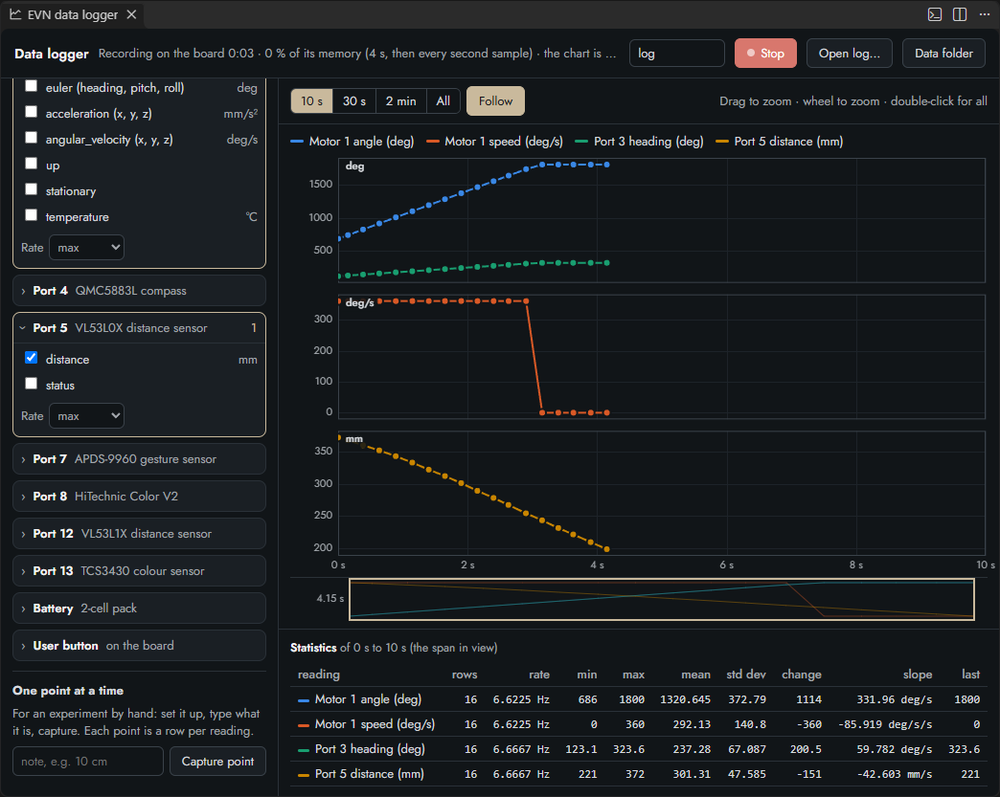
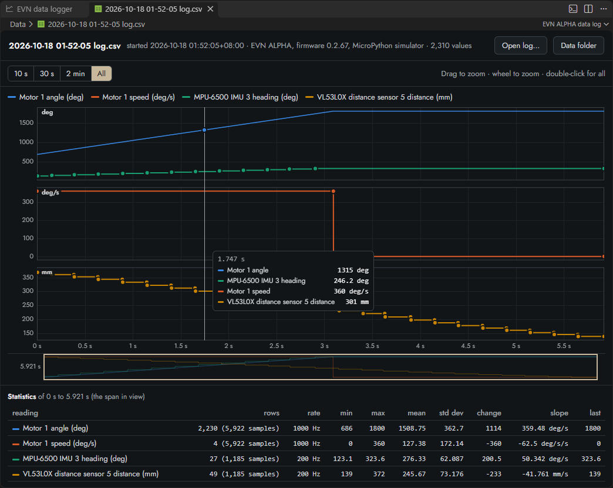

# Recording data

The data logger records what the board measures (motor angles, sensor readings, the battery) to a CSV file you can chart, open in Excel or read in Python. A program can record the same way with `evn.DataLog`.

## Opening the data logger

Press the graph button at the top of the *Board* view, or run **EVN: Open data logger**. It opens beside your program.

The logger needs the [live console](BOARD_VIEW.md#the-live-console): the board idle, not running a program.

The board itself does the recording. Its firmware samples each source at the rate the source makes new readings, keeps them in the board's memory and never lets the recording delay the motors. The logger then fetches what was recorded.

## Choosing what to record

**On the left** is everything the board can measure right now:

- the four motor ports: angle, speed, load, stalled;
- every I2C device it found, with its readings (an IMU's heading, tilt, acceleration …; a colour sensor's hsv, rgb, lux …);
- the battery and the user button.

Tick what to record and choose each source's **rate**:

- **max** records every new reading, and never the same reading twice. A motor gives one every millisecond (1 kHz), an IMU 200 a second, a compass 75, the battery 25.
- **1000 Hz down to 1 Hz** otherwise. A rate above the source's own gives the source's.
- Over Bluetooth every reading is held to 50 Hz.

Right-click a motor, the battery or a device in the *Board* view and choose **Add to data logger** to tick its usual readings.

## Recording



**Record** starts a new file and **Stop** ends it. The status bar shows `0:12 logging` while it runs, even with the logger's tab closed.

- **A light set**, up to 100 values a second (the note under the list says), goes into the file as it is measured.
- **A heavier set** (a motor at **max** is 1000 values a second) is kept in the board's memory while it records. The chart shows a preview meanwhile. The USB link is not made to carry a stream of samples while motors drive.

The note says how long the memory lasts at full rate: about 10 s for one reading at max, longer at lower rates. When a reading's share is full, the board keeps every second sample and **halves its rate**. The recording never stops by itself; a long run comes back evenly thinned, and the file says where (`# rate halved: ...`).

A run of identical readings is kept as two rows, its first and its last. A motor at rest costs two rows however long you record. The chart shows the value flat between them: every reading in between was taken and was the same. The file's last line gives the number of samples taken (`# samples taken: ...`), which is more than the rows.

After **Stop** the logger waits until every motor has stopped, then fetches the samples and writes the file.

A recording also ends when the console lets go of the board: you press **Run**, open the REPL or unplug. What was already in the file stays; what the board still held is lost.

## Capture point

**Capture point** is for an experiment by hand: set it up, type a note (`10 cm`), capture. One reading of everything ticked is added to the day's points file, one row per value with your note.

## The files

Files go to the **Data** folder of your projects folder and show under **Data logs** in *My projects*: `2026-09-25 14-03-11 arm test.csv` (the name box sets the last part), and `arm test points 2026-09-25.csv` for points.

They are plain CSV, one row per value:

    # EVN ALPHA data log
    # started: 2026-09-25T14:03:11.123+08:00
    # board: EVN ALPHA E4630000000000AB, firmware 0.2.67, MicroPython v1.26.1
    time_s,device,port,quantity,value,unit,note
    0.000000,Motor,1,angle,12,deg,
    0.001000,Motor,1,angle,13,deg,
    0.004210,MPU-6500 IMU,3,acceleration.x,12.5,mm/s²,

`time_s` is the board's own clock, in seconds since Record, to the microsecond. A gap or jitter in the data is the board's, not the cable's.

Excel opens the file as it is; filter the `quantity` column. In Python: `pandas.read_csv(f, comment='#')`.

## Logging from your own program

A program records the same way with `evn.DataLog` (Pybricks' `DataLog`, with EVN's `add()` for motors and sensors). It keeps the samples in the board's memory while it runs. It writes a CSV file on the board once the motors have stopped, never while one drives, which would stall its control loop.

```python
from evn import Motor, IMU, DataLog, wait

motor = Motor(1)
imu = IMU(1)
log = DataLog(name='run1')           # the file: /data/run1_<date>_<time>.csv
log.add(motor, 'angle')              # every new reading (up to 1000 a second)
log.add(imu, 'heading', 50)          # 50 a second
log.start()
motor.run(300)
wait(5000)
motor.stop()                         # save() is refused while a motor drives (a stop just issued is fine)
log.stop()
print(log.save())
```

A log not yet saved is saved by itself (`autosave=True`) once the motors coast: when `main.py` ends, the editor's Run finishes, the board soft-reboots or a `with` block ends.

To get the file, open the **data** folder under *Files on the board* in the *Board* view and click the log, or its cloud button. It is copied into the **Data** folder of your projects folder and opens in the viewer. From a terminal, `mpremote cp :/data/run1_....csv .` does the same.

The board keeps the logger's rule: a run of identical samples is two rows. `log.log()` rows are always kept. `log.log(x, y)` adds rows of your own values, in the columns of `DataLog('x', 'y', ...)`.

The whole class is in the API reference, [DataLog](API_SYSTEM.md#datalog--recording-on-the-board). `examples/22_data_log/` has a minimal and a complete program, in Python and in blocks (the *Data log* category).

## Looking at a log



Click a log under *Data logs*, or **Open log...** in the logger, or right-click any `.csv` and **Open in data viewer**.

Each unit gets its own lane with its own scale, on one time axis.

- **Hover** for the values at that moment.
- **Drag** across the lanes to zoom into a span; the **wheel** zooms around the pointer; **double-click** shows everything.
- The strip underneath shows the whole log, with the span in view; drag it to pan.
- Click a name in the legend to hide or show that line.

The table under the chart gives the statistics of the span in view: rows, rate, min, max, mean, standard deviation, change, slope and the last value. Zoom into the part you care about and read it off.

When the file says how many samples the board took, the rows cell adds them while the whole reading is in view: `2 (1,284 samples)`. Its tooltip explains the difference: a run of identical samples is two rows, and each time the board halved a rate it kept every second row.

The mean, standard deviation and slope weight each row by the time it holds, so a flat run counts for its whole span. The rate comes from the shortest gap between rows, which such a run does not stretch.
