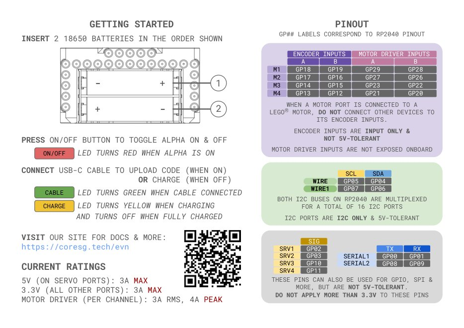
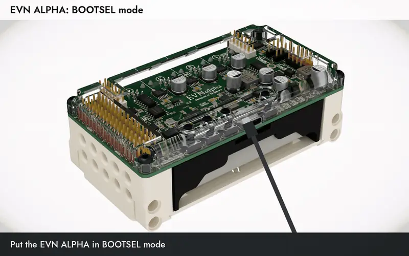
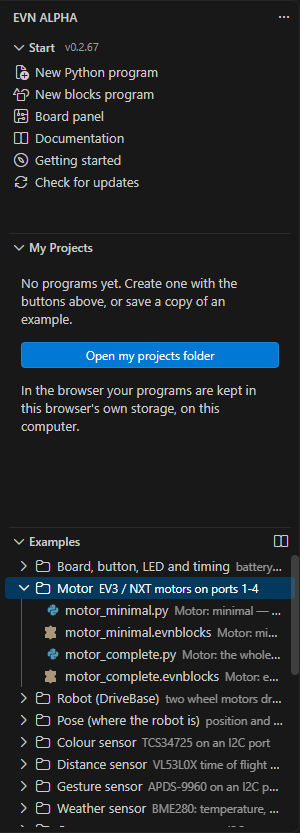
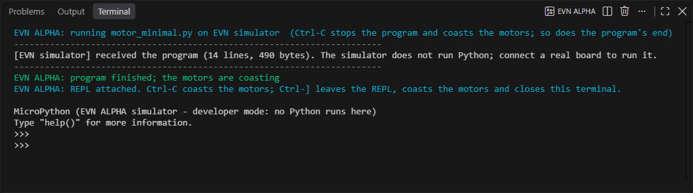

# Getting started

This page takes you from a new EVN ALPHA board to a motor turning under your own program.

The steps:

1. [Get the parts together](#1-what-you-need).
2. [Switch the board on](#2-switch-the-board-on).
3. [Install the extension and mpremote](#3-install-the-extension-and-mpremote).
4. [Put the firmware on the board](#4-put-the-firmware-on-the-board).
5. [Run your first program](#5-your-first-program).
6. [Write your own](#6-write-your-own-program).

VS Code has a guided walkthrough of steps 3 to 6. Open it with **EVN: Getting started walkthrough** in the command palette, or **Getting started** under *Start* in the **EVN ALPHA** side bar. It ticks each step off as you finish it.

No VS Code? The browser IDE needs no install. Do steps 1 and 2, open the IDE in Chrome or Edge from the [home page](https://evn.coresg.tech/) and choose the board's port. Then go on at step 4, which says how the browser flashes.

## 1. What you need

- **An EVN ALPHA board.** [The board](BOARD.md) shows its buttons, lights and ports.
- **Two 18650 Li-ion cells.** The motors run from the cells, not from USB.
  They must deliver a high current: each motor port can draw 3 A RMS, 4 A peak ([current ratings](BOARD.md#current-ratings)).
- **A USB-C data cable.** Some USB-C cables only charge. With one of those the computer never sees the board.
- **One LEGO EV3 or NXT motor** with its cable, for the first program.
- **A computer** with Windows, macOS or Linux, and:
  - [VS Code](https://code.visualstudio.com/) 1.106 or newer;
  - [Python 3](https://www.python.org/downloads/) (3.8 or newer). On Windows, tick **Add python.exe to PATH** in the installer.
- **Recommended:** the [Python](https://marketplace.visualstudio.com/items?itemName=ms-python.python) and [Pylance](https://marketplace.visualstudio.com/items?itemName=ms-python.vscode-pylance) extensions. They give you autocomplete and inline help for `evn`.

## 2. Switch the board on

The board's printed card shows the same three steps.



1. **Insert the two 18650 cells** in the order the card shows, minding the + and - marks.
2. **Press the ON/OFF button.** The red LED lights while the board is on.
3. **Connect the USB-C cable to your computer.** The green LED lights when the cable is connected.

The board talks to the computer **only while it is switched on**. Switched off, the USB-C cable charges the cells: the yellow LED lights while they charge and goes out when they are full.

## 3. Install the extension and mpremote

1. Download the extension (a `.vsix` file) from the [downloads](https://evn.coresg.tech/#/downloads).
2. In VS Code, open the *Extensions* view, click its `...` menu and choose **Install from VSIX...**. Pick the file.
3. Run **EVN: Install mpremote** from the command palette (**Ctrl+Shift+P**). It installs `mpremote`, the small Python tool the extension uses to talk to the board (or install it yourself: `pip install mpremote`). You do this once per computer.

The status bar at the bottom of the window then reads **EVN: no board**, or the board's port once it is found.

On **macOS and Linux** the port is a name such as `/dev/cu.usbmodem…` (macOS) or `/dev/ttyACM0` (Linux) instead of `COM7`. On Linux, add yourself to the `dialout` group (`uucp` on Arch) so the port can be opened ([how](TROUBLESHOOTING.md#linux-the-board-is-found-but-cannot-be-opened)). On recent Debian and Ubuntu, mpremote goes into a Python of your own ([how](TROUBLESHOOTING.md#linux-mpremote-will-not-install)).

## 4. Put the firmware on the board

The firmware is the program inside the board that runs your Python. The extension carries it. You flash it once on a new board, and again when a new extension brings a newer firmware.

1. Press **Flash the firmware** in the walkthrough. The same command is in the *Board* view's `...` menu, and in the palette as **EVN: Flash MicroPython firmware**. Confirm.
2. A board that already runs the EVN firmware restarts into its loader by itself.
   **A new board** has to be put there by hand. With the board on and USB connected: **hold the BOOTSEL button, press and release RESET, then let go of BOOTSEL.** A drive named `RPI-RP2` appears, and the status bar reads **EVN: BOOTSEL mode — click to flash**.
   For a board that is off or powered from USB only: unplug USB, hold BOOTSEL, plug USB back in, then let go.
   
3. Wait for **firmware flashed**. The board restarts on its own.
4. The status bar shows the board's port, for example **EVN: COM7**.

**In the browser IDE** the flash is two steps, because a browser cannot write to the `RPI-RP2` drive. **Flash the firmware** puts the board in BOOTSEL mode (or tells you to, as in step 2) and downloads the firmware file. Drag `EVN_ALPHA_MicroPython.uf2` onto the `RPI-RP2` drive; the board restarts by itself.

A flash keeps your programs, your files and the board's calibrations. Only the firmware is replaced.

The user LED (marked `LED (25)` on the board) blinks once a second while no computer has the board's port open, and five times a second while one has. [The board's lights](BOARD.md#the-boards-lights) lists every pattern.

<details>
<summary>Advanced: what the flash checks</summary>

Before it writes anything, the extension checks that its firmware file is complete and is the build it was released with; a damaged file is refused. It reports **firmware flashed** only when the board answers with the new version. A board that does not come back, or answers with another version, is reported as such. With more than one board on USB, see [Troubleshooting](TROUBLESHOOTING.md#more-than-one-board-on-usb).

</details>

## 5. Your first program

Open the **EVN ALPHA** tab in the activity bar (the ℕ icon). It has *Start*, *My projects* and *Examples*.



1. Plug the motor into **motor port 1**. Keep its wheel off the ground.
2. Under *Examples*, click **Motor** and choose *Minimal · Python* (`motor_minimal.py`).
3. Press **Ctrl+F5** (*EVN: Run current file on the board*), or the **Run example on the board** button next to its name.

The motor turns, and the program's output appears in the *EVN ALPHA* terminal. When the program ends, every motor coasts and the terminal says `program finished; the motors are coasting`.



The terminal then stays at the board's prompt, with the program's variables still there. Type `motor_1.angle()` and press Enter to try it. **Ctrl+]** leaves the prompt and coasts every motor.

**To stop a program**, press **Ctrl+C** in the terminal, **Ctrl+Shift+F5**, or the red **Stop** button in the status bar. Every motor coasts. Without a computer, press the board's **user button**.

**In the browser IDE, press Stop before you close the tab.** A closed tab cannot reach the board, so a running motor keeps driving.

## 6. Write your own program

Press **New Python program** under *Start*. Give it a name; the file opens in your projects folder (`EVN Projects` in your Documents folder). Try:

```python
from evn import Motor

m = Motor(1)
m.run_angle(500, 360)     # one turn at 500 deg/s
print(m.angle())
```

Press **Ctrl+F5** to run it. Prefer blocks? **New blocks program** opens the block editor instead.

For autocomplete on `evn`, choose **Open my projects folder as the workspace** in the *My projects* `...` menu. If `evn` is underlined in red, see [Troubleshooting](TROUBLESHOOTING.md#if-evn-is-not-found).

## Where next

- [Programs: run, stop, ports and units](PROGRAMS.md): examples, blocks, motor and sensor ports.
- [The Board view and the live console](BOARD_VIEW.md): watch and drive every port without a program.
- [Calibrating your robot](CALIBRATION.md): motors, IMU, compass and colour sensors.
- [Recording data](DATA_LOGGER.md): the data logger and `evn.DataLog`.
- [A program that starts from the user button](MAIN_PY.md): a robot that runs without a computer.
- [Working without the USB cable](BLUETOOTH.md): the board's prompt over Bluetooth.
- [Commands and updates](COMMANDS.md): every `EVN:` command.
- [The board](BOARD.md): buttons, lights and the pinout.
- [Troubleshooting](TROUBLESHOOTING.md): when something does not work, and how to report it.
- The [API reference](API.md) lists every call; the [Blocks reference](BLOCKS.md) every block.
