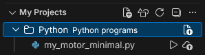

# A program that starts from the user button

Put a program on the board as `main.py` and the robot runs it at a press of the user button, with no computer attached.

## Uploading it

**EVN: Upload current file as main.py** copies the open file to the board as `main.py`. *My projects* and the block editor have an **Upload as main.py** button too.

Choose *Upload and run now* to restart the board and start the program at once, this one time. After a run, its **Stop** button stops the program. The message after the upload offers to remember your answer (setting `evn.uploadMain.then`: *Ask every time*, *Upload and run now* or *Upload only*).

## Starting it

1. Switch the board on, or press RESET.
2. Wait until the user LED double-blinks (two short flashes, once a second): the board is waiting for the button. A press made before the double blink starts is not counted.
3. **Press the user button.** The program starts.

When the program ends, the next press runs it again.

**With VS Code connected**, the button works too. The live console sees the board waiting and sends it nothing (the console row reads *Board is waiting for the user button (main.py)*). A press starts the program with the console listening, and every line it prints shows in the **Console** view.

- *Start now* on that row starts `main.py` from VS Code (the board resets into it, as *Upload and run now* does).
- *Connect instead* on that row ends the wait without starting `main.py` and connects the console.
- A paused console (**EVN: Pause the live console (keep listening)**) still reads the port and sends nothing. A program you start with the button shows its output too, with the status bar's `main.py running on the board` and **Stop**.
- **EVN: Disconnect the live console (free the port)** lets go of the port altogether, for another tool.

When the console finds `main.py` already running, it never interrupts it. The **Console** view comes up with the program's output. The status bar shows `main.py running on the board` with the red **Stop**, as *Upload and run now* does.

Older firmware, and a program that prints at once

A board on firmware 0.2.69 or older does not show its wait to a console that connects late. There the console's first word ends the wait, so use *Upload and run now*.

A program that prints right away is never typed into: the console listens first and only speaks to a board that is silent.

**At a terminal** (*Open REPL*, a serial monitor), press **Enter** first for the prompt. Only Enter or a REPL control key (Ctrl-A to Ctrl-E) ends the wait; any other key is ignored, so text typed during the wait is dropped, never run.

**To start without a press**, for a board that must run unattended, put `import evn; evn.autostart(True)` in a `boot.py` on the board.

## What a button run keeps

Between two button runs there is no soft reset. A module your `main.py` imports (say `robot.py`, with your `IMU`, `DriveBase` and `Pose`) is kept and does not run again. Its objects carry over, with their settings, and each starts the new run fresh:

- an `IMU` at `heading()` 0, warm (no wait for `ready()`);
- a `DriveBase` at `distance()` and `angle()` 0;
- its `Pose` at x, y and heading 0, as its `reset()` does;
- a `Motor` at `angle()` 0 if it was made with `reset_angle=True` (the default). With `reset_angle=False` it keeps its count.

A `Pose(...)` your `main.py` makes again on the same sources takes the last run's over. A setting one run changes is still in force in the next, so set what the program needs at its start.

**Run** from the editor starts with a soft reset instead (so does Ctrl-D). Every Python object goes with it: your program, its modules and their objects start from nothing. But the sensors that are slow to start are kept ready, as on a button run:

- an `IMU` (no DMP reload, no wait for `ready()`, its gyro calibration kept; `heading()` 0);
- a `VL53L1X`;
- a `HuskyLens`;
- the colour sensors (`ColorSensor`, `TCS3430`, the HiTechnic colour sensors).

A kept sensor does nothing until your program opens it: a program that never uses it runs as fast as with the sensor switched off. The next program's `IMU(port)`, `VL53L1X(port)` and so on then starts in exactly the state a first start would give it, only sooner. That is the default settings and the port's stored calibration.

These start again from scratch:

- a sensor the last program re-configured (another rate, timing budget or exposure);
- one that was unplugged or swapped;
- one no program has used through a whole run.

Motors, servos, displays, LED strips and every other device start fresh, and the motors coast at every program's end as before. `close()` still switches a sensor off.

## If the program misbehaves

- Hold the **user button for 2 s** while it runs. The board restarts (motors coast) and waits for the button again.
  

  
If the button is the program's input

  A program that uses the button as an input (`evn.set_stop_button(None)`) turns this off while it runs: then use one of the next two, or Ctrl-C. If that program also catches every error (a bare `except:` in its loop), Ctrl-C does not end it either. Then switch the board off and on with the button held.

  

- Hold the **user button while switching on**: `main.py` is skipped once. Useful with `autostart`.
- **EVN: Stop all motors** stops it from VS Code.
- The *Board* view's console row says when the board runs its own program. Its stop button, **Stop the board's program and connect**, ends it and hands the board back to you. Nothing else the extension does interrupts it.
- **EVN: Remove main.py from the board** deletes it.
- After a watchdog restart (a program that froze the board), `main.py` is skipped by itself.
