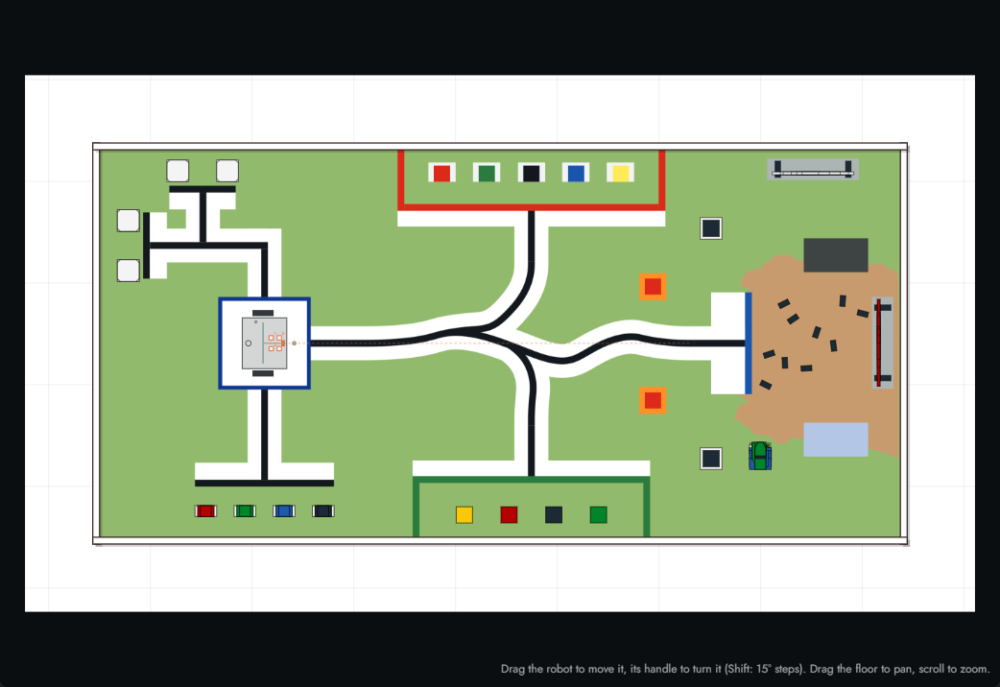
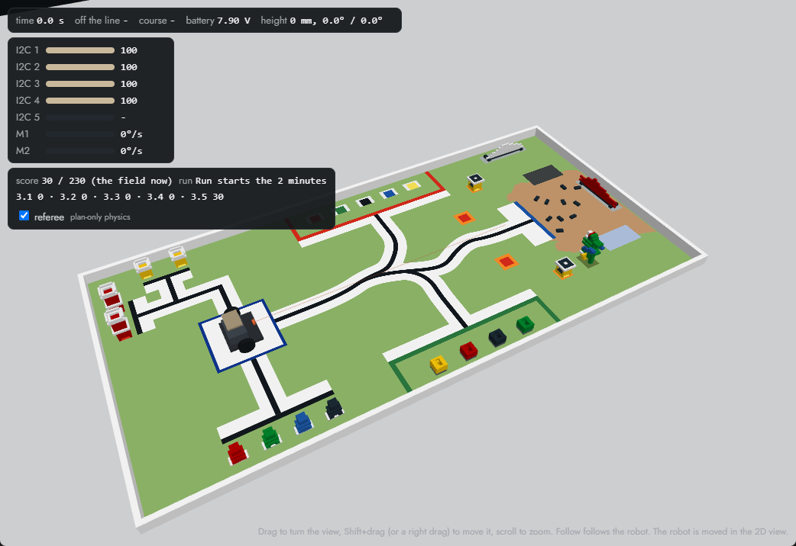

# The robot simulator

The simulator is an EVN ALPHA you can run programs on without a board: a robot on a line-following course, in a
panel next to your program - with the RoboCup Junior Rescue Line course's 3D elements (ramps, raised tiles and bridges,
seesaws, speed bumps, debris, obstacles) and its evacuation zone, which the robot climbs, rides, scrapes over and bumps into, and a
WRO RoboMission Junior table with its game objects and referee. It is a board like any other to the extension - you connect to it, Run your program,
watch it in the Board view, open the REPL, stop it - and the same program file runs on a real EVN ALPHA built like
the simulated robot.

## Opening it

Any of these opens the **EVN Simulator** panel and makes the simulated board the one in use:

- **Simulator** under *Start*, in the EVN ALPHA side bar;
- the **Simulator** row of the *Board* view (under the port row);
- **EVN: Open the simulator (a simulated robot to run programs on)** from the Command Palette;
- **EVN: Select board port** and then **EVN simulator** (in the browser IDE: the last entry of the port list).

While the panel is open the simulated board is "plugged in": it is listed as the port **EVN simulator**, the status
bar names it, and the *Board* view's live console connects to it. Close the panel and it is unplugged: the window
goes back to the board it used before (the board you chose, or auto-detect), and other VS Code windows never
switch to the simulator. A real board plugged in while the simulator is open is listed too; **EVN: Select board
port** chooses between them. A board in BOOTSEL mode can be flashed while the simulator is open.

The simulator needs no Python and no mpremote on your computer (a real board does), and it runs in the browser IDE
as it does on the desktop. It is free until the end of 2026; from 2027 it has a 14-day trial, then opens with a licence
key ([Licence](#licence)).

## Licence

The simulator is **free until 31 December 2026**. From 1 January 2027 it is free for **14 days from the first time it
opens** (the trial), and after that it opens with a **licence key**. The panel's header shows which (*Free until 31 Dec
2026*, or the trial's days left: click it to see the licence), and so does the *Simulator* row of the *Board* view (in
its tooltip while the panel is open). A panel that is open when the trial ends stays open: the next opening asks for the
key.

- **Entering a key.** Once the trial is over, opening the simulator asks for one: **Enter licence key**, and paste the
  key - one line of text that starts with `EVNSIM1.` (line breaks that a mail put into it are taken out). It is
  checked as you paste it, and kept once it is right; **EVN: Enter a simulator licence key** does the same at any time.
  A key needs no internet connection and works in the browser IDE as on the desktop; on the desktop, with Settings
  Sync on, it reaches your other computers too.
- **Your licence.** **EVN: Show the simulator licence** says who the licence is for and its last day (or that it does
  not end) - or, without one, until when the simulator is free or the trial's days left. **EVN: Remove the simulator
  licence key** takes the key off this computer.
- **Getting a licence.** Schools in Singapore can buy them through Vendors@Gov. Anyone else: write to
  [kenneth@coresg.tech](mailto:kenneth@coresg.tech).

Turning the computer's clock back does not give the trial's days back. With the clock more than a week before the day
the trial began, the simulator stays shut and says the day it opens again.

### Lessons

The lessons at [learn.coresg.tech](https://learn.coresg.tech) open with a licence key that unlocks them. Not every key
does, so ask for the lessons when you get one. Anyone can read the site's [free preview](https://learn.coresg.tech/preview/).

- **From VS Code.** **EVN: Open lessons** opens the lessons in your browser. If the licence key you entered unlocks
  them, you are signed in; otherwise you see the sign-in page.
- **In a browser.** Paste the key on the site's sign-in page.
- **Devices.** A key is signed in on a few devices at once (each browser is one). The site's *Account* page lists them;
  sign out on one to free its place for another. A device not used for 30 days frees its place by itself.

## Running a program

Everything you do with a board works on the simulated one:

- **Run** (Ctrl+F5, the Run button, *Run on the board* on a file or an example, Run of a blocks program) runs the
  program in the simulator. Its prints and its traceback come to the **EVN ALPHA** terminal; a line number in the
  traceback jumps to the line. **Ctrl-C** in the terminal, the red **Stop** in the status bar, **EVN: Stop all
  motors** or the panel's **Stop** button stop it, and every motor coasts.
- **Upload as main.py** puts the file on the simulated board and starts it, as the board does after
  `evn.reset(start=True)`. Files uploaded to the board can be imported by your programs.
- **The REPL** (the REPL button in the status bar) is the simulated board's prompt.
- **The Board view** shows the simulated robot live: the motors' angles and speeds, the battery, the colour sensors,
  the distance sensors and the IMU under *I2C devices*. Its buttons drive the motors (a jog turns a wheel, and the robot moves), and *Read this
  device live* reads a colour sensor over the course. The command line runs Python on the simulated board, with
  `m1`..`m4` and `d<port>` for each colour sensor.

**New program** in the panel's header writes a first line follower for the robot you configured
(`line_follower.py` in your projects folder) and opens it: press Ctrl+F5 to watch it drive. It follows the curves
and the sharp corners; the Rescue Line course's tight zigzags are where a better program starts
(`tools/linefollow/programs/lf_recommended.py` in the firmware repository finishes the whole course). Neither looks
for the 3D elements: on the *Hazards sample* a line follower meets what a real course gives it - a speed bump that
lifts its sensors, the top of a ramp where they read the white as dark, and last an obstacle on the line (on the
straight to the Goal, with floor on both sides for a detour round it) - and a program that handles them (a distance
sensor for the obstacle, the IMU's pitch for the ramp) is the next step.

## The panel

- **Course**: the floor. *Rescue Line* is 28 RoboCup Junior Rescue Line style tiles (300 mm, a 20 mm black line on
  white): curves, sharp corners, zigzags, bumps, hairpins, gaps and a crossing, about 9 m. *Tile set sample* is a map
  of 21 tiles of a real competition set (below), from its Start tile to its Goal, 7.7 m. *Hazards sample (3D)* is a
  map of the rules' 3D elements (below): a speed bump and debris, a long ramp up to a bridge 275 mm over the floor, a
  long ramp down, a seesaw, the way back under the bridge (another bump), and an obstacle on the straight to the Goal. *RCJ game
  sample* is a whole game on 25 tiles: a gap, a bump, a seesaw, a ramp up and down, a T junction and a dead end with
  their green markers, an obstacle, two checkpoints, the evacuation zone with two live victims and a dead one, and the
  line from its exit to the Goal; it lays out with no warnings. The *Oval* is a closed
  loop for timing laps; *Straight*, *Curves*, *Corners*, *Zigzag*, *Bumps*, *Hairpins*, *Gaps* and *Crossings* are
  one kind of tile each; *Empty floor* has no line, for driving and turning. *WRO RoboMission Junior 2026* is the WRO
  table with its 27 game objects and its referee ([WRO RoboMission](#wro-robomission)). The maps you build are listed
  under *Your maps*.
- **Speed**: how fast simulated time runs against the clock (¼× to 4×). Your program's clock - `wait()`,
  `StopWatch`, `time.ticks_ms()` - is the simulated one, so a program behaves the same at every speed.
- **Back to start** puts the robot back on the course's start. **Drag the robot** to put it anywhere, and its
  handle (the dot in front of it) to turn it (Shift: 15° steps). The robot can be moved when no program runs.
- **Follow** keeps the robot in the middle of the view; drag the floor to pan, scroll to zoom.
- **3D** shows the course and the robot in 3D: the tiles at their heights with their line on them, the obstacles,
  bumps and debris, the robot at its height, pitch and roll, and its distance sensors' beams. Drag to turn the view,
  Shift+drag (or a right drag) to move it, scroll to zoom; with **Follow** on, the view follows the robot from behind.
  The robot is put down and turned in the 2D view.
- **Button** is the board's user button (hold it): `evn.button.pressed()` reads it while the program runs (see
  "Good to know" for where). With no program running, pressing and releasing it starts `main.py` when the board has
  one (Upload as main.py, then press the Button). One difference from the board: the board's button starts `main.py`
  only while the board waits for it after a boot, before a computer speaks to it (then it is the REPL's), and again
  after `main.py` ends; the simulator's starts it whenever no program runs. The simulator's button does not stop a
  program (`set_stop_button()` changes nothing here): Stop does.
- The figures in the top left: the run's **time** (from the moment the robot first moves after it was put down;
  it stops when the robot reaches the end of the course, which shows as *finished in ... s*), how far the robot is
  **off the line**, how much of the **course** it has done (laps on the oval), the **battery**, on a course with 3D
  elements the robot's **height** (mm) and its pitch and roll, and each colour sensor's reading, each distance
  sensor's range, the IMU's heading and each motor's speed. When the robot drives off an edge or tips over, the panel
  says so. **Back to start** also puts the seesaws, the obstacles and the debris back where the map has them.

## Building a map

**Map builder** in the panel's header opens the map builder beside the floor: the tiles of a RoboCup Junior Rescue
Line competition set ("Tile List for Single Set": 37 kinds of tile, 104 tiles), each drawn as it is printed.

- **Place a tile**: click it in the list, then click the grid; it stays picked, so you can place several (Esc puts it
  down). A tile placed on others replaces them.
- **Turn** it with **R** (Shift+R the other way) or a right click, before or after you place it; **drag** a placed
  tile to move it; **Delete** removes the selected one. A drag or turn that would lay a tile on another (closer than
  a bridge's clearance, below) is not made and the builder says so (the map builder has no undo): to replace that
  tile, pick this one in the list and put it on the cell.
- **Green markers** (RoboCup Junior Rescue Line 2026 rules, 3.6): click it, and every junction of the placed tiles
  shows dashed squares where a marker can go - a 25 mm square in the corner between two arms at right angles, just
  before the junction. Click one to put a marker down, click it again to take it up. A robot coming to a junction
  turns left for a marker on its left, right for one on its right, turns round for one on each side (a dead end),
  and goes straight on with none - so one marker serves the two arms on either side of it, as in the rules'
  figures. The T (#70), the crossings (#80, #81), the Y (#71) and the roundabouts (#49, #50: one junction where the
  stem meets the circle, one where the exit leaves it) have them.
- **Heights** (rules 3.2, 3.7): select a tile to give it a **height** (mm, its top over the floor; a ramp's, at its
  drawn bottom end, where the line enters it as drawn: turned round, it is a ramp down). A ramp climbs the height its
  slope makes over its plan: 137.5 mm for a short ramp (#91, #92), 275 mm for a long one (#93, #94). A tile placed
  next to another takes that tile's height where they meet, so a course carries on at the top of a ramp by itself. A
  tile 260 mm or more up (250 mm clear under its 10 mm slab) stands on four 25 mm pillars at its corners and another tile may lie under it - a **bridge**
  (rules 3.2.3: the robot drives under it; Shift+click picks the lower of two tiles); a lower raised tile is solid down
  to the floor, unless a tile lies under it: then it is a bridge too, on pillars, as long as it is at least 225 mm clear
  under its slab over the top of the tile under it (a ramp's high end). Less than the rules' 250 mm clear ("The minimum
  height (space between the floor and the ceiling) will be 25 cm") is warned, within 3.11.5's -10 %; under 225 mm is
  refused, and a tile the builder puts on a cell at any other height takes the place of what is there. A **Height**
  edit that would leave a tile less than that clearance from another tile on its cell is refused instead (the map
  builder has no undo): the tile keeps its height and the builder says the least clearance and the height that
  makes a bridge; to replace the other tile, put this one on the cell. The builder says where the line steps more than the rules' 3 mm from one tile to the next.
- **Seesaw** (rules 3.8): a selected straight (#10, #10E) can be a seesaw: it pivots about a hinge across its middle,
  15° either way unless you set its tilt beside the box (any angle over 0 up to 45°; 20° or more is warned: rules 3.8.2
  "The seesaw will have an incline of less than 20 degrees when tilted to one side", within 3.11.5's +10 % under 22°),
  its drawn bottom end down at the start (turn the tile round for the other end), a 3 mm board.
- **Ramp** (rules 3.7.5: "The line along the ramps can contain gaps, speed bumps, intersections, obstacles, and
  debris."): tick **Ramp** on a selected line tile - a straight, a corner, a curve, a gap tile, a T or a crossing with
  its green markers - to lay it as a ramp of the short ramp's slope (24.6°, climbing 137.5 mm over its cell from its
  height at its drawn bottom end; turn it round for a ramp down). The angle beside the box sets its incline (any angle
  over 0 up to 45°: it climbs 300 mm x tan(angle) over its cell, its slope 300 mm / cos(angle) long); one of the set's
  ramps (#91-#94) has the same **Incline** field. Past the rules' 25° it is warned (3.7.2 "Ramps will not exceed an
  incline of 25 degrees from the horizontal"; within 3.11.5's +10 % to 27.5°, or past it), never refused. Its paint, line and markers lie on the slope, and it
  is a ramp in every rule: its sides are walls, nothing goes under it, it is never a checkpoint, and the referee scores
  it with the ramp it belongs to. A curve's arcs lie on the slope as polylines, a point every 2 mm of arc (seen from
  above every point is on the flat tile's circle; the chords sag at most 0.0125 mm, so the 20 mm line and what a colour
  sensor reads across it are the flat curve's). The Start, the Goal, the raised tiles (#..E) and the set's own ramps
  cannot be laid as one. Its list beside the box picks the drawn side it climbs to - its
  top (as the set's ramps), left, bottom or right - whatever way its line runs, so a T can climb along its stem or
  along its through line. A line that leaves a ramp across its side (the T's stem across the slope) needs a matching
  ramp beside it - a tile laid as a ramp climbing the same way from the same height (a wide ramp), whose joint is
  level: onto a flat tile that side is a wall of up to half the rise, which the builder warns of (rules 3.2.1: 3 mm
  between tiles) and the robot cannot cross. Ticking Ramp or changing its way re-seats the speed bumps, debris and
  obstacles on the tile on its new top. In a map's JSON it is `"ramp": true` on the tile
  (climbing to its drawn top), or `"ramp": 1`, `2` or `3` (its drawn left, bottom, right: quarter turns as `rot` turns;
  `0` is read as `true`).
- **No peak, no dip** (rules 3.7.6: "The ramp must NOT have a drop-off immediately following a rise section, creating
  a peak-line structure or viceversa."): where the line runs from one ramp straight onto another over both their high
  ends (a rise into a drop-off) or both their low ends (a drop-off into a rise), the builder warns - any ramp, the
  set's or a tile laid as one. A flat tile between them is the legal way (as on the RCJ game sample); the map still
  runs (a warning, not a refusal, so a map saved before still loads).
- **Clear of the field's edge** (rules 3.3.4: "The line will be at least 10 cm away from any edge of the field, walls,
  pillars to support ramps, seesaws, and obstacles that do not lie ahead of the robot's path"; 3.5.7: "Obstacles will
  not be placed closer than 25 cm from the edge of the field (including edges of tiles that are elevated by ramps) and
  inclined tiles"): the builder warns, naming the tile and the distance, where the line's ink (its centre less half its
  width) comes within 100 mm of any of those, and where an obstacle comes within 250 mm of the field's edge or of an
  inclined tile. The field's edge is a tile's side with no tile beyond it, or where the tile beyond is more than 5 mm
  higher or lower (judged every 10 mm along the side): a raised tile's side, a ramp's sloped side beside a flat tile
  (not the stretch where they are level), a bridge's sides (an edge for what is at its height, not for the line on the
  floor under it). A ramp's low and high ends where the floor and the raised tile meet them are not edges, nor its side
  beside a ramp climbing the same way from the same height (a wide ramp), nor a side against the evacuation zone at
  its floor's height (the zone's walls count as walls; the line inside the zone is not checked, and an obstacle in it
  keeps 100 mm from its walls, 3.9.6). A seesaw's sides along its axis are always edges (it tilts); its ends are not,
  where the line crosses onto it. An inclined tile (a ramp, a seesaw) counts whole for an obstacle that does not stand
  on it; one standing on a ramp (3.7.5) is measured to the field's edges only, every tile of its ramp left out (a
  wide ramp, a ramp two tiles long: the ramp tiles level with each other along their shared sides). The line keeps clear of the pillars under
  a bridge where it runs below their top, and of an obstacle at its level that it does not run through. A warning, not
  a refusal: a map saved before still opens. The *RCJ game sample* has none; the *Tile set sample* (a showcase of the
  set's tiles, several of them on the field's edge) and the *Hazards sample* (its obstacle on a one-tile-wide straight
  with floor either side to drive round it) are warned.
- **Checkpoint** (rules 3.4): a selected tile can be a checkpoint, where the referee (below) puts the robot back after
  a lack of progress, drawn with a blue *CP* disc; never a tile with a scoring element (3.4.2 "Checkpoints will not be
  located on tiles with scoring elements": a gap, a junction, a ramp, a seesaw, a speed bump or an obstacle - the 5.6.1
  hazards), which the builder refuses. The Goal is refused too, as the simulator's choice (no rule names it): its points
  come at the stop (5.6.3).
- **Obstacle**, **Speed bump**, **Debris** (rules 3.5): click one, then click where it goes; select one to set its
  size (an obstacle's shape, width, depth, height and mass - 0 g fixes it to the floor; a bump's length, width and
  height, at most a tile, 300 x 300 mm, and 10 mm high; a piece of debris's length and diameter, at most 3 mm; the rules'
  figures are accepted to their 3.11.5 tolerance of +-10 % - a bump 330 mm, 11 mm high, debris 3.3 mm - with a warning,
  and refused past it (a bump's length is accepted to 900 mm, as in 0.2.71, so no saved map is dropped: said past
  300 mm); an obstacle under 150 mm is said, under 135 mm as no rules obstacle); R turns it 15°, drag moves it,
  Delete removes it. Each lies on the tile under it (on a ramp: along its slope); what lies on a tile moves with it.
- **Evacuation zone** (rules 3.9): click it, then click the cell for the zone's bottom-left corner. It covers 4 x 3
  cells of the grid (3 x 4 turned), the rules' 120 x 90 cm with its walls: they stand inside its cells (20 mm thick,
  100 mm high), so the tiles round it are untouched and its inside is 1160 x 860 mm. Select it to set its **entrance** and **exit** (a doorway is one cell's edge of its
  outline, 300 mm open - 280 mm on a corner cell, where the next side's wall stands: the entrance has a 25 x 250 mm silver strip on the floor in it, the exit a black one), its **red** and
  **green** evacuation points (30 x 30 cm right-angled triangles in two corners no doorway touches, 60 mm walls,
  hollow), its height, its walls' height (rules 3.9.3: "at least 10 cm high"; 90 to 100 mm is built and warned, within
  3.11.5's -10 %; under 90 refused) and colour (any but red, green and black: white, grey,
  blue, yellow, wood). R turns it, drag moves it (with what lies in it), Delete removes it; no tile goes on its cells.
  Put a tile's line up to each doorway: the line ends at the entrance and begins again at the exit (rules 3.9.1,
  3.9.2), and the dashed line crosses the zone straight from one to the other. The builder says when the line does
  not come to the entrance, runs into a wall, comes in by the exit, or has no line leaving by the exit, and an
  obstacle in the zone less than 100 mm from its wall (3.9.6). One zone a map.
- **Set start**, then click a tile near the side the robot comes in by (on a Start tile, #1, near its middle: the
  robot starts on its bar). Without a start the robot starts on the Start tile, else on the first tile you placed.
  A robot whose body reaches past the start tile's joint from there is pulled back until its front is 5 mm behind it
  (rules 5.4.1: robots start behind the joint); the builder says so when even its axle at the tile's back edge leaves
  its front over the joint.
- The dashed blue line is the line the robot is scored along, from the start (the green arrow) tile by tile: across
  each tile on its line (through the gaps), into the tile it leads to, turning at each junction as its green markers
  say, until it reaches the Goal (#99), a tile with no line where it arrives, or its own start again (a loop). Under
  the buttons the builder says how long that line is, how many tiles it crosses, and what is wrong: a tile not on
  the line, a line that stops at the edge of a tile, a junction with no marker and no way straight on (a T entered by
  its stem), a roundabout with no marker to leave it by (the line would go round for ever), no Goal at its end, a step
  between tiles, an obstacle under the rules' 150 mm. It also counts the map's 3D elements.
- **Save** keeps the map (in every window, as the robot is); **Drive this map** saves it and makes it the course.
  **Open…** reopens a saved map or a copy of the tile set sample, the hazards sample or the RCJ game sample, **New** starts an empty one, **Delete** forgets a
  saved one. **Export…** writes the map to a `.evnmap.json` file to share, **Import…** reads one. **Import RCJ
  field…** reads a field saved by the RCJ Map Editor (the rescue CMS's JSON), and **Open…** lists the eight **2026
  official fields** (see "Official RCJ fields" below).

The progress, the "off the line" figure and the finish time work on a map as on the named courses. The progress
follows the line in its order. A dead end's arm is on the scoring line twice, out to its end and back. A robot
that turns round within about 100 mm of the end carries on down the arm and on along the line. One that turns
round further from the end, backs down the arm still facing it, or is put down on the way back is not scored on
the way back: its progress counts back down the arm to the junction. One that skips the arm is not given it,
except an arm shorter than about 100 mm, which the progress search reaches across. A robot that leaves the line is scored again where it comes back on if the line it skipped is no longer than 200 mm plus how far
it drove (forward, back and round alike) since its progress last moved. A detour round an obstacle always is, so it
picks up where the robot rejoins. A cut across to a part of the course further on is not: the progress stays where
the robot left the line for the rest of the run, as it follows the line on from there (so a cut is never scored,
and the run does not finish). The one way round that is to drive back and forth off the line for as long as the
part skipped - the distance counts every way the robot goes. The finish time is taken when the robot arrives at the
end of the course from short of it, after it first moved: a robot put down at the end and moved there does not
finish until it leaves and comes back.

What the simulator makes of the tiles:

- **A ramp is 24.6° steep unless its incline is set**: 300 mm of floor for its 330 mm of slope (under the rules' 25°: the tile list gives only
  the length along the slope, so the plan is an assumption), so a long ramp covers two cells and climbs 275 mm. Set
  to another angle it keeps its plan (one cell, two for a long ramp) and climbs plan x tan(angle); its paint keeps its
  place seen from above. The
  *elevated* tiles (#10E, #41E) are the tiles a raised course is built of; any tile can be given a height.
- **Green markers are part of the floor**: the colour sensors see them (green on white: a TCS34725 reads them with
  green above red and blue), so a program finds them as on a real course. The starter program (**New program**)
  does not look for them: it goes straight over a crossing, which is right only where the course has no markers.
- The tiles' geometry comes from the drawings' dimensions and is checked against the drawings' own ink: every
  tile matches within 2 mm (`scripts/test_simulator.js`; the ink is taken out of the PDF by
  `tools/rescue_tiles/extract_masks.py` in the firmware repository).

### Custom tiles: any design within the rules

The library is examples (rules 3.1.4: "There are different tile designs (teams can find examples under Section 3.3,
'Line')"). A map may define its own 300 x 300 mm tiles in `customTiles` and place them by id like a library tile (`rot`,
`z`, `ramp`, `incline`, `checkpoint`, `seesaw`):

```json
"customTiles": [{ "id": "t10", "name": "T, marker 10 mm back",
  "elements": [{ "type": "line", "pts": [[0, 150], [300, 150]], "w": 20, "color": "black" },
               { "type": "line", "pts": [[150, 0], [150, 140]], "w": 20, "color": "black" }],
  "markers": [{ "at": [172.5, 117.5] }] }]
```

- Elements are the library's: `line` (a polyline) and `arc` (centre, radius, from / to degrees), black or red, in the
  tile's frame (x right, y up, 0-300 mm). Routes are derived from the black ink: pieces joined end to end, a line that
  ends on another's ink or crosses it makes a junction, two straight ends facing each other on one line are a gap, a
  line ending at a red strip through the centre (25 x 300 mm, perpendicular to it) makes the tile a Goal. `routes` may
  be declared too; each must be one the drawing carries, and the reverse.
- Green markers are printed on the tile (no `green` on a placement). A marker counts in the corner between two arms at
  right angles of a junction; elsewhere it is painted and warned, not counted.
- Two straight ends of two neighbouring custom tiles facing each other on one line across their seam are a gap too:
  the line runs on across it, the referee scores it once (on whichever of the two tiles comes first in the map's
  `tiles` list, whichever way the line runs), and it is checked as a gap inside a tile is. Each end keeps its own
  tile's height (a ramp beside the seam is no step).
- Ink drawn over ink (a straight drawn again over another on the same line, within 1 degree and 1 mm, or an arc
  drawn again over another on the same circle, centres and radii within 1 mm; either way round, all of it or part) is
  one piece of ink: the union of the two, at the wider width. Ink drawn over ink beside its centre line (a straight
  within 5 degrees, or an arc on the same centre, over 1 mm and under half the two widths' sum apart over more than
  the wider width; ink that only touches is not warned) is not merged - which line is meant is yours to say - and is
  warned "ink drawn over ink near (x, y)", the middle of where they overlap, in the tile editor and in the map.
- The rules' checks warn and never refuse (an official tile may break one); the message says the rule and whether the
  value is within 3.11.5's +-10 %: a black line 10-20 mm wide (3.3.1; each piece has its own width), a gap at most 200
  mm (3.3.2), 50 mm of straight line before each gap (3.3.2; on the tile, when neither way the line runs can have it;
  at the map, for the way the line runs, back to a turn - less half the line's width at the gap - or to the previous
  gap: each gap needs its own 50 mm), the red strip 25 x 300 mm (3.3.5), a junction not at right angles or with more
  than 4 branches (3.6.5), red ink that is not the strip, a strip no line ends at, a marker not "just before" its
  junction (3.6.6), a gap or a marker on a seesaw (3.8.3).
- Refused (the tile cannot be built): an unknown element or colour, a library tile's id or a repeated one, a point or
  ink off the tile, a width over 40 mm, an arc whose radius is not more than half its width or that turns more than
  360 degrees, declared routes the drawing does not carry, more than 64 custom tiles, 200 elements or 32 markers. A
  seesaw needs one straight line along the tile's middle, edge to edge, either way (it tips along it); any other
  custom tile is refused as one.
- The simulator's own readings (not rules): "just before" is within 5 mm of the arm beside the marker and 25 mm of the
  crossing arm; a marker overlapping the line by more than 1 mm is warned; ends join within 0.5 mm, lines are collinear
  within 1 mm and 1 degree; junction arms at right angles within 9 degrees (3.11.5's +-10 % of 90).

**The tile editor** (Map builder, under Tiles: **New tile…**, or select a placed tile and **Edit a copy**; a custom tile
also has **Edit tile**). It draws on one 300 mm tile with a snapping grid: every point on 5 mm (a marker's centre on
2.5 mm, so its side can touch a 10-20 mm line), an arc's radius in 5 mm steps and its ends in 15-degree steps.

- **Straight**: click its two ends. **Arc**: click its centre, its start (that sets the radius), its end (the shorter
  way round; Shift+click the longer). The canvas shows 100 mm round the tile: an arc's centre may lie there (a gentle
  curve), every other point and all the ink stay on the tile. **Gap**: click two points on a straight; the ink between them is cut out.
  **Marker**: click to print a 25 mm green square, click one to take it off. **Red strip**: the Goal's 25 x 300 mm strip
  across the middle, on or off. **Select**: click a piece to select it (outlined). **Line width** (10-20 mm) sets the
  selected piece and the pieces drawn next; **All pieces** sets every black piece of the tile. **Undo** takes back the
  last change; a right click starts the piece being drawn again; Delete or Backspace takes off the selected piece. While
  the editor is open the builder's keys (Delete, R) act on it, never on the placed tile behind it.
- Every change is checked as the map will check it (the same code): the messages under the tile say what is refused and
  why, or the routes, gaps and markers it carries and each warning; the derived routes are drawn dashed on it. A warned
  tile can be saved; a refused one cannot.
- **Save tile** keeps it in the map (`customTiles`, ids `c1`, `c2`, …) and picks it: click the grid to place it, R or a
  right click turns it, as a library tile. It is in the palette before the library. Editing a custom tile changes every
  placement of it; **Delete tile** takes it out with its placements. **Edit a copy** of a library tile loads its lines
  and arcs, with the green markers chosen on that placement printed.

### Official RCJ fields

The RoboCup Junior Rescue Committee publishes the Rescue Line fields it builds in the RCJ Map Editor, the field
editor of the rescue CMS (<https://github.com/robocup-junior/rcj-rescue-cms>). The builder imports such a field as a
map: **Open…** > **2026 official fields** gives the eight 2026 practice fields, #01 `RL2026D1_1` to #08 `RL2026D2_4`
(bundled with the extension), and **Import RCJ field…** reads any field saved from the editor as JSON. The map opens
in the builder as an unsaved copy; **Save** or **Drive this map** keeps it. The import's warnings are in the EVN log.

- **Tiles.** Each CMS tile image is drawn from its traced geometry (`assets/rcj/tiles.json`): a tile the library
  draws the same is the library tile (the start, the straight, the Goal and other common tiles); any other design is
  a custom tile of the map (`cms-tile-12`, …), its lines and arcs as the image draws them, its green markers printed
  on it. The trace's pixel noise is taken out on import (vertices on the editor's 10 mm grid, line ends on the
  junctions and tile edges, widths 10-20 mm); six designs are corrected by hand from their images (named in
  `tiles.json`, `hand`).
- **Course.** The tiles are placed at the CMS's rotations and levels (one level is one ramp tile's rise, 137.5 mm), the
  ramps sloped the way the CMS marks them, the evacuation zone on its cells with its entrance and exit, the
  checkpoints on their tiles. Each tile's speed bumps and obstacles are spread along its line (the RCJ game sample's
  sizes); a speed bump lies wholly on its own tile across the line (10-30 mm of its length on the black ink), off the
  tile's corners and junctions and level on a ramp, at the place where the line
  crosses it nearest its middle (within 40 mm of it on the eight 2026 fields, 50 where the line runs 10 mm off the
  tile's edge) - slid along its length where the line runs close to the tile's edge, so the
  referee scores it on the tile the CMS gives it; where no place on the tile takes it at full length, or none near its
  middle, it is shortened (said); where none takes it at all, it is laid at its share of the line only if that is
  clear of the other items, else left out (said); the victims and
  the evacuation points' corners are placed at random from seed 1, so a field imports the same map every time
  ("Randomise victims" draws others).
- **Checked against the CMS.** For every 2026 field the simulator's tests check that the imported course follows
  the CMS's order tile by tile, from the start through the evacuation zone to the Goal, and that the published
  counts (checkpoints, ramps, seesaws, intersections, gaps, speed bumps, obstacles) read back from the map; the ramps
  as the slopes placed plus the ramp cells laid flat (below), each field's split pinned.
- **Warnings.** The official fields keep their own design; the simulator says where it reads a rule otherwise.
  Most are rules 3.3.4 (a line under 100 mm from the field's edge, a wall or a seesaw), some 3.5.7 (an obstacle
  under 250 mm from an edge or a ramp); #04's tile-76 has 40 mm of straight line before its gap where 3.3.2 asks
  for 50. These are warnings, never refusals: a custom tile's rule checks warn, only its structure is refused. A
  ramp tile the CMS marks with no level change on it or beside it is laid flat, and said; a ramp laid flat is not
  scored as a ramp by the referee (#05 has 3 such cells, #06 all 8, #08 3; on #06 and #08 one of them is the Goal).
- **Not imported:** the field's time limit (`duration`), its second start tile and the evacuation zone's
  lack-of-progress index (the referee keeps its own settings).

The 2026 fields (`assets/rcj/fields-2026`) are the RCJ Rescue Committee's, bundled unmodified with its fields'
copyright kept by the Committee. The tile images (`assets/rcj/tiles`) are from the rescue CMS, used under its MIT
licence (Copyright (c) 2016 Fredrik Lofgren); each folder's `NOTICE.md` gives the source and the licence text.

## The 3D elements

The RoboCup Junior Rescue Line 2026 rules' 3D elements, as the simulator builds them and as the robot meets them:

| Element | Rules | In the simulator |
|---|---|---|
| Ramp | 3.7: up to 25°, one or more tiles; gaps, bumps, intersections, obstacles and debris on it (3.7.5) | a slope of 24.6° (a short ramp climbs 137.5 mm, a long one 275 mm) or the placement's `incline` (over 0 to 45°, warned past 25°), solid down to the floor; its sides are walls; any straight-lined tile laid as one (its *Ramp* box) |
| Raised tile, bridge | 3.2: tiles on a backing, bridges at least 25 cm high on 25 x 25 mm pillars | a tile at a height: under 260 mm solid to the floor unless a tile lies under it, from 260 mm (or over another tile, at least 225 mm clear under its slab; under 250 mm clear warned, 3.11.5's -10 %) a 10 mm slab on corner pillars that the robot drives under; its edges are walls from below and drops from above |
| Seesaw | 3.8: pivots about its middle, under 20°, a straight line | a straight tile tilting 15° either way (or its `incline`, over 0 to 45°, warned from 20°), its low end 3 mm up; it tips when the robot's weight passes its hinge, and stays where it tipped |
| Speed bump | 3.5.1: at most a tile (30 x 30 cm), at most 1 cm, white, black where it crosses the line, fixed | a rounded bump (a circular segment) of the size given, the line's paint on it; 5-900 mm long (0.2.71's limit) and 5-330 mm wide, 1-11 mm high (3.11.5: +-10 %, said past 300 mm or 10 mm) |
| Debris | 3.5.3: at most 3 mm, toothpicks and dowels, not fixed | a dowel of the size given (up to 3.3 mm thick, said past 3 mm), light brown (the sensors see it on the line); a wheel rolling over it kicks it back a little |
| Obstacle | 3.5.4-3.5.6: 15 cm or more, may be heavy or fixed, may be moved | a box or a cylinder of the size and mass given: fixed (0 g) or too heavy to push, the robot stops against it (its wheels slip); light, the robot pushes it, and it slides to rest on the floor |
| Evacuation zone | 3.9: 120 x 90 cm, walls at least 10 cm high (not red, green or black), a silver strip at the entrance, a black one at the exit, red and green evacuation points (30 cm triangles, 6 cm walls, hollow) in corners away from the doorways | 4 x 3 cells, 1200 x 900 mm with its walls: 20 mm thick inside its cells (fixed, 100 mm high unless set; 90 to 100 warned), open at the two doorways, so its inside is 1160 x 860 mm; the strips are painted on the floor in the doorways (25 mm in from the outline); the evacuation points' walls are 10 mm thick and 60 mm high inside their triangles (a robot whose body clears 60 mm passes over them, a distance sensor under 60 mm sees them) |
| Victims | 3.10: 4-5 cm spheres, at most 80 g, an off-centre centre of mass; 2 live (silver, reflective, conductive) and 1 dead (black, not conductive), placed at random on the zone's floor; fake victims (objects or images) to ignore | loose balls (below), 45 mm across, 70 g, the centre of mass 5 mm off the middle (put down with it underneath, as a weighted ball lies); accepted 36-55 mm and up to 88 g (3.11.5's +-10 %, said outside 40-50 mm / 80 g); a live one reads as the silver strip does and is `conductive` (for a gripper's contacts), a dead one reads black; a fake is a 30 mm grey or black ball (not conductive) or a printed disc on the floor (grey print or black); each on the zone's floor, off the evacuation points |


What the robot does on them:

- **It rolls over the heights.** Each wheel rolls over the floor as a circle would - up a bump's edge before it is over
  it - the caster rests on the floor, and the robot's pitch, roll and height follow; where the body or a colour
  sensor would go into the floor (at the foot of a ramp, over a bump) it scrapes over it instead, the caster in the
  air. A robot that drives off an edge lands at once on what is below it (the height is worked out tick by tick: there
  is no falling or bouncing).
- **Gravity pulls it along a slope**: up a ramp the motors push harder (2.3 V more for the default robot at its 0.6 kg)
  and slow down when they cannot; held on a ramp, the robot stays (the tyres grip); left coasting, it rolls back down.
- **Solid things stop it**: obstacles, pillars, the side of a raised tile or a ramp, a seesaw's raised end, the
  evacuation zone's walls and its evacuation points' walls (they stop a pushed obstacle too). A light
  obstacle is pushed, and is stopped in turn by the side of a raised tile, a ramp or a seesaw (it slides onto what
  is at most 20 mm over the surface it stands on, so up a ramp onto the tile at its top; pushed off a raised tile, it
  slides off the edge a few mm a tick rather than tipping, and the side goes on pushing it out after it has come to
  rest, shoving the loose obstacles it then meets - a row of them, up to 8 deep - as far as they can go, at most
  3 mm a tick; a box jammed between the side and a fixed obstacle, or a row stopped by one, stays where it is; a row
  of 12 or more touching loose boxes does not move and stops the robot). What it can climb is about a third of its wheel's diameter (a 3 mm step, a speed bump).
- **Its sensors see the heights**: a colour sensor's view widens and its light falls with its height over the floor
  (half its reading at about 12 mm for one calibrated at 8 mm: a sensor lifted at the top of a ramp reads the white as
  dark), and it sees the line of the tile it is over (not a bridge's over it); a distance sensor's beam stops at the
  first solid thing, the floor ahead of a robot pitched down included; the IMU reads the robot's pitch and roll.
- **The silver strip reads brighter than the white**: tape like a mirror sends a sensor's own light straight back, so
  the simulator gives it about 1.3 times the white paper's reading - at the default exposure a colour sensor's clear
  channel saturates on it (`raw()` and `percent()` tell it from the white; `normalized()` reads 100 on both). That is
  an assumption, not a measurement: a real strip read at an angle sends the light away and reads dark, which the
  simulator does not do.

The robot's **mass**, **body** and **caster** (the configurator's *Chassis*) decide how it climbs, scrapes and
fits under a bridge.

**Loose balls** (the ground the victims, rules 3.10, are built on; a map's `"type": "ball"` object, below) are bodies
of their own, stepped with the robot every millisecond:

- **They fall, bounce and roll.** Dropped, a ball bounces a little (restitution 0.3: about a tenth of the drop back
  up; under 150 mm/s an impact does not bounce) and comes to rest on the floor, a tile or a ramp. On a ramp it rolls as
  a solid sphere does (5/7 of g sin of the slope, less its rolling resistance: 0.01 of its weight's lever), not as a
  sliding block; sliding friction 0.5 turns a skid into rolling.
- **Rolling resistance and an off-centre centre of mass hold it on a slope.** A centred ball stays on a slope under
  about 0.6° and rolls down anything steeper; a ball whose centre of mass is `com` mm off its middle rocks back to rest
  with that point low, so it stays on a slope whose sin is under about `com` / radius (its centre of mass over the
  point it touches: a 45 mm ball with com 11 mm, up to about 29°). A ball at rest for 0.3 s sleeps (costs nothing)
  until something moving comes near it; a ball touching a mechanism's shape does not sleep.
- **Solid things stop it**: the floor, tiles and ramps (their tops, their sides, a bridge's underside), speed bumps
  and debris (it rolls over them), the zone's walls and its evacuation points' walls, the obstacles and pillars (a
  light obstacle takes its push), the robot's body (the robot pushes it, and feels it: a free ball slows it, and a
  ball held by a wall - or by a row of balls a wall holds, or by an obstacle a wall holds - stops it as the wall would,
  the ball never pushed into the wall or up over it; a ball between the robot and an obstacle it pushes, or one too
  heavy for it to push, stays between them, neither drives into it), and the other balls (their momentum kept, the
  same bounce between them). A robot put down on a ball pushes it out of its body 3 mm a tick (3 m/s), and is itself
  moved back off a ball held by a wall at that speed, so a ball beside a wall is never pushed through it.
- **Not modelled**: a ball tipping a seesaw (it rides one, the seesaw does not feel it), the off-centre ball's
  gyroscopic effect, air drag, a ball deforming. The loose obstacles still slide as before (they do not tip or fall
  off an edge).

For a mechanism (a scoop, a claw, a lift's tray) the engine has kinematic shapes: boxes fixed to the robot, placed
each tick relative to its chassis; a shape's motion pushes, carries and lifts the balls it touches (a tray lifts a
ball, a claw closing round one holds it, opening drops it). Two shapes closing on a ball past its size squeeze it:
it stays centred between them and each presses on it with 5 N per mm of overlap. A shape's point meets a ball at most
2 m/s fast: a pose that jumps (a servo snapped round) moves the shape there but hits as 2 m/s, so a ball is never
thrown through a wall - a mechanism that should hit harder must move in steps. Each shape reports what the balls
press on it with (their weight on a tray, a push, a squeeze), the load a motor or servo model stalls on. A squeeze's
force is a stiffness (5 N per mm); a single shape pushing a ball that a wall holds is not: it moves on into the ball
regardless, and the force it reports (about 140 N for a 70 g ball) is the engine's push-out of that overlap (its
200 mm/s limit, the ball's mass, the solver's passes), not a spring - read it as "stalled against something solid",
not as a measure of how hard. They are the
engine's hook for the mechanisms (`World.bodies.addShape` / `setShape` / `removeShape` / `touching` / `shapeForce`),
and the configurator's mechanisms ("Mechanisms", below) are built on them.

**Victims** (rules 3.10) are balls with a kind. The builder's **Live victim**, **Dead victim**, **Fake victim** and
**Fake image** buttons place them (select one to set its kind, size, mass and how far off-centre its centre of mass
is); the evacuation zone's **Randomise victims** puts 2 live + 1 dead (and as many fakes as asked) at random on its
floor from the seed shown - the same seed gives the same places, and the seed moves on by one after each use. They
are 5 mm clear of the walls and 10 mm clear of the evacuation points, the obstacles and each other. A colour sensor
looking down at a victim reads what its patch's rays meet: a live one as the silver strip (brighter than the white), a
dead one as the black paint, each at its own distance (`brightness()`: a sensor mounted 70 mm up reads a live victim
under it about 5 times the white floor and a dead one about half of it, since the ball is closer than the floor it
was calibrated on). A distance sensor's beam meets a victim at the height it is. Not modelled: a silver victim's
mirror (a tilted mirror sends the light away), a fake's shape other than a ball.
For the referee (engine, `victims.ts`): `victimsInPoints(world)` says, for each victim, the evacuation point it lies
entirely inside (in plan, its bottom under the points' 60 mm wall tops) and whether the robot's body or a mechanism's
shape touches it (within 0.5 mm) - rules 5.6.6's successful rescue; `replaceVictimInWorld(world, ball, seed)` puts a
victim carried out of the zone back at random (5.5.6).

## The referee

On a map (built in the map builder, or the samples), a RoboCup Junior Rescue Line referee watches the run and keeps
the score by the 2026 rules (draft of 2026-01-28, sections 3.4 and 5.3-5.7). Its card is under the figures in the
top left: the **score** (the field score, and its line, exit bonus and multiplier), the time **left** of the game,
the **LoP** count with the attempt and the tile reached, and its last events. **referee** turns it off (nothing is
scored and the robot is never put back) and on again (a new game from where the robot is, on the map's field).

- **The game** is 8 minutes, calibration included (5.3.1). It starts when the robot first moves after it was put down
  (a robot needs no calibration here: **calib** counts that many seconds before the run). It ends at 8 minutes, when
  the robot has stood still on the Goal for more than 5 s (the exit bonus), or with **End game** (5.7); its time stops
  there and is the game time (5.7.1).
- **The tile sequence** is the line's, from the start: each tile it crosses, in order (a tile crossed twice is two
  steps; an intersection's routes one step; the evacuation zone one step). The robot has **reached** the next tile
  when more than half of it (25 points of its footprint) is on that tile while it is over that tile's line - its
  line sensors seen from above cover part of it (5.4.6, read with the figures at the end of 5.5 at their drawn
  scale): the band across the robot between its outermost colour sensors, widened by the line's half width and 3 mm
  each side (a sensor that close to the line's centre reads its ink: one edge follower is over the line as well as a
  pair either side of it; a robot with no colour sensor: its centre line, the line's width wide); it crossed into the tile over the
  line, or it came back onto the line there; the zone, when more than half of it is inside.
- **Hazards** (5.6.1) score when the robot reaches the tile after them, once a pass of the sequence (5.6.4: a retry
  after a lack of progress does not score them again): 10 a tile with a gap (a stretch of its route no line covers),
  10 a tile with a speed bump anywhere on it (each bump once: one lying across two tiles scores on the first, a
  tile the course crosses twice scores its bumps on the first pass it scores - a pass skipped after three
  failed attempts leaves them to the next: 5.6.4), 10 each intersection or dead end it passes (5.6.1 counts "10 points per
  intersection/dead end", where gaps and bumps are "per tile with one or more": a roundabout passed through two of its
  junctions scores 20), 10 each inclined tile of a ramp (a long ramp, #93 / #94, is one tile: 10; two ramp tiles in a row: 20), 20 an obstacle by
  its line, 20 a seesaw; nothing in the evacuation zone (5.6.5). **Ramp** sets how a ramp of several inclined tiles
  scores: *per tile* (3.7.4, the default: each inclined tile 10, once) or *per ramp* (10 once for the whole run of
  inclined tiles). The 2025 rules already scored per ramp tile (3.7.4, the summary and the change list) with one
  once-a-ramp sentence left in 5.6.1, and the 2026 final removed that sentence; *per ramp* is kept for a referee who
  reads it the old way.
- **Checkpoints** (3.4): the start tile, and the tiles marked *Checkpoint* in the map builder. A game started on the
  Start tile scores it 5 points as the scoring run starts (the figure under 5.6.3: "When the robot is placed on the
  start tile it receives 5 points for visiting the implicit checkpoint"; always 5, whatever the attempt later).
  Reaching a checkpoint scores each tile since the last one (the zone counts none) at 5 points on the first attempt,
  3 on the second, 1 on the third and 0 after (5.6.3); stopping on the Goal scores the last stretch the same way.
- **A lack of progress** (5.5) is called with **Lack of progress** (the team captain's), or by the referee for what
  5.5.1 names, judged by the figures at the end of 5.5: the robot may lose the line as long as it regains it by the
  next tile, its projection over the line where it leaves that tile. The line lost (5.5.1b): once the robot has lost the line on a tile it may go anywhere within the
  next tile - round an obstacle, bulging over a tile's side onto a tile beside the course or off the tiles - but as
  more than half of it (its footprint's centre) crosses the next tile's exit (the side holding the end of its line,
  or that side's line beside the tile, up to a tile on, not along the tile it is on) its line sensors must be over
  the tile's line there (within the robot's length); it is then the next tile reached, else a lack of progress (figures 1 and 4 fine; 2, and 7 - a
  corner cut out of the corner tile's exit side away from its line - not). A line not in the sequence (5.5.1c), the
  edge-point latch: the front sensors' middle within 20 mm of a tile's line where it crosses the tile's edge,
  20-50 mm past that point the way the robot moves, within 20 degrees of the line there - except where the course's
  own line crosses a joint up to the tile after next and the robot moves on along it. So a branch not taken, a line
  beside the course (figure 5), a later part of it (figure 6) and the course's line driven back onto the tile before
  (figure 3: turned round, or reversing on past the whole tile before) are called; a back-up within the tile or
  back over the joint it has just crossed (heading on along the course), a turn on the spot, crossing a line square
  or passing beside it are not. Nothing else is automatic: stopping, circling or wandering off
  the course are not against the rules. For unattended runs the engine's `autoCaptain`
  setting (off) calls the team captain's 5.5.1a, logged as the captain's, when the robot's centre is over `offTiles`
  (300 mm) off the tiles, over `lostOff` (400 mm) from the line, or after `autoCaptainS` (30 s) without 10 mm of
  progress along the course. Reaching the next tile is 5.4.6's, the same test: more than half of the robot on it
  while its body is over its part of the line, or its exit crossed over the line as above. The robot is put
  on the last checkpoint, on its line facing on (the start: where the course starts), with its program still running;
  the seesaws ahead are tipped down toward it (5.5.7); with **press** on (the default) the start button is held 200
  ms for it (4.2.8: after a lack of progress a team may use only this button and at most one switch cutting the power), which
  `evn.button.pressed()` reads - turn **press** off for a program that stops itself on a button press, or the
  referee's press stops it. **LoP: restart** (4.2.8's power switch: the team's declared procedure) restarts the
  program instead, as switching the robot off and on would: the running program ends at once (a KeyboardInterrupt, every
  motor coasts), so the robot stays on the checkpoint; the board resets and runs `main.py` (upload the program as
  main.py; without one the board just restarts); and with **press** on, main.py's first read of the button (within
  10 s of its start) sees it held for 200 ms, so a program that waits for the button when it starts runs either way,
  after a pause or a calibration too. The restart is given up when the robot moves before main.py runs (the extension
  did not run it: the console was busy, say). What remains: a program that makes no further board call (a
  pure-Python loop) may not take that stop, and where the panel has no shared memory the board's restart then ends the
  panel's worker - a new game, as a **Stop** there is. A program started or the
  board reset right after a lack of progress (before the robot moves again) is that procedure, not practice (below). After three failed attempts at a checkpoint the robot goes on to the next one, its
  tiles and hazards unscored (5.5.5: *skip after 3*, the default); *retry after 3* keeps it trying, at 0 points a tile.
- **The evacuation zone multiplier** (5.6.6-5.6.10): each live victim rescued into the green point, no part of the
  robot touching it, x 1.4; the dead one into the red point, once both live ones are, x 1.4; each lack of progress
  between the checkpoints round the zone takes 0.05 off each of them, never below 1.25. A victim is rescued when it
  lies entirely inside its point (in plan, below the point's walls), nothing of the robot (its body or a mechanism)
  touches it, and it has been at rest for 0.2 s (a ball still falling, bouncing or rolling in does not count yet); the
  referee then takes it out of the play (off the field: the sensors no longer see it) and counts it once. A live
  victim in the red point, or the dead one in the red point before both live ones are rescued, stays and is not
  counted. The dead one scores only "if both living victims have already been successfully evacuated" (5.6.6) when it
  is placed: one at rest in the red point before then is not credited later where it lies - it counts once it has left
  the point (no longer entirely in it) and is placed there again after both live ones are rescued. The card's **rescued** shows live x/2, dead x/1.
  Putting the robot down by hand (a new game) puts the rescued victims back where the map has them, the referee on
  or off.
- **Victims at a lack of progress** (5.5.6): the victims in the zone stay where they are, one the robot's body or a
  single mechanism (a plough, one jaw, a jaw pinning it to a wall) is only pushing along the floor too; one the robot
  holds (it touches the robot or a mechanism off the floor: on the body, in a bin, on a lift arm; or two mechanism
  parts grip it from opposite sides, a claw's jaws, at any height) is put down at rest on the zone's floor at the clear
  spot nearest under where it is, so the put-back does not carry it - "roughly on the robot's location": straight
  under it where that is clear (the robot is put back on the checkpoint at the same moment, so it is not in the way),
  inside the walls, 10 mm clear of the other balls and the obstacles, never onto an evacuation point (held over one:
  the nearest spot outside it - only the robot's placing scores, 5.6.7); one outside the zone (carried out), or held as
  the robot leaves the zone, is put back at random on the zone's floor, from the referee's `seed` setting (default 1;
  the same run, the same places). The evacuation points are never moved (3.9.10's "may" is not done).
- **The exit bonus** (5.6.11): 60 - 5 x the lacks of progress (not below 0), when the robot has stood still on the Goal
  for more than 5 s; then the game ends. **Field score** = (line tracing + exit bonus) x multiplier (5.6.12).
- Putting the robot down by hand (dragging it, **Back to start**, another course, **Apply** in Configure robot) starts
  a new game from the tile it is on, and with the referee on every new game starts from the map's field: the victims,
  obstacles, debris and seesaws back where the map puts them, nothing rescued (5.6.7: only the victims the robot placed
  in this game score). With the referee off, the robot put down leaves the field as it is. The reset can put a victim
  under the robot when it is put down on that victim's place on the map. Turning the referee on while a program runs
  is a new game too: the wheels stop where they are and the field is reset under the robot.
- **Practice** (5.3.7, 4.1.1, 4.1.2): a game that is not a rules run is still scored, and the card says *practice* and
  why: it was put down off the Start tile, a motor was driven from the Board view (any motor button, coast, brake and
  stop included, and a motor model changed there), code was uploaded, or a program
  was started or the board reset mid-game and then drove a motor (the extension's own file listing or soft reset
  drives nothing and does not count) - except right after a lack of progress, the team's 4.2.8 procedure. The referee is the simulator's reading of the draft rules; a real referee decides what "following the line"
  is.

## Challenges

A challenge is a course with a task, scored by the simulator: get the robot from the blue start box into the green goal,
around red obstacles, as fast and as reliably as you can. Choose one in the **Course** list:

| Level | Course | What it asks | Starts vary by | Par |
| :--- | :--- | :--- | :--- | :--- |
| 1 | *Obstacle course · Level 1: Around the block* (2000 x 1000 mm) | round the block in the middle, into the goal on the far side | ±10 mm, ±1° | 6 s |
| 2 | *Obstacle course · Level 2: Slalom* (2400 x 1200 mm) | over the first barrier, under the second, into the far corner | ±20 mm, ±2° | 10 s |
| 3 | *Obstacle course · Level 3: The gauntlet* (2400 x 1200 mm) | through a 400 mm gap, round a pillar, up into a bay through its 320 mm opening | ±30 mm, ±4° | 8 s |

The walls are 100 mm high and the obstacles 150 mm, so the distance sensor sees both; the colour sensors read the start
box as blue and the goal as green. On a challenge course the robot works as on any other: run your program with
Ctrl+F5 and watch it, as often as you like.

### Running a challenge

1. Open the program in the editor (one file: the challenge runs it on a fresh board, without the files you uploaded).
2. Set **Runs** in the panel's header: how many times the program runs, 1 to 20 (5 to start with; the
   `evn.challenge.runs` setting keeps it).
3. Press **Run challenge**. The first run starts from the course's start; every other run from a start moved and turned
   a little, at random, as a robot put down by hand is. The runs are fast: simulated time is not paced to the clock.
   A run that drives into the goal takes a few seconds of your computer's time, most of it starting Python; one that
   calls the board in a tight loop until the time limit can take a minute.
4. The results card lists every run: where it started, how it ended (*goal*, *out of time*, *stopped short*, *error*),
   its time, how many times the robot touched a wall or an obstacle, and its points. **Try** puts the robot at that
   run's start, so you can run your program from there with Ctrl+F5 and see what went wrong.

A run ends as soon as the whole robot is inside the goal (your program is stopped there with a `KeyboardInterrupt`),
when the program ends, at the level's time limit (60 s; Level 3, 90 s), or with an error. A program that catches the
`KeyboardInterrupt` (a bare `except:`) has 2 s of simulated time for its `finally:` and is then ended for good; the
run's result was settled when it ended (what the robot touches after it does not count). One that still goes on past
the time limit + 3 s stops the challenge, and it does not count. A program in a loop that never waits (no `wait()`, no board call) stops the
simulated clock; when the clock has not moved for 60 s of your computer's time the challenge is stopped, and it does
not count.

**Points.** A run that does not reach the goal scores 0. One that does scores 50, plus up to 40 for speed (all 40 at or
under par, `40 x par / time` above it), plus 10 if it touched nothing. The challenge's **score** is the mean over the
runs, so reliability counts as much as speed: a fast program that misses one run in five loses a fifth of its score.

Every run is the same each time it is run: the same program, robot and start give the same result to the millisecond,
on the desktop and in Chrome or Edge (Firefox and Safari may differ in a last digit). Python's randomness is seeded per
run: `random`, `random.seed()` with no seed, `random.Random()`, `random.SystemRandom`, `os.urandom` and `secrets` all
draw from the run's seed. A program that reads the computer's clock (`datetime.now()`) or reaches into the browser
(`import js`) can differ from run to run, and then does not verify: use `StopWatch` or `time.ticks_ms()`, which follow
simulated time.

### Handing it in

**Save submission…** on the results card seals the last challenge you ran: your program, the robot as you configured
it, the level, the runs and their starts, every result. It asks once for your **teacher code** (it starts with
`EVNTCH1.`; your teacher gives it to you, `evn.challenge.teacherCode` keeps it) and for your name, and saves a
`.evnsub` file in *EVN Projects/Submissions*. Hand that file in. Only your teacher and EVN can open it, and your
teacher re-runs it: a file changed after it was saved, or made some other way than by Save submission, does not
verify. It also holds your simulator licence's id, when you entered a key. The command palette has it too: **EVN: Save a
challenge submission**.

### For teachers

1. **EVN: Make a teacher key (for challenge submissions)**, once. It asks for your name and saves your key file
   (`.evnkey`): keep it safe and to yourself, it opens your students' submissions. Your **teacher code** goes on the
   clipboard: give it to your class (a board, a message, a worksheet). The code holds no secret.
2. **EVN: Open a challenge submission** (or right-click a `.evnsub` file in the Explorer) asks for your key file the
   first time, opens the submission and **re-runs it**: the same program, robot, level and starts, in the simulator. The
   results the report shows are the re-run's, never the file's. It says **VERIFIED** when every run came out as the
   submission says, the file's claims add up, and it was sealed for you and for EVN (as Save submission seals it);
   otherwise **NOT VERIFIED** and why. It names the robot, and what differs from the standard robot if the student
   changed it (bigger wheels drive faster). **Open the program** puts the program in an editor.
3. Then it runs the program again **from new starts**, as many as the student's runs, starts the student never saw. A
   student may have run the challenge many times and handed in the luckiest set of starts, or written a program that only
   works from those: the score from new starts shows how reliable the program really is. Grade on it, or on both.

Verification needs the Simulator (it opens it) and the version of the level the student ran (the report says when a
newer extension changed the level). The program runs walled off from the judge: it cannot send the panel results of its
own, nor change how the simulator computes (JavaScript's own objects are frozen before it runs), and every run runs in
a worker of its own, so nothing a program does in one run reaches the next; the score is summed up by the extension,
not the panel.

### On a real table

The courses are meant to be built too: the dimensions above, white floor, walls 100 mm high, obstacles as fixed boxes at
least 150 mm high (the blocks' sizes are in `src/sim/engine/challenges.ts`). The same scoring works with a stopwatch,
but a real run differs from the simulator's:

- **Start.** Put the robot in the start box by hand, a little off each time, as the simulator does; start it with the
  user button (a program that waits for a press). Time from the press.
- **Wheels and floor.** Real tyres slip, a floor is not perfectly flat, and two motors are never quite the same: a
  program tuned in the simulator usually needs its distances and turns trimmed on the table. Programs that measure (the
  distance sensor, an IMU, the lines on the floor) carry over best.
- **Battery.** A fuller battery drives a little faster; time the runs on a charged battery.
- **Judging.** "The whole robot inside the goal" and "a touch" are the judge's call; agree how before the runs. The
  simulator counts each touch once, however long it lasts.
- **Reliability.** Run the program the same number of times as the simulator would (5 is a good start) and score the
  mean: a table shows how reliable a program really is better than any simulator.

## WRO RoboMission

In this release the Course list shows the WRO course in developer mode only (the hidden setting
`"evn.developer.courses": true` in your settings, then close and reopen the panel); it comes to everyone in a later
release.

**WRO RoboMission Junior 2026** in the Course list is the World Robot Olympiad's RoboMission Junior game of the 2026
season, "Heritage Heroes", as the rules of its International Final give it (*RoboMission Junior Game Rules, Season
2026*, version of 15 January 2026, and the *RoboMission General Rules 2026*, chapters 5, 7 and 10): the table, the 27
game objects at their start places, and a WRO referee that times the 2-minute run and scores it by the Junior scoring
sheet. The simulator is not affiliated with or endorsed by the World Robot Olympiad Association; World Robot Olympiad,
WRO and RoboMission are its names and trademarks, and WRO's mat and rules are WRO's.



| What | WRO RoboMission Junior 2026 |
| :-- | :-- |
| Table | 2362 x 1143 mm, the mat filling it; walls 50 mm high outside its four edges (General Rules 7.2) |
| Start | the white 250 x 250 mm square of the start area (7.8): the robot facing right, the middle of its whole outline - body, wheels, sensors and mechanisms, every servo at the middle of its travel - on the square's centre |
| Floor | the mat you load (below), else a schematic drawn from EVN's own measurement of it |
| Objects | 4 visitors, 2 red towers, 2 yellow towers (a base and a top each), 4 of the 5 artefacts, 10 dirt particles, 2 barriers, the parrot |
| Run | 2 minutes from the program's Run (10.1); the time in full seconds, truncated (10.8) |
| Score | the Junior scoring sheet, 230 points at most |
| Not here | Elementary and Senior; the International Final's extra task; surprise rules; national organisers' versions |

- **The walls** stop the robot's whole footprint from the floor up - a robot with more than 50 mm of clearance does not
  drive under them - and every game object: a pushed object stops at a wall (and, pushed further, stops the robot),
  and an object moved out of the robot after Apply (below) is moved only along a path that crosses no wall. So nothing
  leaves the table.
- **Back to start** puts the robot on the start and every object back at its start place; **drag the robot** to put it
  anywhere, as on every course. Only the robot is dragged: the objects move when something pushes them. A robot put
  down on an object pushes it out of the way, at most 3 mm a tick (1 ms).

### The mat

The extension ships the game - its areas, objects and scoring - but not WRO's artwork. Download the printing file of
the Junior 2026 mat (a PDF) from <https://wro-association.org> and, on this course, click **Load WRO mat...** in the
panel's header. The panel renders it (*Rendering the mat...*: a few seconds) and checks it before it goes on the
floor:

- one page whose trim box (else its page box) is 2362 x 1143 mm, within 1 mm; a file over 64 MB, an image in it over
  10^8 pixels or a render over 60 s is refused;
- **it is this mat**: the colour on both sides of the edges of a set of scoring areas is compared with the mat's own
  colours. A mat whose areas moved fails: the panel names the first area that failed and keeps the schematic. A file
  that is not WRO's exact file but passes (a re-export, a revision) is taken, with *(not the traced file)* on the
  header's chip.

Once taken, the header shows **Mat: WRO Junior 2026** and **Forget**. The colour sensors read its print, and the 3D
view and the cameras show it. The file is kept in the extension's own storage - on your computer, or under Remote-SSH,
WSL or Codespaces on that remote host - and is rendered again the next time the panel shows this course; it is never
uploaded. **Forget** deletes it and puts the schematic back. A mat is not loaded or forgotten while a program runs (both
buttons are greyed out then).

Until a mat is loaded the floor is the **schematic**: the roads, the black lines and the scoring areas in the mat's
colours, with no artwork, the same on every computer. Where the mat is a flat colour the two read the same; where it
has pictures they differ, so check a program tuned on the schematic on the mat. Both are an approximation: a printed
mat under a sensor's light is not a picture on a screen, real mats differ from table to table (General Rules 7.10), and
the clear channel here is the mean of red, green and blue (the TCS34725's own weighting is not modelled yet).

### The game objects

Each object is rebuilt from WRO's building instructions as a LEGO model, brick by brick: its size from the bricks, its
mass from the parts' weights (about +/-10 %). The visitors (red, green, blue and black, about 35 g each), the red
towers (126.5 mm tall, about 125 g), the yellow towers - a base, and a top that rests on it by friction (it plugs into
nothing) - the artefacts (blue, red, green, black and yellow, about 31 g), the dirt particles (a 2x4 brick, 2.3 g), the
red and the white barrier and the parrot. The 2D view draws each part's outline in its top colour; the 3D view and the
cameras show the models.

**Randomisation (Junior chapter 3).** The field is laid from a **seed** (1 to start with): the five artefact colours
are shuffled and the first four go on the excavation site's four black squares, left to right (one artefact is not
used); the ten dirt particles go anywhere inside the dirt area at any angle, at least 1 mm inside its edge, never on one
another. The same seed gives the same field on every computer. **Randomise** in the header draws the next seed, the
header's chip shows it (*seed 1 (next seed 2)*), and the field is laid from it at the next **Back to start** - never
under a run.

**Physics in plan** (the card says *plan-only physics*). The objects slide on the mat and on each other with friction;
they never tip over, fall over or break, so "upright" and "not damaged" in the scoring are always met. In plain terms:

- **Pushing.** The robot's body, wheels and mechanism parts push the objects, and an object pushes the ones it meets.
  An object held by a wall (or by a row of objects against a wall) stops the robot. One pressed against the robot only
  by the robot's own parts - a particle caught between a scoop's sides, say - is pushed out of the robot rather than
  stopping it.
- **Stacking.** An object can rest on another (a yellow top on its base) and moves with it.
- **Claws.** A claw grips an object its two jaws close on from opposite sides: the squeeze is the force the servo's (or
  motor's) stall torque gives each jaw, and the object is held while the jaws' friction (MU 0.5) carries its weight -
  the preset's claw (about 4.3 N a jaw) holds up to about 440 g, so any of the objects. A held object lifts, turns and
  drives with the claw: its weight is on the arm's servo, its mass in the robot's. **When the claw opens** (a servo
  commanded open again, a motor claw's jaws opened) the object is let go and drops onto what is under it - but never
  onto the robot itself: while it hangs over the robot the claw keeps it until it is clear. **When Apply** in the
  configurator removes or rebuilds the claw, its object is let go at once, wherever it is. If it then lies in the robot
  or in a wall, it is moved out sideways at once, with what rests on it as one piece, by the shortest move found (24
  directions, up to 300 mm) that leaves it clear of the robot, the walls and the other objects. It is never moved across a wall (one that
  starts in a wall leaves it on the robot's side), and
  the robot feels nothing of this move. If no such spot is found (a robot ringed by objects), it stays where it is, and
  the robot pushes it out as it pushes any object it overlaps, feeling the push. A scoop, a bin or an arm's tray pushes
  the objects but does not lift them: only a claw does.
- **Mechanisms meet the table.** On this course a mechanism's parts meet the mat, the walls and the objects (on the
  other courses only the balls): an arm lowered onto the mat, or a jaw closing on a wall, stops there as at an end
  stop (a servo stalls, a motor is held). After Apply, an object that a rebuilt part (or the body) now lies in is moved
  clear in the same way, with what rests on it; an object merely touching the robot, a wall or another object stays.
- **Sensing.** A colour sensor looking down reads the top of an object under it (each colour on one fixed scale,
  whatever mat is loaded: a white brick reads the same on the schematic and on the mat); one with **facing** `forward`
  reads an object's side brick by brick (a tower's black window, the parrot's blue wing) within 30 mm (see
  [Configuring the robot](#configuring-the-robot)). The distance sensors' beams and a switch's feeler meet the objects
  too.

### The WRO referee

Its card is under the figures in the top left: the **score** (live while a run is on, then the run's result, kept until
the next Run), the **run**'s time left (or how it ended, and its time), the points of each mission, and its marks.
**referee** on the card turns it off (nothing is scored) and on again: the field laid from the seed, the robot put on
the start and the card cleared - so it is not turned on while a program runs. **End run** in the header is the team's
STOP.

- **The run starts at Run**: Run (Ctrl+F5, the Run button), Upload as main.py, or the Button starting `main.py` - the
  judge's signal and the robot's start button in one (10.1, 10.5). The program's imports and waits are inside the 2
  minutes, and so is a wait for its own start button: a program written for a real table that waits for its button
  has that wait in its time. A line run from the REPL, the Board view's command line or `mpremote exec` starts nothing.
- **The start checks** at Run: the robot's whole outline not inside the start area's white square (10.2), larger than
  250 x 250 x 250 mm (5.1), the configured mass over 1.5 kg (5.2.1), more than 5 motors, servos counted (5.2.8). Each
  that fails shows as *illegal start* with its reason; the run still runs and scores.
- **It ends** at 2 minutes (10.7.1); when the robot is moved by hand - a drag, **Back to start**, Apply in the
  configurator (10.7.2), scored at once, before anything moves; with **End run** or the panel's
  **Stop** (10.7.5), once the robot stands still; and when the program has ended and the robot stands still - every
  motor and servo under 1 degree/s and the robot under 1 mm/s for 0.5 s; the run's time is then the start of those 0.5
  s (the robot was done then). The robot can be dragged or put back only when no program runs, so a drag or Back to
  start ends a run whose program has ended while the robot is still settling.
- **Run again** during a run ends that run where it is, scored (*a new Run*), and starts a new one; the card keeps the
  ended one as *the run before*. A Run after a run ended starts a new run from the field as it is: only Back to start,
  the referee turned on or picking the course lays the field again.
- **The time** is recorded in full seconds, truncated (10.8). A run that scored nothing in missions 3.1-3.4 is given
  120 s (10.12; the bonus alone is not a task).
- **Marks.** *not from the start field*: the run started on a field something had moved since it was laid (its score
  includes what an earlier run left). *driven from outside the program*: a motor run from the Board view, or a command
  from the console that drove a motor or a servo, during the run (it still scores). *not yet verifiable (no run
  record)*: the simulator has no run record yet to check a result against.

**Scoring** is of the field when the run ends (10.8), by the Junior scoring sheet:

| Mission | Condition | Each | Max |
| :-- | :-- | --: | --: |
| 3.1 Visitors | completely in its colour's area | 10 | 40 |
| | partly in its colour's area | 5 | |
| 3.2 Red towers | completely in a red target (its orange border included) | 15 | 30 |
| | partly in a red target | 10 | |
| 3.2 Yellow towers | the top on a base, the base completely in a yellow target | 25 | 50 |
| | the top on a base, the base partly in a yellow target | 15 | |
| 3.3 Artefacts | completely in the exhibition spot of its colour | 15 | 60 |
| | partly in it | 5 | |
| 3.4 Dirt | not touching the cobblestone area | 2 | 20 |
| 3.5 Bonus | a barrier not moved (each of two) | 10 | 20 |
| | the parrot not moved | 10 | 10 |
| | | | **230** |

How the referee reads the rules where they leave a choice (in the team's favour, General Rules 10.6):

- An object's **footprint** is what of it touches the mat. **Completely in** is the footprint inside the area; **partly
  in** is it meeting the area without being inside. An area's own boundary line is part of it, and so are the
  exhibition spots inside the museum and the black squares inside the excavation site. A visitor's area is its
  colour's: green the excavation site, red the museum, black and blue their visitor areas.
- **0.5 mm at every edge goes to the team**: an object up to 0.5 mm over an area's edge is still inside it, and one up to
  0.5 mm into an area it must not touch does not touch it.
- **To score in missions 3.1-3.3, an object must be on the mat**: one held by the claw or resting on another object
  scores nothing (a yellow top scores on its base), and one in an area of another colour scores nothing.
- **The negative conditions are read as written** (3.4, 3.5): only what touches the mat can touch an area. **Dirt**
  scores when it does not touch the cobblestone area, held or lying on another object included. **A barrier or the
  parrot** held by the claw, lifted, or resting on another object touches no mat outside the grey areas, so it is not
  moved and scores its 10 points.
- **A yellow tower** is a top resting on a base with its centre over the base's top pad, at any turn (the top plugs
  into nothing); it scores by where the base is. A base alone scores nothing.
- **Moved** (3.5) is a part of a barrier or the parrot touching the mat outside every grey area: one pushed wholly
  into another grey area is not moved.

### Restarting

When Stop ends the simulated board and starts it again (neither shared memory nor JS Promise Integration, or a program
that does not take the Stop within 3 s: [Good to know](#good-to-know)), the table comes back as the panel's last
picture showed it: the robot, the servos' angles, every object (one in a claw still held, the claw still closed on it),
the seed and the card. A run that was on is ended there and scored from that picture, marked *scored from the last
frame before the board was stopped*; a run that had already ended keeps its result. Where Stop reaches the program
without a restart, the run ends as with End run, once the robot stands still.

### Not modelled

- Tipping, falling, stacking under load and breaking: the objects slide flat (a later step adds them), so "upright"
  and "not damaged" are always met, and the robot never loses a part (10.4).
- Lifting by a scoop, a bin or a tray (only a claw lifts), and the held object pushing a motor claw's jaws back open.
- A held object lowered onto the robot's own parts passes through them: the mechanisms and what they hold meet only
  the mat, the walls and the objects.
- The run record and verifying a result: no WRO result is verifiable yet.
- The other age groups, the International Final's extra task and surprise rules.



## Configuring the robot

**Configure robot** in the panel (or **EVN: Configure the simulated robot**, or the gear on the Board view's
*Simulator* row) opens the hardware configurator:

- **Drive base**: the motor model of the two wheels (any motor of the library: EV3 Large, EV3 Medium, NXT, JGA25-370,
  Pololu 25D, CHR-GM16, CM22-2230), the motor port of each wheel, whether each motor is **mounted mirrored**, the
  **wheel diameter** and the **axle track** (mm). A mirrored motor turns its wheel backwards for a positive
  (clockwise) turn of its shaft, as one motor of a usual robot is mounted: the program needs
  `Direction.COUNTERCLOCKWISE` on that motor, exactly as on the real robot (forget it, and the robot spins on the
  spot when it should drive straight).
- **Chassis**: the robot's **mass** (g), its body's **front** and **rear** (mm ahead of the axle and behind it) and
  **width**, its **height** over the floor (what passes under a bridge), the **clearance** under the body and where the
  **caster** is (mm ahead of the axle, negative behind). Front, rear, width and caster left empty are worked out from
  the wheels and the sensors.
- **Colour sensors**: up to four TCS34725 colour sensors looking down, each on an I2C port, placed from the middle of
  the axle: **forward** and to the **left** (negative: to the right), in mm. The **height** above the floor sets
  how big a patch of floor the sensor sees (half of its light comes from within about half the height).
  **Facing** `forward` turns one to look ahead at its height: it reads walls, obstacles and game objects within 30 mm
  (fading to dark at 30 mm), white at its **cal** distance (mm, default 8) reading white. A downward sensor mounted
  high to read an object's top (up to 80 mm) sets **cal** near the object's distance (empty: its height).
- **Distance sensors**: up to four VL53L0X time-of-flight sensors, each on an I2C port: where it sits (forward, left,
  its height over the floor) and the way it looks (degrees from straight ahead, to the left).
- **Cameras**: up to two cameras whose pictures your own program on this computer reads (below, "Cameras").
- **IMU**: an MPU-6500 lying flat on the robot, on an I2C port.
- **Servos, touch arrays and ADCs**: up to four servos on servo ports S1-S4 (the type fitted - `geekservo_270`,
  `geekservo_360`, `geekservo_cr` or `generic` - and its stall torque), up to two MPR121 touch arrays and two ADS1115
  ADCs, each on an I2C port, with their **switches** (below).

**Apply** checks the configuration and restarts the simulated board with it: a running program stops, the robot
stays where it is and the Board view reconnects. The robot is kept for you (in every window, and after a restart).
**Copy setup code** puts the lines that build this robot in a program on the clipboard, for example:

```python
from evn import Motor, Direction, DriveBase, ColorSensor, wait

left = Motor(1, Direction.COUNTERCLOCKWISE)
right = Motor(2)
robot = DriveBase(left, right, wheel_diameter=62.4, axle_track=178)
sensor1 = ColorSensor(1)
sensor2 = ColorSensor(2)
```

The default robot is the line-following robot the simulator was first built for: two EV3 Medium wheels (left on
port 1, mounted mirrored; right on port 2), 62.4 mm wheels 178 mm apart, 0.6 kg, two line sensors 24 mm ahead of the
axle and 32 mm apart (ports 1 and 2), two more 24 mm further ahead (ports 3 and 4), and a distance sensor looking
ahead on port 5, 40 mm up. No IMU: add one in the configurator. A robot configured before distance sensors were
offered keeps what it had (no distance sensor is added).

### The WRO drive base preset

**Preset: WRO drive base**, under the drive base's fields, writes the EVN owner's competition drive base into the
form: two EV3 Medium wheels, the left on port 3 mounted mirrored and the right on port 2, 62.6 mm wheels 176.7 mm
apart, a body 47 mm ahead of the axle and 77 mm behind it, 216 mm wide (the wheels inside it), 62.6 mm high (the
wheels' tops) and 1.5 mm over the floor, its rollers 71.4 mm behind the axle, and 411 g (its parts added up, the
motors, the board and its cells estimated: weigh your robot and set its mass after the preset, which replaces the
mass with the rest of the drive base). Your sensors, IMU, servos, mechanisms and cameras stay as they are (the model
has no sensors; one further ahead than 47 mm sticks out of the body); **Apply** to use it, on any course. Its setup code:

```python
left = Motor(3, Direction.COUNTERCLOCKWISE)
right = Motor(2)
robot = DriveBase(left, right, wheel_diameter=62.6, axle_track=176.7)
```

The numbers are measured from the robot's LDraw model (`tools/wro/extract_drivebase.py`; how and why each one:
`docs/SIMULATOR_WRO_DESIGN.md` §13). The 3D view draws it as any configured robot, from these numbers. On the real
robot, calibrate the axle track with one turn in place against a mark: a robot turns about its tyres' contact
patches, a little inside the 176.7 mm between their middles.

## Cameras

The owner (2026-10-27): "We can also expose virtual camera streams (with configurable hardware and software
parameters). Users can then process the stream with tools like opencv". A camera on the simulated robot is what a
Raspberry Pi camera on a team's robot would be: its picture goes to a program of yours on this computer (Python with
OpenCV, say), not to the EVN program - the EVN board has no camera input.

**Configure robot -> Cameras** (up to two, `"cameras"` in the robot's JSON):

| Field | Meaning | Default |
| :-- | :-- | :-- |
| model | Raspberry Pi Camera Module 2 (62.2°), Camera Module 3 (66°), Camera Module 3 Wide (102°), Global Shutter Camera (60°: the lens is yours), a USB webcam (60°), or Custom - a model fills the resolution, field of view and frame rate; editing one makes it Custom | Camera Module 3 |
| forward, left, height | the lens from the middle of the axle, mm | 60, 0, 120 |
| yaw, tilt down, roll | where it looks, degrees (yaw to the left, tilt down from level) | 0, 40, 0 |
| resolution | 160 x 120 to 1280 x 720 | 640 x 480 |
| field of view | horizontal, degrees (a pinhole: fx = fy = (width / 2) / tan(fov / 2), the centre at ((width - 1) / 2, (height - 1) / 2), OpenCV's convention) | the model's |
| fps | 1-60 | 30 |
| latency ms | from the end of the readout to the frame being available | 50 |
| format | JPEG (with its quality, 1-100) or PNG (lossless) | JPEG 80 |

The 3D view draws each camera's board and its field of view (four blue rays). The **Camera** button over the course
shows the first camera's newest frame at its release (as your program gets it from the stream), with its frame rate, the frames dropped and the time a frame takes to draw and
encode. A camera draws the same scene as the 3D view - the course, the obstacles, the victims, the robot's own body
and mechanisms (a claw in front of the lens hides the floor) - but never the distance sensors' beams or the cameras'
rays. Cameras need WebGL in a Web Worker: a window without it (a blocklisted GPU, some remote desktops) refuses them
at **Apply**, with that reason.

**Timing is the simulation's.** Frame *k* is taken at *t_k* = *k* / fps of simulated time from the run's start (the
scene as it is at the first 1 ms tick at or after *t_k*), and is available at *t_k* + 0.8 / fps (a rolling sensor's
readout; 0 for a global shutter) + the latency. So frame numbers and times are the same at every Speed: at ¼x a 30 fps
camera gives 7.5 frames a second of wall time, at 4x 120 (as many as the computer draws). A paused world
takes no frames; with no program running the world idles in real time and the cameras keep streaming, so you can drag
the robot onto a marker and watch your OpenCV window. Each Run, Stop or Back to start (and a new course or robot)
starts a new **run**: frame numbers restart at 0.

**The stream** is an HTTP server on 127.0.0.1 (this computer only) in VS Code on the desktop, running while the panel
is open and the robot has a camera:

| URL | What |
| :-- | :-- |
| `http://127.0.0.1:47800/cam/<id>/stream.mjpg` | an MJPEG stream (JPEG cameras; a PNG camera answers 406): `cv2.VideoCapture(url)` opens it as it is |
| `http://127.0.0.1:47800/cam/<id>/frame.jpg` (or `frame.png`) | the newest frame; `?after=<k>&run=<r>&wait=<ms>` waits for one newer than frame *k* of run *r* (the `X-EVN-Run` of the frame you have: a later run's frames are newer, so the first frame of a new run comes at once; without `run`, *k* counts in the current run) |
| `http://127.0.0.1:47800/meta` | JSON: the port, the run, each camera's newest frame |

Every request needs your **token** (`?token=<token>` or the header `Authorization: Bearer <token>`): 32 hex digits made
once and kept in `~/.evn/sim-token`, readable by you only - on a shared school PC other users' programs can reach
127.0.0.1 too. While the panel is open, `~/.evn/sim-endpoints.json` holds the port and the token
(`{"http": 47800, "token": "...", "cameras": [{"id": 1, "format": "jpeg"}]}`, rewritten when you apply cameras); a second VS Code window's panel takes the next free block of ports and writes
`~/.evn/sim-endpoints-2.json`. A frame from `frame.jpg` / `frame.png` carries `X-EVN-Run`, `X-EVN-Frame` (*k*),
`X-EVN-Exposure-Us` (*t_k*, simulated µs since the run's start), `X-EVN-Exposure-Len-Us` (0 for now: the scene is one
instant), `X-EVN-Available-Us` and `X-EVN-Dropped` (frames you did not get since your last one). The MJPEG stream carries
no metadata (OpenCV drops it), and a reader slower than the camera gets frames that are up to about half a second
old there (the backlog is in OpenCV's own buffers); for the newest frame every time, read `frame.jpg`.

**Copy OpenCV code** (under Cameras) puts these lines on the clipboard, with this panel's endpoints file:

```python
import json, os
import cv2

with open(os.path.expanduser("~/.evn/sim-endpoints.json")) as f:
    ep = json.load(f)
cap = cv2.VideoCapture(f"http://127.0.0.1:{ep['http']}/cam/1/stream.mjpg?token={ep['token']}", cv2.CAP_FFMPEG)
while True:
    ok, frame = cap.read()
    if not ok:
        break
    cv2.imshow('EVN camera 1', frame)
    if cv2.waitKey(1) == 27:   # Esc
        break
```

The newest frame with its metadata, without the stream's backlog:

```python
import json, os, urllib.request
import numpy as np
import cv2

with open(os.path.expanduser('~/.evn/sim-endpoints.json')) as f:
    ep = json.load(f)
req = urllib.request.Request(f"http://127.0.0.1:{ep['http']}/cam/1/frame.jpg", headers={'Authorization': 'Bearer ' + ep['token']})
with urllib.request.urlopen(req) as r:
    frame = cv2.imdecode(np.frombuffer(r.read(), np.uint8), cv2.IMREAD_COLOR)
    print('frame', r.headers['X-EVN-Frame'], 'taken at', int(r.headers['X-EVN-Exposure-Us']) / 1e6, 's')
```

Settings: `evn.simulator.sbc.basePort` (47800), `evn.simulator.sbc.requireToken` (on),
`evn.simulator.sbc.endpointsFile` (on).

Measured (this design's lane, 2026-10-27): a 640 x 480 frame of the RCJ course draws and encodes in about 5 ms on a
laptop GPU (AMD Radeon 890M; JPEG q80 or PNG) and 7.5 ms on the software renderer, in the camera's own worker - off the
panel and the simulation; capturing a frame's scene and handing it to the panel (its snapshot, structured-cloned by
`postMessage`) costs the simulation about 0.3-0.5 µs a 1 ms tick averaged over the ticks at 30 fps (on `straight`,
where a tick costs about 4.3 µs; none without a camera). A pixel of the picture is where the pinhole above puts it: a floor marker lands within
0.3 px, a line's centre within 0.1 px; a line's edge is about 2.6 px wide (10-90 %) 150 mm away and 1.7 px a metre away.

Not yet: lens distortion, noise, exposure and white balance, motion blur and the rolling shutter's skew (all to come);
raw frames (`frame.raw`); cameras in the browser IDE (a web page cannot open a port: a relay you run will carry them);
a camera draws whether or not anything reads it. A camera whose WebGL context the browser loses (a GPU reset) publishes
no frame from it, says so in the panel, and starts again on a new context.

## What the simulated board has

The simulated board's `evn` module has what the simulated robot has, with the firmware's names, arguments, units
and errors:

- `Motor`: `run`, `dc`, `run_angle`, `run_target`, `run_time`, `run_until_stalled`, `track_target`, `stop`,
  `brake`, `hold`, `angle`, `reset_angle`, `speed`, `done`, `stalled`, `control.limits()` (its torque limit caps the
  voltage, as on the board), `control.target_tolerances()` / `stall_tolerances()`, `gears=`, `speed_unit=`,
  `full_speed()` (and `full_speed(deg_s)`), `settings()`; a second `Motor(port)` takes the port over, as on the board.
  A port without a wheel has a free motor of the default model on it (EV3 Large on 1-2, EV3 Medium on 3-4).
  `run_time(speed, time)` goes the distance the firmware gives it - the one a run from rest at that speed would cover in
  the time - from wherever the motor is, at whatever speed it turns (a motor already turning too fast to stop within
  that distance is braked as hard as the motor can and brought back), and is done at `time`; with `then=Stop.NONE` the
  distance is the one a run from rest reaches at full speed with no slowing down, and once there the motor runs on and
  goes on up to `speed` (from the lower speed it has reached when `time` was too short to reach it), as the board does;
  it is done (and a `wait=True` call returns) once `time` is up, and `run_angle()` / `run_target()` with
  `then=Stop.NONE` once they reach the target and run on. A `wait=True` move returns at the 1 ms tick it is done,
  never before its `time`. `run_time(0, t)`, and a `run_time` with a time of 0 (no distance), holds the motor where it
  is and is done when `t` is up, as on the board. A `run_angle()`, `run_target()` or `run_time()` given while the
  motor turns faster than 5 degrees/s carries its speed on only when the motor is held by a command (`run()`, a move,
  or `dc()`, whose measured speed it takes) and there is room to stop before the target; otherwise - coasting, braked,
  or the target too close or behind - it starts from rest where the shaft is and brakes, as the board does. Slower
  than that, a move counts from where the motor is held: after `track_target()` (or `hold()`) from the held target,
  where the board counts from the shaft (unchanged). The drive base's wheels keep their own rule: a maneuver given
  while the base moves carries each wheel's speed on when it has room to stop, also after `stop()` / `brake()`, where
  the board starts the wheels from rest.
  `control.pid()`, `control.evn()` and `model.settings()` keep and read back what you set (the firmware's defaults
  for the motor's model until then), but the simulated motor's controller is the simulator's own and does not use
  them; `control.state()` and `model.state()` read the measured angle and speed in deg/s (no observer estimates,
  current 0).
- `DriveBase`: `straight`, `turn`, `curve`, `arc`, `drive` (deg/s or `SpeedUnit.PERCENT` steering), `stop`,
  `brake`, `hold`, `distance`, `angle`, `state`, `reset`, `done`, `stalled`, `settings()`. `curve(0, angle)` turns
  on the spot, as on the board. A maneuver given while the robot still moves (a `turn()` during a `drive()`, a
  maneuver chained onto one in progress) starts as the board starts it, a move per wheel from where each wheel is: a
  wheel whose target is a stopping distance ahead carries its speed into its move, the other is braked as hard as its
  motor can and brought back. A `turn(90)` during `drive(400, 0)` runs on about 30 mm and comes back to where it was
  called, and the tyres slip while the inner wheel brakes (the robot turns about 86 degrees for `angle()`'s 90, as
  a real robot slips). Two drive bases (on four motors) run at once, as the firmware allows.
- `ColorSensor`: `normalized`, `percent`, `raw`, `read`, `rgb`, `hsv`, `color`, `color_match`,
  `detectable_colors`, `ambient`, `lux`, `age`, `gain`, `integration_time`, `wait_time`, `ranges`,
  `calibrate_black`, `calibrate_white`, `clear_calibration`. Each port's stored calibration is the course's own black
  and white, so `normalized()` reads about 0 on the line and 100 on the floor.
- `DistanceSensor`: `distance`, `read`, `raw`, `status`, `timing_budget`, `signal_rate_limit`, `vcsel_periods`,
  `inter_measurement`, `profile`, `age`, `close`: a range (mm) once a timing budget (33 ms; `None` and
  `'phase fail'` with nothing within 1.2 m, 2 m in the long-range profile), with the VL53L0X's noise.
- `IMU`: `heading`, `reset_heading`, `tilt`, `euler`, `quaternion`, `up`, `acceleration`, `linear_acceleration`,
  `gravity`, `angular_velocity`, `raw`, `read`, `stationary`, `ready`, `heading_confidence`, `settings`, `dmp`,
  `sample_rate`, `ranges`, `filter`, `axes`, `age`, `temperature`, `close`, and `calibrate` / `calibration` /
  `clear_calibration` / `calibrate_gyro` (the simulated module is calibrated: they return at once): the chassis'
  motion at the module's rate (200 Hz), with a little noise. Its acceleration is the mean over each sample's period,
  as the chip's filter gives it, so a crash into something solid shows: every reading made from the chip's counts
  (`acceleration()`, `linear_acceleration()`, `angular_velocity()`, `read()`, `raw()`) reads up to its range in
  `ranges()`: 2000 deg/s and +-2 g with the DMP on (the board's pin), 2000 deg/s and +-16 g after `dmp(False)` turns
  the DMP off, and what `ranges()` sets after that (a `dmp(False)` with the DMP already off keeps it), as on the
  board. `tap()` and `screen_orientation()` return `None`.
- `Servo`: `move`, `angle`, `done`, `duty`, `pulse`, `stop`, `profile`, `set_range`, `enable`, `disable`, `close`,
  every profile and keyword of the board (`Servo(n, profile="geekservo_270", reverse=False, *, range=, min_us=,
  max_us=, start=, max_dps=)`), its checks and messages, and its take-over (a second `Servo(n)` replaces the first).
  As on the board, `angle()` reads the position the driver tracks (where the pulse sends the horn: a hobby servo has
  no encoder), `move()` sweeps it at `speed` (at most the profile's `max_dps`), and a `Servo(n)` with nothing fitted
  works and pulses into nothing. The **servo fitted** (the configurator's) turns its shaft toward the angle its pulse
  means in its own pulse window - a program's profile that does not match the servo moves it elsewhere, as on the
  board - at its no-load speed (0.12 s / 60 degrees, 500 deg/s; the 360's 560), slowed in proportion to a load
  against it and **stalled** at its stall torque (2 kg cm, 0.196 N m); a load beyond that drives it back. A
  continuous servo turns ~185 / 315 / 450 deg/s at duty 50 / 75 / 100 (the bench's figures), starting and stopping
  over ~0.1 s. `stop_all()` and Ctrl-C end sweeps and give continuous servos their stop pulse; a soft reset releases
  every servo and its pin goes quiet. The panel's bars show each fitted servo (`S1`..`S4`: its shaft, `stall`).
- `TouchArray` (MPR121): `touched`, `read`, `pressed`, `proximity`, `events`, `data`, `thresholds`, `debounce`,
  `electrodes`, `sampling`, `charge`, `autoconfig`, `out_of_range`, `overcurrent`, `clear_overcurrent`, `age`,
  `close`, with the driver's defaults (12 / 6 thresholds, a status every 4 ms, auto-configuration on: an electrode's
  baseline 728 counts) and the setters' checks; a setter returns with the first status under it (~50 ms) and the
  constructor after ~50 ms. A closed switch takes ~500 counts off its electrode (a bare finger's, on the board).
- `ADC` (ADS1115): `raw`, `voltage`, `read`, `inputs` (0..3 single-ended, 4..7 differential: AIN0-AIN1, AIN0-AIN3,
  AIN1-AIN3, AIN2-AIN3), `range`, `data_rate`, `continuous`, `age`, `close`, with the driver's defaults (input 0,
  +-4.096 V, 860 SPS: a conversion every 3 ms per scanned input, 151 ms at 8 SPS) and checks; a code clips at the
  range's full scale. No noise is added.
- `PID`, `StopWatch`, `wait`, `stop_all`, `battery`, `button`, `led` (the panel shows the board's LED), `Color`,
  `Port`, `Direction`, `Stop`, `SpeedUnit`, `Side`.

**Switches (limit switches, bumpers).** The board has no switch class: a switch is wired to an ADC input (to 3.3 V
over a pull-down: 3.3 V pressed, 0 V released; read it with `ADC(n).voltage(input) > 1.6`) or to a touch-array
electrode (a metal contact: `TouchArray(n).read(electrode)`), and the configurator models it that way. Each switch is
a short **feeler**: where it sits on the robot (forward, left, height in mm, as a distance sensor), the way it points
(degrees from straight ahead, to the left) and its **reach** (mm): it closes while a wall, a block, a ramp, a raised
tile, the seesaw, a speed bump or the floor is within the reach along that line (to 2 mm), and stays closed while it is
pressed against it. The feeler's origin is on the body's outline: a switch extends the body's front, rear or width
to its origin (auto or set: a switch on a bracket past the set front makes the bracket part of the body), so the robot
stops with the switch on the wall, and a new switch sits on the body's
front with its lever 10 mm out of it. The configurator warns when a feeler's tip stays inside the body (it would never
close). Feelers see the course only, not loose balls or victims (on the WRO table they meet the game objects): a mechanism's own sensing comes from the mechanism.
An ADC input without a switch reads its constant volts.
Mechanisms drive these readings from the world too (below).

**Mechanisms (claw, lift arm, scoop, bin, door).** The configurator's "Mechanisms" section puts the parts a robot
rescues victims with (rules 3.10) on the robot, each driven by a servo port (a servo the robot has) or a motor port
the wheels do not use, or fixed. No new class: the program moves them with `Servo(n)` / `Motor(n)` as on the real
robot, and the mechanism follows the shaft. Each has:

- a **type**: an `arm` (a bar pivoting on an axis across the robot; its joint is its pitch in degrees, 0 straight
  ahead, + up; "level": a parallel linkage keeps what rides on it level), a `claw` (two parallel jaws and a palm; its
  joint is the gap between the jaws in mm), a `scoop` (a tray with sides and a back, open at the front; its joint is
  its tilt about its back edge in degrees, + front up), a `bin` (the same with a front wall, unless a door rides on it)
  or a `door` (a flap hinged at its foot; its joint is how far it is opened in degrees, 0 upright, + outward);
- the **joint mapping**: joint = ratio x (shaft angle - zero) - the ratio is the gear ratio (joint degrees, or a claw's
  mm, per shaft degree; negative: the other way), held at **min / max** (end stops: a servo pushed past one stalls, a
  motor stops against it and its stall detection sees it);
- the **mount**: forward / left / up (mm from the middle of the axle on the floor) and yaw (degrees to the left: a bin
  facing back is 180), or **on** an earlier arm / scoop / bin: then from its tip (a claw on an arm, a door at the
  front of a scoop); **sizes** (length, width, height, thickness, mm) and **mass** (g, added to the chassis' mass,
  which is the robot without its mechanisms).

Each tick the parts are posed from the shafts' angles as solid boxes the balls (victims) meet. A claw grips a ball that
both jaws touch with its middle between them (a ball pushed against the tips of closed jaws, or lying on top of them,
is no grip, and the jaws are never pushed open by one; between them is read in the robot's tilted frame, the one the
jaws are posed in, so a held ball stays held on a ramp - the robot's roll tilts neither). Jaws closing on a ball squeeze it (5 N per mm of overlap a jaw) and stop where that squeeze is the force the servo's (or motor's) stall
torque gives each jaw - about 4.3 N, 0.86 mm into the ball, for the preset's claw on a Geekservo - with the servo
stalled holding it, as a real one does (jaws that closed past that gap before the grip registered - a fast claw - are
put back on it, so the squeeze is never more than the stall force); friction on that squeeze holds the ball (MU 0.5: up to about 440 g for the
preset) or lets it slip. An arm lifts it; a tray carries what rolls onto it; a door holds balls in or lets them out.
Back on the shafts: the weight of a mechanism's parts and what the balls press on its parts and on those of what rides
on it (their weight, a push, the jaws' friction as they lift), as a torque about its hinge, averaged over 0.1 s (the
gear train's give; a load that comes at once - a heavy ball dropped into a scoop - reaches the shaft over 0.1-0.3 s,
so an overloaded servo moves near its free speed that long before it stalls) - a servo slows under it and, beyond its stall torque, stalls and is driven back (a heavy victim in
a claw on a weak servo is never lifted: the jaws slide up it); a motor feels it as a load its controller holds. The
balls carried off the floor add to the robot's mass for driving (each once, a ball in a claw inside a bin too).

**Presets:** "Arm + claw on servos 1 / 2" (an arm 110 mm long pivoting 70 mm up, 30 mm ahead of the axle: pitch =
servo 1's angle - 135; a claw on its tip: gap = 0.8 x (servo 2's angle - 60) mm, 60 mm open at 135; its gripper
contacts on touch-array electrode 0 and a ball-held switch on electrode 1) and "Scoop on motor 3 + door on servo 1"
(a 90 x 80 mm scoop 45 mm ahead, geared 5:1 - tilt = motor 3's angle / 5; a door at its front: opening = servo 1's
angle - 45, so 90 degrees open - lying flat as a lip - at the servo's middle; a ball-held switch on electrode 0).

**Telling live from dead (rules 3.10.3).** A live victim is silver and conducts; a dead one is black and does not. A
claw's **gripper contacts** (a touch-array electrode or an ADC input) close while the claw grips a ball whose
`conductive` flag is set: `TouchArray(n).read(electrode)` is True (an ADC input reads 3.3 V) on a live victim and False
(0 V) on a dead one. The contacts are modelled as a plate on each jaw that only the ball connects: a claw closed on
nothing reads them open (real plates that touch when the jaws meet would read closed then). A claw / scoop / bin's
**ball-held switch** closes while a ball is in it, whatever it is. An electrode or ADC input the robot already uses
(a switch, a fixed voltage) cannot be wired to a mechanism too. So:
close the claw, wait for the touch array's next sample (4 ms), then `held = touch.read(1)` and
`live = touch.read(0)`.

Not modelled: the parts do not collide with walls, tiles or the robot's own body (only with the balls; on the WRO
table they meet the mat, its walls and the game objects too: [WRO RoboMission](#wro-robomission)), a claw's
shaft feels no load from the balls (its grip is the stop at the squeeze its stall torque gives), mechanism inertia on
the actuators, and the robot's tilt is left out of the levers.

**Serial headers (`evn.UART`).** `UART(1)` (Serial1) and `UART(2)` (Serial2) are the board's: the same constructor,
`init()`, `read` / `readinto` / `readline` / `write` / `any` / `flush` / `txdone` / `sendbreak` / `flush_rx` /
`overflow` / `repl` / `deinit`, iteration by lines, the same ranges and every error with the board's message
(`micropython/modules/evn_periph.c`; the API reference's `evn.UART` row). The wire is timed in simulated time as the
board's PL011 runs it: a frame is 1 + data bits + parity + stop bits (1000 bytes at 9600 8N1 take 1.0417 s; 8E2 1.25
s), a `write()` queues every byte (a 1023-byte ring, then the 32-byte FIFO and the shift register: up to 1023 bytes
return at once, up to 1056 after the binding's 1 ms retry, more as the wire drains), read timeouts are simulated
milliseconds with rp2's rules (a short `read(n)` waits one more `timeout`), the 255-byte receive ring drops and counts
what it cannot take (`overflow()`, read-and-clear: 300 unread bytes keep 255 and count 45), and a byte at another baud,
width, parity or polarity is lost uncounted, as a framing error is on the board. **Between runs, as the board:** a Stop
releases the object but the port runs on; the bytes received meanwhile (255 at most, then `overflow()`) and the port's
format are the next program's - a program that reads a packet stream should resync, as on the robot. A port receives
only once a program has opened it since power-on (the panel's start, Apply of a robot, the referee's restart). One
departure: bytes still queued for sending when Run is pressed (within a full ring's wire time of the last `write()`:
1.1 s at 9600 baud, 0.1 s at 115 200) go out at once, where the board's new program would queue behind them. A worker
the panel restarts (a program stuck in pure Python on a page without shared memory) keeps the ports from its last
snapshot, with two losses the board does not have: bytes still queued for sending are dropped (on the board they
leave), and bytes the program read since that snapshot (at most 33 ms of wall time before the restart) are read
again. **No link yet:** what a program writes goes nowhere and nothing arrives (the bridge to a process on the PC,
an SBC, comes next: `SIMULATOR_SBC_DESIGN.md`); `repl(True)` is kept and returned but carries nothing until then.

A colour sensor, distance sensor, IMU, touch array or ADC opened on a port the configurator has none on raises the
firmware's error (`OSError: no MPU-6500 on port 3 (I2C 0x68)`, `OSError: no MPR121 on port 9 (I2C 0x5a)`,
`OSError: no ADS1115 on port 9 (I2C 0x48)`). Hardware the simulator does not have is there by name, and says so when a
program opens it: `Compass(3)` raises `OSError: no compass on port 3: the simulated robot has a drive base, colour and
distance sensors, an IMU, servos, touch arrays and ADCs (the hardware configurator)`. So do the other I2C devices, `Bluetooth`,
`Pose`, `DataLog` and `ADRC` in this version; a `DriveBase` drives on its encoders (its `imu=`, `compass=` and `pose=`
are not simulated yet: read an `IMU()` for the heading). `Motor.calibrate()` returns at once (the simulated motor
is known exactly); `evn.configure_motor()` is the configurator's job. `read()` returns at the sensor's next sample,
as on the board, to the simulator's 1 ms step (a colour cycle of 4.8 ms reads every 5 ms). Arguments the firmware
takes by position only are positional-only here too (`m.run(speed=100)` is a `TypeError`).

**Files.** A program's files are the board's: what it writes at the top of the flash stays on the simulated board at
the next Run (the board keeps its flash), as a file uploaded from the Board view does, and the Board view lists it once
the program ends: its download gives the program's version, its delete removes it, and an upload of the same name
replaces it. A Stop that restarts the simulated board, and closing and opening the panel again, keep them too; what a
program wrote before a Stop that restarted the board is lost (that run never ended). Kept are files whose names are
letters, digits, `_`, `.` and `-` only (`log_1.txt`, not `my log.txt`). A folder a program makes stays, with the files in it, until the simulated
board restarts (the Board view does not list it). A file a program leaves open is closed by the next Run's reset, as the
board's reset does, and keeps what was written to it. Each Run starts in the flash's top folder, as the board's does
after its reset.

While a motor drives (`run()`, `dc()` at any duty, `dc(0)` too, a move under way, a `then=Stop.NONE` move running on
after it reads done, a `track_target()` while its shaft turns at 1 deg/s or more or just given, a drive base's move, a
wheel run by itself, a motor the Board view's buttons turn) the flash refuses writes with `OSError: 16` (EBUSY), where the board's
LittleFS does (a `dc()` drives until another command or a coast: `stop_all()`, Stop, the next Run's reset, the coast
after a run):
- creating a file, at `open()`; and the `os` module's writes (remove, rename, mkdir, rmdir), at once;
- a `write()` that takes a file past 512 bytes (LittleFS keeps a smaller file in its directory, and a bigger one
  needs a block erased), or any write to a file already past that, at that `write()`;
- a smaller write waits in the file's cache until `flush()` or `close()`, and is refused there. A refused `close()`
  still closes the file, and what had not been committed is lost (an existing file keeps its old content).

Holding, braked and coasting motors do not block a write. An upload or a delete in the Board view is never refused
here (on the board it is, while a motor drives). A file error carries MicroPython's number and type
(`OSError: [Errno 2] ENOENT`, `errno.ENOENT` is 2).

**The Python is CPython 3.13, made to look like the board's MicroPython.** The simulator runs your program in Pyodide
(CPython compiled to WebAssembly), with the board's `time` / `utime` on the simulated clock (`sleep`, `sleep_ms`,
`sleep_us`, `ticks_ms`, `ticks_us`, `ticks_cpu`, `ticks_diff`, `ticks_add` - and, as on the board, no `time()`,
`time_ns()`, `localtime()`, `gmtime()` or `mktime()`), MicroPython's `errno`, `sys.print_exception()`, `help()` with
the board's text, `micropython.const`, `gc.mem_free()` and the `u`-names (`ujson`, `ustruct`, ...), and tracebacks in
MicroPython's layout with the program's frames only. A program written for the board runs unchanged; what differs is
what differs between the two Pythons - the wording of some error messages, CPython's syntax (a `match` statement runs
here and is a `SyntaxError` on the board; so is anything newer than MicroPython's grammar), and the standard library,
which is CPython's (a program that only runs in the simulator because it uses a CPython module, or a name such as
`FileNotFoundError` the board does not have, will not run on the board). MicroPython's own WebAssembly build is not used because it cannot free memory while a program runs, and a
robot's loop runs for minutes.

## How close to the real robot it is

The simulator is a model, built from the firmware's own numbers (the motor library's no-load speeds, rated voltages,
default limits and calibration results) and from the line-following simulation of the firmware repository
(`tools/linefollow`, `docs/LINE_FOLLOWING_SIM.md`), whose optics and courses it uses. What it gets right is what a
line follower's design depends on: the robot's geometry, the sensors' positions and the size of the patch they see,
a sensor cycle of 4.8 ms with its age, the motors' top speeds and accelerations at the pack's voltage, `drive()`'s
ramps and the profiled moves, a mirrored motor's sign. What it leaves out:

- the motors run a simpler control law than the board's ADRC (the same references and limits, a different
  transient; like the ADRC it takes up a steady load, so a move ends on a ramp), with no gear backlash and no encoder
  steps; a wheel's law is tuned for the inertia it carries, its motor's plus half the robot's mass at the wheel's
  radius (the configured mass and wheel), so a heavy robot or a large wheel settles too;
- the tyres grip and slip as tools/linefollow's model has them (a creep force and the tread's stretch, up to the
  grip, 0.7 of the weight on the wheels), with no sideways slip; the caster drags a little;
- the 3D elements are worked out in height tick by tick (the robot lands at once off an edge, does not bounce over a
  bump or fly off a crest), a body scraping the floor drags a little but does not wedge, and a pushed obstacle slides
  without tipping;
- a call into the board takes a fixed small time (tens of µs, as the board's do), but Python itself runs at your
  computer's speed, not the board's;
- the sensors read a perfect floor through their calibration (no room light, no shadows, no mains flicker), with
  0.8 % noise;
- the battery stays near 7.9 V.

So a program that works in the simulator is the right program; its constants (speeds, gains) may still need a
little tuning on the real robot.

## Good to know

- **Stopping a program, and the panel while one runs.** Stop (Ctrl-C) raises one `KeyboardInterrupt` in the program, as
  on the board: every motor coasts as the program takes the press (a press that lands inside a motor command coasts
  that motor too, just after the command), its `finally:` and `except KeyboardInterrupt:` run to their end (board
  calls in them included), and the run ends after them. One exception, with shared memory: a press in a
  `while <condition>:` loop inside a `try:` can skip that `try`'s `except` and `finally` - nearly always when the loop's
  body calls nothing, about half the time when it calls a function, rarely when it calls the board. CPython 3.13 repeats
  the condition at the loop's end, and the jump back there, where the press can be raised, lies outside the `try`. A
  `while True:` or `for` loop is caught. `import signal` fails as on the board; a program that reaches the module
  another way (`__import__("signal")`, `exec(..., {})`, `importlib`) can turn Stop off for that run only - the next run
  gets the simulator's handler back. The Button, the Speed and the Course reach a running program too. How depends on
  the page the panel is in, and a window can have both of the first two:
  - **Shared memory** (a page that is cross-origin isolated): the Button and the Speed reach the program at its
    next board call, Stop even in a loop that never calls the board. Without JS Promise Integration as well, the
    Course list waits until no program runs.
  - **JS Promise Integration** (WebAssembly stack switching, in the editor's JavaScript engine; most VS Code windows
    have no shared memory): the program hands the simulator a turn at its board calls and in its waits, every few
    milliseconds at most, so the Button, the Speed, the Course and Stop reach it there. A loop that never calls the
    board takes no turn: without shared memory, Stop then waits 3 s and ends the simulated board as below.

  Either way the turns do not stretch the program's clock: a wait ends where it asked, whatever the computer's timers do (a
  late timer makes the run slower on the wall, not longer on the program's clock), and the turns cost about 0.1 µs
  of the computer's time per board call.
  - **Neither:** the Button and the Speed wait for the program's end, the Course list waits until no program runs,
    and Stop ends the simulated board and starts it again from where the robot is: the program's `finally:` does not
    run, and its variables are gone afterwards, as after a reset.

  The Output channel's "simulator: the board is up (...)" line says which one this window has. Closing the panel
  stops everything.
- **A map is a file you can share.** It is plain JSON: `{"version": 1, "name": ..., "tiles": [{"id": "10", "col": 0,
  "row": 0, "rot": 0, "green": [3], "z": 275, "seesaw": true}, ...], "start": {"col": 0, "row": 0, "side": "S"},
  "objects": [...]}` - each tile's number in the set, its grid cell (300 mm, x to the right, y up), its quarter turns
  counter-clockwise, its green markers (the places in its library tile's `markers` list), its height (mm, absent: 0)
  whether it is a seesaw and whether it is a checkpoint (`"checkpoint": true`), and for a ramp or a seesaw its
  `"incline"` (degrees, over 0 to 45; absent: 24.6 for a ramp, 15 for a seesaw); the start's side is S, E, N, W of its cell, or C for a Start tile's own start. Each
  object is `{"type": "obstacle", "x", "y", "rot", "shape": "box" or "cylinder", "w", "d", "h", "mass"}`,
  `{"type": "bump", "x", "y", "rot", "length", "width", "height"}`, `{"type": "debris", "x", "y", "rot", "length",
  "diameter"}` or `{"type": "ball", "x", "y", "rot", "radius", "mass", "color": "#rrggbb", "com"}` (a ball's `color`
  and `com` optional: its centre of mass `com` mm, at most 0.8 of its radius, off its middle toward `rot`), `{"type":
  "victim", "kind": "live" or "dead", "x", "y", "rot", "radius", "mass", "com"}` (radius 18-27.5, mass up to 88, com
  0.5 or more: each optional, 22.5 / 70 / 5 when absent) or `{"type": "fakeVictim", "form": "ball" or "image", "look":
  "live" or "dead", "x", "y", "rot", "radius", "mass"}` (victims and fakes only in the evacuation zone, on its floor,
  off its evacuation points, no two balls in one place) (mm, g, degrees; `z`, the height of the tile it was put on, optional). The evacuation zone, when there
  is one, is `"zone": {"col", "row", "cols": 4, "rows": 3, "entrance": {"side": "S", "k": 1}, "exit": {"side": "N",
  "k": 2}, "red": "NW", "green": "SE"}` - its bottom-left cell, 4 x 3 or 3 x 4 cells, each doorway's side and cell
  along it (S and N counted from the left, E and W from the bottom, from 0), the evacuation points' corners (SW, SE,
  NE, NW), and optionally `"z"` (mm), `"wallH"` (mm, 90 to 300; under 100 warned) and `"wall"` (white, grey, blue, yellow or wood).
- **The simulated board runs the extension's own firmware version**, so the Board view never offers a flash for it,
  and **EVN: Flash MicroPython firmware** explains that there is nothing to flash.
- **The developer mode's simulated board** (the hidden setting `evn.developer.simulatedBoard`, docs/WEB.md) is a
  different, older thing: a wire-level stand-in for testing the extension, which runs no Python. While it is on, it
  is "EVN simulator" until the Simulator panel opens; while the panel is open the name is the panel's robot, as without
  the developer mode (the Console and the Board view move to it), and the stand-in comes back when the panel closes.
